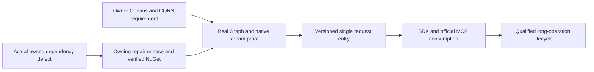

# ADR-082 — Native Orleans CQRS streams

Status: Accepted C0 runtime-compatibility and C1 request-RPCv2 implementation contracts,2026-10-04. C1 implementation depends on the published Graph repair and passing unchanged C0 oracles; C2/C3 contracts and all required product qualification remain pending.

Related: owner2026-10-04 rule in AGENTS.md, REQ/AC-NCQRS-001–005 in [NativeCqrs](../Features/ClusterRouting/NativeCqrs.md), ADR-002/010/020/022/036/057/060/081/116/125/136, and REQ/AC-ANN-007/008.

## Decision and source basis

Use our pinned ManagedCode.Communication CQRS native IAsyncEnumerable<CqrsStreamChunk<TProgress,TResult>> for streamed results and long operations through Orleans. Retain the connection-owned execution grain ([ADR-125](ADR-125-connection-owned-execution.md)), canonical persisted command/retry authority, current principal/read-cut checks and node-local PartitionHost/ZoneTree ownership. Native streams must not become a second execution dispatcher, trusted client identity or durable storage authority.

The centrally pinned ManagedCode.Communication packages provide the native
capacity-one cooperative producer, typed chunk conversion, fatal classification
and cancellation-aware producer settlement. KeyLoad owns its well-formed
Started/progress/terminal protocol, exactly one terminal outcome and bounded
transport admission. It does not introduce a parallel query dispatcher.

The centrally pinned ManagedCode.Orleans.Graph and native Orleans enumerator
pipeline own request context, batching, pulls, cancellation and disposal. C0
retains actual runtime oracles for first-chunk/await behavior, native MoveNext
and Dispose settlement, concurrent context isolation and exact failure identity.
Dependency source presence and owning tests do not qualify their combined
KeyLoad runtime behavior.

## Ordered implementation, ownership and joins

1. TASK-NCQRS-C0-CONTRACT, root: this decision, the complete feature/AC contract, source audit, dependency choice and task graph before write delegation.
2. TASK-NCQRS-C0-RUNTIME-ORACLES: only new UnitTests/Features/ClusterRouting/NativeCqrs*.cs. Genuine TestCluster, actual Graph/Communication registration and generated typed observations; allowed/denied calls after first chunk/await, actual cancellation/early disposal, bounded producer settlement, terminal failure and concurrent identity/context isolation. No product/shared/test-oracle replacement, build or Git actions.
3. TASK-NCQRS-C0-JOIN, root: use only the centrally pinned test-only Microsoft.Orleans.TestingHost reference, review all code, strict build/formatter/governance, focused C0 through Aspire, full normal/scalar regressions, original artifacts and honest evidence. Diagnose a concrete dependency defect in its owning repository; no KeyLoad fallback or graph bypass. Commit each completed stage and qualify exact delivered Linux source.
4. C1: follow the accepted [NativeCqrsRequestV2](../Features/ClusterRouting/NativeCqrsRequestV2.md) REQ/AC-CRS-001–006 and exact ordered ownership. Root freezes the current request alias `keyload.request.v2` and interface version4, the native Started/terminal shape, safe bounded native drain, signed request purpose and authenticated version fields. Requests reach node-local ZoneTree owners only through ordinary Orleans grain calls.
5. C2/C3: follow the remaining root-only pre-write freezes in the feature's ordered stages. Workers may not invent public progress/result formats, durable operation handles, ANN formats or maintenance authority. These stages remain required product work.

ANN algorithm work owns disjoint Search files and may proceed in parallel. Streamed ANN maintenance progress and original-result replay are specified in [ManagedAnn](../Features/Search/ManagedAnn.md) and [NativeAnnOriginalResult](../Features/Search/NativeAnnOriginalResult.md); this ADR only requires that they use the same bounded native stream protocol, persisted authorization and joined cleanup. A failed C0 blocks product-stream dependants until corrected; merely authored tests or a returned enumerable are insufficient.

## Delivery and rollback

The 2026-10-05 TASK-CRS-CANCEL-FAILURE-JOIN prerequisite is frozen in
[NativeCqrsRequestV2](../Features/ClusterRouting/NativeCqrsRequestV2.md),
REQ/AC-CRS-JOIN-001. An owning Communication cancellation-callback failure must
not skip the original native producer join. Source repair and independently
controlled native tests precede canonical patch release, full owning checks,
GitHub publication and verified NuGet availability; root then updates KeyLoad
and qualifies actual Aspire consumer behavior. Source/test workers own disjoint
private Communication scopes; root owns package/docs/delivery/consumer joins.
Original failure identities, fatal priority, stream backpressure and public shape
remain unchanged. No dependency replacement or consumer workaround is allowed.

TASK-CRS-NODE-WORK-JOIN implements REQ/AC-CRS-WORK-001 in the linked feature
spec: finite silo-local producer/capability ownership, original cancellation and
frame joins before native transport/store shutdown, exact failure retention and
no timeout-as-settlement shortcut. Source and independent test workers own
disjoint private files under the linked ordered roles: query owns owner/kernel,
cluster owns independent tests and lifecycle owns verified capability joins.
Root owns review/integration, Server shutdown/DI, native fixture joins, published
Communication repair and actual Aspire/Linux evidence. Original storage,
RPC and authority contracts remain unchanged. Private metadata tests alone
cannot mark this decision Implemented or establish shutdown safety.

C0 remains test infrastructure over the current generated contracts and native Orleans family. C1 uses the current homogeneous request interface; the application RPC version is validated against interface version4 before routing application work, and current capability fencing remains mandatory. Current canonical data and HTTP/SDK/MCP results remain protected.

TASK-CRS-C1-FATAL uses the centrally pinned Communication native CqrsRuntimeFailures.FindFatal for direct and deeply nested AggregateException failures. New test-owned RequestCqrsFatalSettlement controls exercise native creation, pulls, disposal and activation cleanup, preserve exact preconstructed fatal identity with primary/disposal/activation precedence, and join every admitted cleanup before a healthy following stream. Ordinary failure and cancellation controls remain required. Owning publication and local mechanism tests alone do not qualify C1 or mark this ADR Implemented.

TASK-CRS-CANCEL-FAILURE-JOIN depends on the delivered owning Communication
repair, and TASK-CRS-NODE-WORK-JOIN retains node drain before native silo stop
and physical cleanup. Original owning publication and development receipts are
linked by the feature specification. Fresh exact-source normal/scalar, recovery,
SDK/MCP cluster, resource and endurance qualification remains required; a published
dependency or local mechanism pass cannot mark this ADR Implemented.

Rollback of C0 removes unused test infrastructure; it cannot establish product stream readiness. Later product rollout, rollback, long-work checkpoint authority, terminal cancellation and fault qualification require their concrete accepted contracts. Frontend N/A: no UI. Required real SDK/MCP Docker/Aspire cluster, recovery, resource and exact-source Linux gates remain mandatory.

## C0 native test construction clarification

Use the actual centrally pinned Orleans IConfigureGrainTypeComponents/IGrainActivator pipeline to explicitly construct only the three empty-constructor test grains. Orleans retains instance attachment, scheduling, context, lifecycle and all routing; delegate disposal to DefaultGrainActivator and leave other grain activators intact. Use the pinned TUnit1.72.10 shared data-source factory for one per-session NativeCqrsClusterFixture with native async initialization/disposal. NativeCqrsActivation.cs and NativeCqrsDataSource.cs belong to the existing ClusterRouting test slice. No artificial constructor references, fabricated native observations or analyzer suppressions are permitted; source/compiler and runtime evidence remain separate.

## Owning Graph repair implementation contract

REQ/AC-GSE-001–004 in NativeCqrs.md owns exact native request tracking,
startup-only factory catalog, server-local delegating requests and scoped native
enumeration. Actual owning client/silo policy, lifetime, identity, catalog and
delegation regressions must qualify those APIs. Any defect is repaired in the
owning Graph repository through its canonical checks, patch release, GitHub
publication and verified NuGet delivery before updating KeyLoad. Root then runs
the unchanged six Aspire C0 oracles and every required consumer gate. Preserve
native Orleans execution/cleanup and persisted authorization; no fallback
authority, local unpublished package or duplicate extension is permitted.
Original runtime artifacts remain in the evidence chain. This ADR is Accepted
until all required product stages and qualification are complete.
