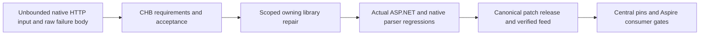

# ADR-083 — Bounded native CQRS HTTP consumption

Status: Accepted; current centrally pinned Communication APIs own the bounded HTTP contract. Fresh Aspire consumer and exact-source Linux qualification remain required. Not Implemented until the complete required gates pass.

Related: REQ/AC-CHB-001–005 in [CqrsTransportBounds](../Features/ClientApi/CqrsTransportBounds.md), AC-NCQRS-004 and [ADR-082](ADR-082-native-cqrs-streams.md), persisted privacy/resource contracts in ADR-010/015/022. Owning source: the ManagedCode.Communication family selected in Directory.Packages.props, maintained in the sibling Communication repository.

## Decision

Repair Communication's actual CQRS HTTP client. Place physical byte admission before excess bytes reach the native BCL SSE parser, cap failure-body UTF8 reads and remove its raw-body Problem.Detail fallback. Retain the native parser/writer, lazy single request, typed chunks, cancellation and disposal. Add validated finite frame/failure options and optional aggregate-byte admission with the exact defaults, limits, physical delimiter semantics, safe codes and boundary tests frozen in the feature contract.

No KeyLoad parser or unpublished local package is authorized. Generic long-operation aggregate admission is optional at the library level; KeyLoad must freeze finite product budgets in C2. Physical byte limits do not promise an exact BCL allocation ceiling or performance improvement. New diagnostics use safe public constants and preserve original exceptions only at the immediate owning telemetry boundary.

## Implementation contract

Exact owning paths are ManagedCode.Communication/Cqrs/CqrsStreamClientOptions.cs, CqrsHttpClientExtensions.cs and directly required bounded client helpers/constants; ManagedCode.Communication.Tests/CQRS native transport/API regressions; README.md examples. Existing server writers, normalizer, Graph, reliability and unrelated packages are outside scope.

Ordered stages: freeze contract; implement/review finite physical guard and failure decode; actual positive/negative/edge/cancel/dispose tests; full owning build/TUnit/coverage and bounded hot-path measurement; canonical patch commit/push/release/feed proof; centrally update all three consuming pins; restore/build/focused native CQRS via Aspire and required complete consumer gates. Never skip a failing stage or treat a green release workflow as all-package availability.

Related joins: C0 Graph/native runtime tests use the current centrally pinned packages. C2 public HTTP adoption requires the verified package release and its separate product contract. C1 signed request/RPC and C3 long-work durability are unchanged.

## Rollout, rollback and evidence

This is an additive configuration contract plus intentional safe plain-text failure behavior; valid bounded RFC7807 remains compatible. Document both in the owning README. No stored-data, node-local ownership, public SQL protocol or cluster membership change. Keep rollback within the verified package release path; never restore an unsafe raw-body fallback as a workaround.

Tests and original source/run/attempt/feed evidence must establish every CHB AC. Source presence alone is not implemented status. Frontend N/A: transport library work. No acceleration, public readiness or durable-operation claim follows from this repair.

## Successful typed absence

# Exact current absence response boundary

REQ-CLIENT-RESULT-001 / AC-CLIENT-RESULT-001 preserves successful absence with fresh persisted authorization, original cancellation, unchanged storage state and exact positive document/message/schedule/transfer/saga values. The change is one coherent producer/API/consumer package join; partial wrappers are not deployable.

Native proof: GrainCoreReadCapabilities has exactly six nullable domain branches: Document, Message, QueueTransfer, QueueTransferReceipt, RecurringSchedule, Saga. SDK GetAsync(two overloads), InspectAsync, QueueTransferClient(two extensions), RecurringSagaClientExtensions(two extensions) all use allowNullResult:true. McpReadCatalog independently declares these exact six output schemas nullable. Other domain reads remain unchanged. Existing OwnedDocumentReadResultV1 private identity data cannot be exposed as a public response.

Recommended current named responses (each sealed record, GenerateSerializer, sole nullable native domain field Id0; stable new alias below):

| Response | Nullable field | Alias |
|---|---|---|
| DocumentReadResult | DocumentResult? Document | keyload.document-read-result.v1 |
| MessageInspectionResult | MessageInspection? Message | keyload.message-inspection-result.v1 |
| QueueTransferReadResult | QueueTransferInspection? Transfer | keyload.queue-transfer-read-result.v1 |
| QueueTransferReceiptReadResult | QueueTransferReceiptInspection? Receipt | keyload.queue-transfer-receipt-read-result.v1 |
| RecurringScheduleReadResult | RecurringScheduleInspection? Schedule | keyload.recurring-schedule-read-result.v1 |
| SagaReadResult | SagaInspection? Saga | keyload.saga-read-result.v1 |

The native storage/capability observations remain unchanged and nullable. The existing CanonicalOperationGateway, after successful original GrainValue decode and before its existing McpBoundedJson serialization, produces the named current public response for these six public read kinds. This single gateway already owns SDK HTTP, official MCP and SQL CALL reply shaping. No underlying private transfer/receipt authority is restamped or wrapped; no changed grain kind, operation ordinal, storage family or request fields. The exact outer wrapper is included in the same MaximumDataReplyBytes check; no response-size exemption. Null native value yields nullable field, exact expected native type yields its unchanged record, and any other actual native type fails closed using existing RecoveryRequired/InvalidRequest. Original error paths never fabricate a successful outer value.

Update SDK generic signatures, remove allowNullResult plumbing, and require every successfully decoded response to be nonnull. Update the six official MCP output schemas to their named nonnullable outer response; preserve field/body privacy and schema validation. Existing SQL CALL output is the same canonical response from this gateway; SQL SELECT domain rows and core query composition remain unchanged. No dual reader or compatibility route for prior unreleased JSON null shape. All current client examples/tests/actual typed CQRS consumers must use the nullable domain field deliberately, preserving prior successful absence versus failures. Native/core direct reads retain their existing APIs.

All three Communication pins10.3.7 join only after the complete affected source/test chain compiles; actual published payloads are verified. Focused original HTTP null/healthy/retry/cancellation tests, genuine official MCP absent/present/privacy tests, current SQL CALL full output and unchanged native/no-effect/replay/cold receipts prove only their actual scope. Required integrated Linux cluster/process and whole solution gates stay open. No new public status-only generic wrapper is introduced; status operations use nongeneric native Result where their actual meaning is status only.

### Blob absence dependency discovered before package join

Native BlobClientExtensions also has two genuine successful nullable reads, independently asserted by the original AllNativeAbsentReads whole operation: BlobMetadata and BlobUploadInfo. REQ/AC-CLIENT-RESULT-001 therefore requires BlobMetadataReadResult(BlobMetadata? Metadata) with alias keyload.blob-metadata-read-result.v1 and BlobUploadInfoReadResult(BlobUploadInfo? Upload), alias keyload.blob-upload-info-read-result.v1, sole field Id0. Preserve native creator/resource authorization, range/list and upload mutation/receipt contracts. The same bounded public gateway shapes both records before current reply admission; eight domain responses total, nine SDK calls counting both document overloads. Official MCP output and SQL CALL stay identical. No generic Optional or absent→failure.

## Nongeneric credential acknowledgement

Recommended next status-only public boundary (not part of sealed Result189)

REQ-CLIENT-STATUS-ACK-001 / AC-CLIENT-STATUS-ACK-001: ConfigureApiKey public SDK returns native nongeneric Result; success carries no public data, original failures retain their exact Problem, and stable command identity/replay/current authorization remain unchanged. Meaningful ConfigurePrincipal/Resource DTOs and all eight nullable read-domain fields remain unchanged. Existing internal durable bool acknowledgement is original ledger evidence, not a fabricated nullable public payload; preserve its original native bytes and validate true at the public status boundary before exposing success. No serializer/alias/Id/OperationKind change is proposed.

Exact native API: CommunicationEndpointExtensions.WithCommunicationResults(RouteHandlerBuilder) maps genuine nongeneric Result.Succeed() to HTTP204; Result.Fail(Problem) retains RFC7807. Native HTTP client metadata also has nongeneric SendForResultAsync, but its documented caller cancellation propagation differs from KeyLoad original-write UnknownWriteOutcome, and the exposed overload has no KeyLoad MaximumProblemBodyBytes parameter. Therefore do not blindly replace the current bounded KeyLoad transport or widen problem admission. Reuse the existing KeyLoad transport owner/message construction/bounded problem reader and error mapping, with one nongeneric status branch returning native Result.Succeed() only for the exact admitted no-content status; no fake data, default success or alternate dispatcher.

Server status projection must run only after the same CanonicalOperationGateway native command completes and after the actual genuine bool ACK is validated. Before effects, current persisted authorization and original signed connection/CQRS checks remain authorities. Unexpected native status type or false ACK fails closed; original initiating exceptions and middleware Problem mapping stay unchanged. HTTP response keeps original operation identity headers. Official MCP/SQL status output must be explicitly no-data (JSON null) under their existing success envelopes with genuine RequestId, independently reflected in the status tool output schema; never confuse this with outer-null typed query success. Current command routes/roles/input schemas/effect hints remain unchanged.

Required complete existing operations: credential revoke/expiry refuses actual SDK/official MCP request without effects, exact same credential repair command succeeds, replay has no additional database effects and returns genuine nongeneric success; two same-volume cold cuts retain original credential/command authority. Update each original bool control to its exact declared status/no-data assertion, preserving the independent complete database images and original native acknowledgement evidence; do not delete controls wholesale. Transport controls cover exact204, unexpected success shape, bounded original RFC7807, mid-body/caller cancellation mapped to original-write UnknownWriteOutcome, lost response and same-ID reconciliation. No retries/timeouts/defaults change.

Implementation order: public projection validates the original native true ACK; Authorization HTTP returns the genuine nongeneric Communication Result through its native endpoint filter; SDK admits only 204 in the existing bounded transport; MCP/SQL retain null-data envelopes and explicit output schema; complete credential repair/replay/cold and transport controls retain original receipt evidence. No persisted layout changes. This private successor depends on sealed Result189. Runtime and delivered Linux/cluster gates remain open.
