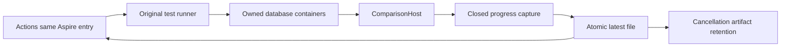

# ADR-085: Visible bounded benchmark progress

Status: Accepted; verification pending.
Date: 2026-10-04.
Contract: [REQ/AC-BC-LIVE-001..004](../Features/BenchmarkComparisons/LiveProgress.md).

## Decision

Keep the existing canonical TUnit entry and ComparisonHost.
Add a closed diagnostic progress line to the runner, with phase changes
and one periodic latest snapshot. Capture only that validated line into one
cell-owned file before teardown. The Actions entry observes this file while
executing the same AppHost command, preserving its exit status. This avoids
depending on TUnit output capture or Aspire CLI presentation for live visibility.
The ordinary bounded execution/container logs and original measurement JSON remain.

Alternatives rejected: smaller datasets or ANN would change the workload;
unfiltered stdout or debug logging risks private data; simply selecting Detailed
TUnit output does not solve the Aspire CLI output boundary. A shorter arbitrary
timeout would hide slow execution and cannot qualify the workload.

## Implementation contract

1. The linked requirements and policy are frozen before implementation: the runner emits the closed progress line, capture writes the cell-owned file and the Actions entry observes it.
2. Keep callback/lifetime bounded; join heartbeat termination on every success/failure/cancellation path. Oracle cancellation remains outside timing.
3. Reject malformed lines; the latest file is written atomically and stays available before teardown.
4. Retain the canonical dotnet/AppHost invocation, original exit and signal handling. No independent database startup or global process termination is permitted. Benchmarks runs focused progress capture regressions independently of its complete measurement matrix; these do not qualify a database.
5. Actual Linux CI/workload/cancellation artifacts supply delivered proof.

marker schema 1 contains only closed phase and bounded nonnegative numeric
values. No database public DTO, persisted format, topology, report schema,
dependency or website evidence authority changes. Progress is diagnostic only.

Rollout: source, capture and entry land together. Rollback removes all three
joins together; no stored-data contract changes apply. Existing terminal failures
remain failures, cancellation remains cancellation, and failed cells remain null.

