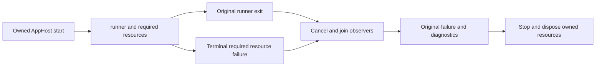

# ADR-086: Stop owned test workloads on terminal Aspire failure

Status: Accepted implementation contract; local development regressions passed;
delivered-source Linux qualification pending.
Date: 2026-10-04. Related: REQ/AC-TEST-012..014, ADR-117.

## Decision

Use actual Aspire resource notifications and host stopping cancellation, rather
than parsing CLI warning text. The disabled dashboard is optional infrastructure
and cannot determine the test outcome. Original CI37202347856 reports show
completed tests with business failures, not a proven AppHost crash.

Register observation before starting the owned application. Race runner
completion against the required dependency failure notifications. FailedToStart,
RuntimeUnhealthy, Finished, Exited or an exit code end a runner wait; an absent
original exit status is an error. Required long-lived dependencies cannot exit
successfully during measurement. Derive dependencies from actual WaitAnnotations,
following their graph once per resource, with bounded tasks proportional to the
existing fixed topology. Expected WaitForCompletion exits remain valid, while
wrong or missing exits fail. HealthStatus.Unhealthy by itself is not a terminal
failure. Preserve exit codes and fail before the full deadline.

Cancel and join every owned observer on success, failure or cancellation. Observe
startup concurrently with failure so a resource failure also cancels pending
startup. Retain the initiating exception rather than replacing it with sibling
cancellation. Existing stop/dispose and bounded diagnostic retention remain the
owner's finally responsibility. No detached task or new timeout increase.

Startup readiness for the shared cluster fixture explicitly uses execution
StopOnResourceUnavailable and cancels/joins other startup waits when one fails.
This startup guard ends at initial readiness. Continuous comparison guards end
at runner completion, before intentional node loss/restart regression scenarios.
Explicit WaitOnResourceUnavailable restart paths stay unchanged. Independent
database jobs continue their own workloads after another database fails.

## Implementation and verification

1. Requirements and this ADR precede the lifecycle helpers.
2. AppHost lifecycle helpers retain original terminal state, exit code, cancellation and joined completion. Real distributed test fixtures use TUnit.Aspire; comparison orchestration belongs to the separate benchmark host.
3. Build/format/governance and focused TUnit tests run through the canonical Aspire entry, then exact-source Linux CI reports are retained. Full unit/scalar/recovery/cluster and benchmark qualification remain required; unrelated failures are reported honestly. Source/service tests do not prove a Docker crash was exercised. A real failure artifact supplies environmental-path evidence.

Acceptance mapping is in TestInfrastructure. No production contract, package, stored-data format or topology changes. Rollback reverts only these lifecycle joins and helpers; the canonical Aspire entry and existing outcomes remain required. Frontend N/A: developer and CI lifecycle only.

