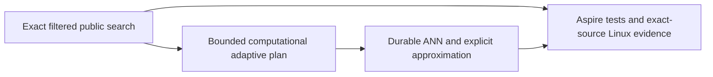

# ADR-087: Filtered retrieval in the authorized search cut

Status: Accepted; implementation and qualification pending.

An allowlist must constrain actual database search rather than require the client
to filter an already truncated top-k. Use an optional bounded SearchRequest field
and filter branch output before ranking/fusion in the same persisted-policy cut.
Lexical corpus statistics retain their authorized scope. Complete exact results
remain the public contract until explicit approximation/freshness metadata and
the durable ANN lifecycle are delivered. Post-top-k filtering, filter-specific
IDF and output-filtered ANN graphs are rejected because they change correctness
or hide recall loss. This stage makes filtered search callable immediately while
preserving the remaining adaptive projection qualification.

Implementation contract: [FilteredRetrieval](../Features/Search/FilteredRetrieval.md),
REQ/AC-FILTER-001–005, KL-032/060; ADR-010/018/019/022/082.
Ordered stages, disjoint worker/root ownership, tests, baseline failures,
dependencies, rollout/rollback and client/RF3 joins are frozen there. Root owns
shared request contracts; Luna owns Query/Search and its new tests.
No data format or trusted role is introduced. Source is not qualification.

## TASK-FILTER-POLICY-COLD-001 implementation contract

See [the exact feature contract](../Features/Search/FilteredRetrieval.md#task-filter-policy-cold-001-retained-policy-refusal-and-same-root-recovery), REQ/AC-FILTER-POLICY-COLD-001. Preserve the existing three typed denial assertions, complete gated canonical inventory, actual persisted repair and two joined same-root cold opens. Unit Search owns the existing case and its private assertion helper; root owns integration/build/normal/Linux gates. No product, serialization, generation, authorization, quota or clock boundary changes. Source and preview do not qualify KL-031/032 or RF3.

## TASK-FILTER-FALLBACK-ORACLE-001 implementation contract

See the FilteredRetrieval contract REQ/AC-FILTER-FALLBACK-ORACLE-001. Preserve the original complete native bottom100 fallback, N-1 exhaustion and subsequent healthy operation, add the independent full candidate oracle and unchanged canonical vector/commit-cut checks, and extract only that method into a bounded Search helper. Policy-cold contract is the explicit document predecessor. No product/persistence/generation/limits changes; root owns final normal/Linux verification.
