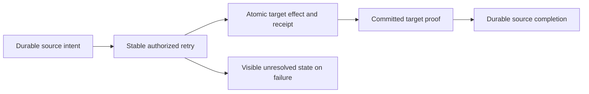

# ADR-088: Durable remote queue intent and receipt

Status: Accepted; implementation and qualification pending.

Partition-local processing cannot atomically enqueue on another partition. Retain
a source-owned immutable intent, commit target enqueue with a dedup receipt, and
complete the source only with the target's committed proof. The target partition grain
is reached through an ordinary Orleans call; each side commits through its own
ordered ZoneTree apply. Retry the same identity after unknown outcomes. A coordinator
is orchestration, not authority. Retain unresolved intents and target receipts with
finite admission rather than invent a TTL that could lose work or recreate
acknowledged messages. Claims are bound to the actual persisted principal; initial
administrative access is explicit and still enforces source/target data grants.

Distributed transactions, client-asserted success, shared projection-outbox
semantics and silently dropping failures are rejected. Separate commits expose
OutputPending; external side effects remain outside database guarantees.

Implementation contract: [RemoteTransfers](../Features/Messaging/RemoteTransfers.md),
REQ/AC-XFER-001–005.
The linked contract contains ordered stages, exact ownership, baseline, tests,
native serialization, retained payload, resource/retention limits and rollout/
rollback. ADR-002/003/024/026/028/029/030/036/082/125/136 remain mandatory.

## Bounded coordination

- One optional, centrally validated technical principal (nullable
  `TransferCoordinatorPrincipalId`) lets the transfer workers act for the source. It
  selects an existing subject only; it never creates credentials, grants roles or
  impersonates another creator, and every inspection and batch is freshly authorized
  against persisted policy. A null selection disables transfer discovery.
- Pending intents are advanced by Orleans `[StatelessWorker]` grains as described in
  [ADR-094](ADR-094-orleans-due-coordination.md): the workers accept pending-intent
  events, buffer them in memory and, on an Orleans timer (typed interval option),
  write the batch through the ordinary connection grain -> partition grain ->
  ZoneTree owner path. They never check leadership, elect a coordinator or run as a
  singleton. Discovery is a bounded scan under the normal operation read limits, and
  a known failed intent keeps its cursor so it does not starve later intents.
- Command identities are deterministic SHA-256 derivations of the immutable intent
  tuple and the closed stage (accept / complete), so a retry after an unknown outcome
  reconciles the same effect. Read position, random values and job dequeue counts are
  excluded.
- Target Accept capacity failure may advance a bounded, source-recorded attempt
  generation (`DatabaseLimits.MaxQueueTransferAcceptAttempts`, nullable, positive,
  at most `MaxScanRecords`). The target receipt always wins: an acknowledged target
  message is never recreated. A failed advance keeps its identity and requires an
  explicit authorized operator repair.
- A denial caused by a changed persisted principal policy epoch may be repaired by a
  source-side compare-and-set (`AdvanceQueueTransferRepair`) bounded by
  `MaxQueueTransferRepairAttempts`; the original failed outcome stays byte-identical
  and the repaired attempt is authorized against current persisted policy.
- Every history reference charges one source record plus its encoded bytes against the
  existing operation limits; coordination reads are charged like any other read.

Open: universal automatic retry, same-epoch field-only policy repair, capacity-only
complete repair, retention-horizon evidence and all Linux runtime qualification.
No acceptance is claimed from authored source.
