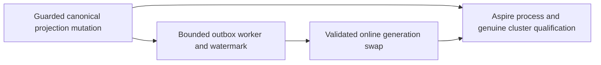

# ADR-089: Canonical guarded vector projection lineage

Status: Accepted; implementation and qualification pending.

An embedding job can finish after its input changes or its permissions are
revoked. Bind its output to the actual source event and document revision and
persist lineage with the vector in one canonical transaction. Validate current
source visibility/field policy at apply and again when deriving search eligibility.
Reducer generation and dedup identity are explicit. Replay computes by default;
job/network side effects require separately authorized dispatch.

Unconditional vector overwrite, payload-only lineage and treating job ACK as
search-index freshness are rejected. Current principal-scoped native full-text
generations remain unchanged until their online outbox lifecycle is frozen.

Implementation contract: [EventProjectionLineage](../Features/Search/EventProjectionLineage.md),
REQ/AC-LINEAGE-001–005; ADR-015/019/022/025/029/
030/078/081/082. Ordered stages, exact scope, tests, baseline, current native data contract and public cluster integration are frozen there.
This ADR becomes Implemented only after all required artifacts and evidence.
The new private effect identity uses the stable integer `DistanceMetric` value
as a key-codec-v1 scalar. Apply, eligibility and deletion use the identical key;
the existing key codec and existing persisted records do not change.

## Autonomous ANN maintenance over committed vectors

REQ-LINEAGE-004/005 and AC-LINEAGE-004/005 require a bounded native maintenance owner over canonical committed vectors. This does not authorize server embedding inference: application embedding output remains the separately guarded ApplyVectorProjection operation. AppendEvents-only application consumers and ANN canonical-vector consumers have distinct filters, identity and checkpoint/effect keys.

- `ProjectionConsumerDefinition` appends a nullable ANN maintenance profile (collection, field, full VectorSpace) and `ProjectionConsumerInfo` a nullable maintenance authority captured from the server-authenticated Configure principal, original command, incarnation and policy epoch. Capture and validation occur in the original same-partition transaction. The same immutable profile is carried in the maintenance request; independently signed request envelopes and content fingerprints include its complete native bytes, a same-ID request with a changed profile conflicts, and a configured vector-field profile must equal the full VectorSpace. Null profiles keep the original generic maintenance contract and byte-identical public JSON.
- Autonomous work follows the background-worker pattern of [ADR-094](ADR-094-orleans-due-coordination.md): Orleans `[StatelessWorker]` grains accept post-apply events for configured consumers, buffer them in memory and, on an Orleans timer (typed interval option), submit a separately signed typed maintenance command through the ordinary connection grain -> partition grain -> ZoneTree owner path. They never check leadership or run as a singleton; duplicate hints are absorbed by deterministic command identities and the canonical compare-and-set. Canonical effects and the checkpoint are atomic; pending, retry, cancel and unknown outcomes never imply a successful public result.
- Cold publication discovery reads only the exact owned receipt pointers through a read-only ANN seam, validating checksums, format, identity, source, current policy, native index and watermark. RAM slot existence, a job acknowledgement, a canonical checkpoint, the newest directory and a missing outcome are insufficient freshness or absence proofs; policy, schema or generation incompatibility fails closed and requires an authorized new generation.
- The first manual Build reserves its initial request in the consumer record so the autonomous path cannot ignore it; an uncertain started operation is an explicit recovery gate until its exact original result is available or an authorized new generation is configured.

Complete operation evidence is mandatory: configure/Build, committed source update/delete/reprojection, Restore with published watermark and full literal ANN results, old/stale/revoked/corrupt/no-history refusal with complete no-effects, authorized repair, exact original replay, cancellation and resource join, process restart and real SDK/official MCP/both Q1 cluster cold/healthy flows. Runtime gates remain open; ANN maintenance progress and original-result replay are specified in [ManagedAnn](../Features/Search/ManagedAnn.md) and [NativeAnnOriginalResult](../Features/Search/NativeAnnOriginalResult.md).
