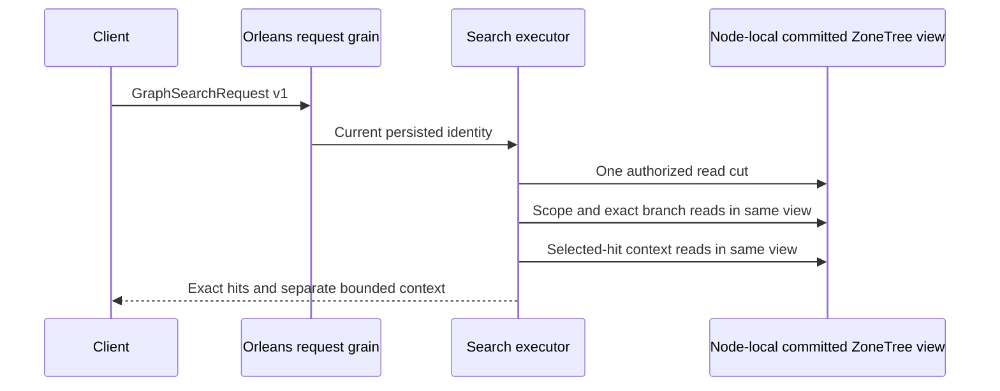

# ADR-090: Same-cut graph scope, retrieval and expansion

Status: Accepted for staged implementation, not Implemented. Date: 2026-10-04.

Architecture sections26.2–26.4 require three distinct graph roles rather than
using an independent traversal result as an unqualified search filter. Public
Traverse opens its own storage cut, so composing it with Search would mix policy
and data revisions. The existing atomic partition and node-local ZoneTree owner
remain authoritative while the connection-owned Orleans grain ([ADR-125](ADR-125-connection-owned-execution.md)) routes each request.

Decision: implement the explicit v1 records, narrow internal borrowed-view Core
reachability bridge and exact Query fusion/output contract in
[GraphRetrieval](../Features/Search/GraphRetrieval.md). It maps
REQ-GSEARCH-001..006 to AC-GSEARCH-001..006. Do not retain decoded
intermediate JSON or edge payloads, use an independent read gate, cross partitions,
silently truncate a graph, or substitute ANN for an exact branch. A shared budget
charges all roots/operators; shortest-hop identity deduplication prevents cycles
and multiple paths from multiplying contributions.
Label filtering requires the persisted graph field policy at canonical `/label`,
including empty label filters; a plain `label` name cannot bypass that policy.

Implementation contract:

1. Abstractions/Features/Search/Contracts owns the new graph AST/reply records.
2. Core/Features/GraphTraversal/Queries and Execution own same-cut BFS and persisted visibility.
3. Server/Search, Client/Search and Orleans/Search carry the transport adapters, shared MCP/read kinds and composition.
4. UnitTests/Features/Search owns the six mapped operator/oracle/authorization/ expansion/budget test families.
5. The SQL SEARCH profile implements SQL equivalence and actual .NET/official MCP cluster fault cases before complete task closure. Keep Linux source/run/job/artifact evidence; build or development subset success is not whole-task qualification. Its frozen Q1.Search.v1 statement grammar, dedicated SqlGraphSearchRequest, exact lowering, rejection/parameter rules and same-executor ownership are in GraphRetrieval's SQL SEARCH contract. Scalar QueryPage stays unchanged.

6. Three-way fusion qualification strengthens the existing same-partition path using deliberately conflicting text/vector/graph branch ranks, a separately computed weighted RRF oracle, current authorization, and actual direct/SQL .NET/MCP cluster parity. This adds qualification for existing contracts, not a second executor or global distributed rank claim.

No persisted data conversion or dependency change is involved. Nodes lacking the application capability
cannot accept this request. Rollback removes endpoint admission and fails
unsupported operators explicitly while retaining committed stores. Integration
requires all coding artifacts and successful mapped tests; final
complete acceptance additionally requires the SQL SEARCH profile and original acceptance evidence. Graph
expansion declares SelectedHits completeness, while graph scope/branches are
complete only within their explicit same-partition traversal contract.

## Vector attachment adapter

REQ-QUERY-VECTOR-ATTACH-001 / AC-QUERY-VECTOR-ATTACH-001 and REQ-QUERY-007 under ADR-090: `KeyLoadQuery<T>.Take(limit).AttachVector(field, vector, space, scope)` translates only the existing non-evaluating member path and constructs the same canonical GraphSearchRequest v1 consumed by GraphSearchAsync. The vector is an immutable attachment bounded by existing MaximumConstantArrayItems; scope is explicit bounded native GraphScope. No new planner, result materialization, wire model, trusted caller role or query dispatcher. Scalar Where/order/project/Explain state is rejected UnsupportedCapability rather than silently omitted. Take is preserved as the canonical search limit. Server validation remains responsible for finite values, dimension/profile, current persisted policy, scoped read cut, shared budget and cancellation. Named SQL, builder request, typed/JSON requests must return complete independent literal ranks and errors; SQL's existing parser detail remains distinct from native typed validation detail. Real ZoneTree wrong dimension/unsupported/overattachment/denied-principal operations must preserve complete store and position then produce the complete healthy literal result.

Ordered join: freeze owning spec/ADR; Client QueryExecution builder/helper; native UnitTests wholeflows; integration/build/format/discovery/full suites/Linux cluster. Dependencies unchanged; rollback removes adapter API and tests without modifying stored data.

## Unsupported scalar state with a vector attachment

REQ-QUERY-VECTOR-ATTACH-001 / AC-QUERY-VECTOR-ATTACH-001, REQ-QUERY-007 and ADR-090: supplement
the existing Order whole flow with three actual builder Where, custom projection
and Explain states. Construct each supported scalar state successfully before
AttachVector; require exact UnsupportedCapability and no lowered request, unchanged
native read diagnostics, complete canonical storage bytes and position. Then execute
the valid C# attachment through the real ZoneTree SearchEngine and retain the existing
independent full literal two-document ranks, revision, JSON, redaction, empty expansion
and equivalent SQL/typed/JSON results. Preserve the same complete storage and cut after
healthy continuation. No planner/public scope change. Authored cases require native
normal/scalar execution and existing public cluster gates; source is not qualification.

Typed seed: VectorAttachmentDocument is instantiated as each actual committed document. Default absent vector attachment is omitted by WhenWritingDefault; member remains supported by the existing field translator. Independent literal full JSON equality is checked before native commit. Native vector records, document bytes/revisions, SQL/typed/JSON rank oracles remain unchanged. No dummy/public type/suppression.

## Authorized hybrid explain

REQ-SEARCH-EXPLAIN-001 / AC-SEARCH-EXPLAIN-001: opt-in SearchRequest.Explain (native Id12, default false) adds optional RankedDocument.Explanation (Id2, omitted JSON when absent), shared by ordinary and graph retrieval via GraphSearchRequest.Search. Typed v1 SearchHitExplanation contains FusionConstant and at most three ordered SearchBranchContribution records: fixed Text/Vector/Graph enum, actual one-based native rank after existing authorization/allowlist/graph scope and deterministic branch order, configured weight, exact weight/(FusionConstant+rank) double contribution. Final score remains the existing deterministic RankedDocument.Score; branch contributions use the same existing arithmetic evaluation/order. No raw similarity, term statistics, hidden candidate IDs, paths, query payload, private inventory or new ranking algorithm. Contributions describe only actual positive-weight fused branches; default ranking/JSON remains unchanged, including current zero-weight behavior.

REQ-SEARCH-EXPLAIN-002 / AC-SEARCH-EXPLAIN-002: capture actual already-computed contribution values only when requested; maximum three ordered contributions per authorized canonical EntityRef, candidate count constrained by existing native branch work/window bounds. Before retaining each contribution, exact serialized contribution bytes cumulatively must fit existing MaximumResultBytes; an oversized individual contribution uses existing result-byte error, cumulative capture overflow gives BudgetExceeded with safe detail The search explanation byte budget is exceeded. Selected-hit contribution lookup checks the original shared read budget/cancellation; no new readcut, principal reload, dispatcher or unbounded enumeration. Include complete metadata in existing exact cumulative result byte measurement before retaining each hit and final array. Budget rejection/cancellation exposes no partial success and does not mutate canonical store.

REQ-SEARCH-EXPLAIN-003 / AC-SEARCH-EXPLAIN-003: real ZoneTree wholeflows compare independent weighted Text/Vector/Graph scores/contributions, ordinal ties, allowed-candidate changes, denied field/hidden entity privacy, original cancellation/fullstore+cut/no partial then full literal healthy. Real cluster SDK/official MCP and Q1 CALL graph-search operation carries actual opt-in typed request and complete result metadata through existing routes/schema; no new operation tool or named SQL dialect syntax. Qrels/window acceptance remains separately bound to approved cohort and existing internal GlobalBranchWindows contract; allowlist changes are not advertised as measured relevance-window qualification. No rerank/BM25/public candidate-window knob introduced.

Ownership: Abstractions Search/Contracts; Query Search/Queries existing fusion+projection+ordinary/graph execution; owning Unit/Integration Search flow roles. Native aliases and existing IDs retained; new aliases keyload.search.hit-explanation.v1 and keyload.search.branch-contribution.v1. No persisted format migration/fallback; new typed fields must be rebuilt together. Rollback removes opt-in field/metadata and authored flows only before release, without modifying raw authority/provider.

Test ownership: DeniedExplainAndOriginalCancellationReturnNoPartialResultBeforeHealthyLiteralRead now cancels the original caller token synchronously from the existing owning TimeProvider only after same-store native RangeExaminedBytes increases. No asynchronous polling, sleeps, record padding, production hook or fake storage. Joined SearchEngine worker settles before fullstore/cut checks and healthy literal flow. Existing approved qrels/window gate remains separate.
