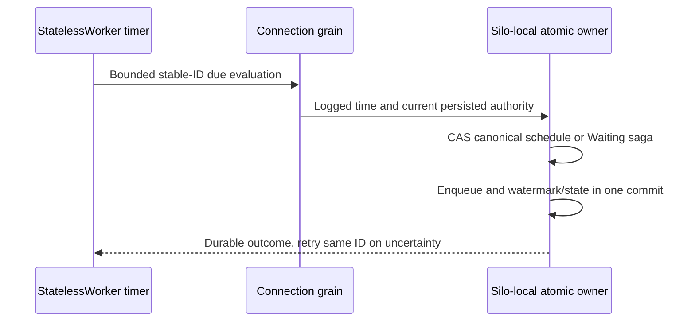

# ADR-092: Logged-time recurring occurrences and saga timeout CAS

Status: Accepted; implementation and qualification pending. Date: 2026-10-04.

Existing NotBefore and per-delivery inboxes implement delayed messages and handler
deduplication; they do not establish recurring schedules or multi-step saga state.
Architecture requires versioned timing, stable OccurrenceId and explicit
cancel/timeout races. Use the existing Orleans-routed, node-local ordered atomic
gate and logged Command<DatabaseCommand>.Timestamp as the sole durable decision time.

Decision: the precise UTC fixed-interval CatchUp profile, generated contracts,
identity formulas, finite retention, persisted creator/caller authority and saga
transition graph in [RecurringSaga](../Features/Messaging/RecurringSaga.md),
REQ-JOBS-001..005/AC-JOBS-001..005. A timer is a repeated request to evaluate
canonical due state, never durability authority. Bound catch-up32 and preserve
backlog. Compare-exchange resolves timeout/completion/cancel before an atomic
timeout enqueue; no general workflow-engine behavior is inferred.

Implementation contract and join points:

1. Generated v1 DTOs/aliases/Ids, the next unused SchedulerManage capability, discriminator/structure/apply/replay and the HTTP/SDK/official MCP joins are frozen in the linked feature.
2. Existing transfer F1 remains frozen; helpers may call the established private Enqueue through a narrow DatabaseEngine partial.
3. The canonical record contract writes canonical state and enqueue in one transaction and authors independent recurrence/CAS/restart/auth/quota tests.
4. Autonomous due evaluation runs in Orleans StatelessWorker grains that buffer due hints and write batches on an Orleans timer ([ADR-094](ADR-094-orleans-due-coordination.md)); it builds real process and genuine cluster SDK/MCP fault fixtures and completes the original acceptance.

Dependencies: existing queue readiness/inbox. The feature
uses the current persisted record contract and explicit capability admission.
Rollback pauses scheduling and retains watermarks/saga/queue data; it never
decrements/reuses a generation or replays external actions. Unsupported
timezone/calendar profiles fail explicitly. A scoped development pass or commit
does not establish Linux/cluster/endurance/performance qualification.

