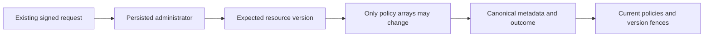

# ADR-093: Compare-and-set resource field policies

Status: Accepted for implementation; qualification pending.

Vector projection lineage and graph label authorization require current resource
classifications, so a public flow must change a resource definition. A raw-store rewrite in a test would conceal a missing public flow.

Decision: extend the existing authorized canonical ConfigureResource request with
an optional expected schema version and admit only field/header policy changes,
with an exact version increment. Physical shape, indexes, authority, quotas,
paused state and typed schema remain immutable through this request. Physical-shape changes remain unsupported by this request. Blind replacement and
a second policy store are rejected.

Implementation contract: [ResourcePolicyUpdates](../Features/Authorization/ResourcePolicyUpdates.md), REQ/AC-RPOL-001–004 and AC-LINEAGE-004. Persist through the existing metadata apply gate and deduplicated outcome; no new dependency or stored-data format. This ADR becomes Implemented only with all mapped implementation and evidence.

