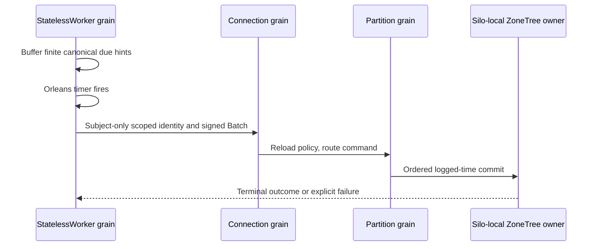

# ADR-094: Orleans StatelessWorker coordination of due queue, recurring and saga work

Status: Accepted for S2 implementation; qualification pending.
Date: 2026-10-04.

KL-100's S1 commands persist schedules and Waiting sagas but have no autonomous
runtime. Adopt the bounded discovery, StatelessWorker batching, request and retry
contract in [DueCoordination](../Features/Messaging/DueCoordination.md),
REQ/AC-DUE-001..004 and REQ/AC-JOBS-005. Existing canonical records and ordered
atomic transitions remain the authority; a disposable fixed-tail sweep avoids a new
durable due-index format and prevents continuously arriving keys from extending a
sweep forever.

## Decision

Due queue deadlines, recurring schedules and saga timeouts are advanced by Orleans
`[StatelessWorker]` grains. They never check leadership: there is no `IsLeaderAsync`
gate, leader hint, coordinator election or singleton coordinator, and no work runs in
a hosted timer outside Orleans.

1. A bounded number of StatelessWorker activations accept due hints (discovered from
   the canonical scheduled/lease/message-meta and schedule/saga records) and buffer
   them in memory.
2. On an Orleans grain timer, whose interval is a typed option validated at the
   composition boundary, the worker writes the buffered batch to the database
   through the ordinary path: connection-owned execution grain, partition grain,
   then the node-local ZoneTree owner. Every effect is an ordinary signed Batch
   command; the worker has no direct apply path and no synthetic privileged
   principal.
3. Buffered hints are disposable. A lost buffer, a duplicate hint delivered to
   several workers, or a restart only repeats discovery; correctness rests on
   deterministic command identities and on compare-and-set of the canonical state
   (state / version / lease / deadline / index), so duplicate effects are rejected
   or replay the original receipt.
4. Buffer size, batch size, timer interval and discovery page / byte / deadline
   limits are centrally validated typed options; there are no per-class constants.

Implementation contract:

1. Core owns Messaging Queries/Models/Validation; Orleans owns Messaging
   Grains/Contracts/Execution for the StatelessWorker, timer and batching; tests
   live in the Messaging UnitTests slice. Native records keep their aliases and
   field IDs; new hint DTOs have explicit v1 aliases and stable generated IDs; no
   persisted or public S1 discriminator changes.
2. All writes use the existing connection-owned execution and the bounded
   ManagedCode Communication CQRS consumer. No direct Apply, copied dispatcher or
   hosted timer outside Orleans is allowed.
3. Tests cover finite sweep/cursor/byte/deadline/corruption/cancellation bounds,
   current creator authority, duplicate delivery from several workers and stable
   unknown-response retry. Aspire SDK/official MCP tests observe autonomous
   emission and expiry, duplicates, silo loss and restart, revocation,
   cancellation and healthy following calls. S1 process-cut tests remain mandatory
   and prove only process durability.
4. Root integrates, reviews, builds, formats, runs the Aspire suites and retains
   exact-source Linux artifacts before full KL-100 closure. Scoped tests and code
   presence do not close S2.

Dependencies: ADR-092, existing queue admission, native request and identity
boundaries, [ADR-110](ADR-110-native-orleans-execution-primitives.md) and
[ADR-125](ADR-125-connection-owned-execution.md). Rollback stops due coordination
while retaining all watermarks, outcomes, queues and saga state. Failed pages and
jobs remain observable with safe structured errors; no raw retained templates,
credentials or subject/entity identities are logged.

## Command identity and retry

Each dispatch chooses one command GUID after the canonical read and creator-authority
reload, and retains it across its single unknown-result retry. Later sweeps use fresh
IDs. A caller retry of an existing command ID replays its original terminal receipt.
Canonical occurrence IDs, monotonic schedule state, saga revision CAS and serializer
aliases/IDs remain stable.

## Queue deadline advancement (REQ-MSG-004 / AC-MSG-004, REQ-MSG-092-DEADLINE)

The additive `AdvanceQueueDeadline` Batch mutation uses QueueConsume, fresh persisted
worker-input permissions, the signed native EvaluatedAt and an exact
state/version/lease/deadline/index CAS. Alias `keyload.mutation.advance-queue-deadline.v1`
with Id0..6; the JSON discriminator is `advanceQueueDeadline` and the kind property is
`deadlineKind`; kinds are PromoteScheduled, ExpireLease and ExpireMessage. The
mutation is a direct Batch only: nested processing, inbox or projection effects
cannot use it, and it never creates a lease, trusts a business timestamp as current
time or creates a scheduler principal.

The nullable host-selected `QueueDeadlinePrincipalId` names an existing persisted
principal; null means the queue branch is unavailable, a malformed selection is
invalid, and a revoked, expired or under-permissioned subject is refused. Every
dispatch and cached-result replay uses current permissions, and resource or dispatch
pause prevents transitions. Discovery is read-only over canonical records with
central record, byte and deadline budgets, fixed upper tails and store-incarnation
and read-generation resets; it retains only bounded metadata hints and charges all
native visited bytes, point reads and lookahead. No effect is credited merely from a
discovery hint. Configuration never grants roles.

Acceptance requires the not-due Conflict, stale RevisionConflict, paused
DispatchPaused and revoked-policy refusals to retain complete message bodies,
metadata, index and counters; the original successful receipt replays across cold
reopen; process cuts recover whole bodies, counters and receipts. A null-selected
principal produces no queue effects while ordinary recurring schedules keep working.
Qualification remains open until the current-source native build, normal Unit,
process recovery and Docker/Aspire SDK/MCP cluster runs execute.
