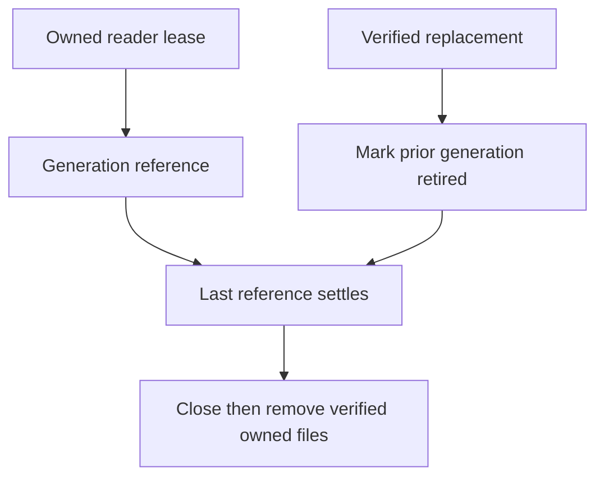

# ADR-095: Bounded index generation leases and retirement

Status: Accepted current contract; full current-source runtime qualification remains open.
Date:2026-10-04.

Use [OnlineGenerationLifetime](../Features/Search/OnlineGenerationLifetime.md),
REQ/AC-LEASE-001..004: finite generation/lease/build ownership, fully verified
publication, reference-counted retirement, retained cleanup failures and joined
shutdown. Preserve selected provider, canonical scope validation and all
original physical budget/settlement gates.

Implementation contract: the interface-preserving manager contract is frozen first;
the Search slice owns the Server Storage/Lifecycle manager, lease and
settlement helpers, the existing generation capacity and restart retirement
preflight joins, and new independent real-UnitTests. Keep one builder, one retired/current generation and three physical generations
including staging as physical ownership bounds. Published readers share one
read-only native index with independent budgets and iterators, without a reader
count admission limit. Retirement, invalidation and shutdown join all readers
before closing or deleting their generation. The single cold-build slot remains
an open concurrency limitation. The actual
production caller is integrated and serialized Release/format/governance and Aspire
unit/recovery/cluster runs retain exact-SHA Linux original results before qualification.

Online maintenance must additionally pin/capture a canonical base cut atomically, build while canonical
writes proceed, replay ordered deltas, validate/cut over and recover catalog/pins.
Do not call leased generations a completed online index. No public wire, canonical storage or index manifest transition occurs. Rollback stops the node and reconstructs only
its disposable owned index; original canonical data remains authoritative.

The online publication contract is REQ/AC-ONLINE-001..005 in
[OnlineGenerationLifetime](../Features/Search/OnlineGenerationLifetime.md). It does not
mark implementation or authorize persisted catalog serialization. Ordered stages,
file/slice ownership, complete operation tests, rollback and join points are
specified there. Exact internal provider composition, generated catalog
alias/fields/path/publication order and consumer/generation selection resolution
must be frozen before production seams. All leased-generation and read-cut bounds, deadlines,
provider, read pins, identity, persisted policy and retained failures remain.
Authentic Linux source/image/discovery and complete Unit/Recovery/cluster
SDK/MCP/Q1 outcomes remain open.

The online operation contract: the appended
OnlineGenerationLifetime section reserves distinct OperationKind34, typed online
request/result aliases and IDs, progress Id4, administrator + existing
consumer trust boundary and original CQRS ownership. Implicit Search and explicit
immutable Build/Restore semantics remain unchanged. Core internal copied-byte pin
and Server friend adapter are selected without public IAtomicStore change.
The exact generated catalog/path/publication/restart contract and
original stable outcome retention are frozen before source seams. No serializer fallback
or migration is allowed. Shared codec, registration and session reconciliation
need actual Linux Unit/Recovery/cluster complete evidence. New online code must preserve existing
REQ/AC-LEASE/CUT and complete REQ/AC-ONLINE-001..005 together.

## Canonical online publication and restart contract

Current Core and Orleans source implements the command and publication contracts below; complete operation discovery and runtime qualification remain open. Original REQ/AC-ONLINE-001–005 and every original acceptance predicate remain mandatory. Preserve explicit TextIndexSelection, its single enrollment and immutable Build/Restore U; implicit Search performs no maintenance effect or enrollment. Public MaintainOnlineTextIndex and private OnlineTextPublicationPhase remain distinct capabilities with stable existing enum values. All original cancellation, deadlines, options, authorization, cluster and required full-suite gates remain mandatory.

### Frozen contracts and source ownership

Public SDK extension is MaintainOnlineTextIndexAsync returning Task<Result<OnlineTextIndexMaintenanceResult>>, using the original KeyLoadClient.Send write/commandId/cancellation path. Distinct route /search/text/online/maintain and on-demand tool keyload_search_text_online_maintain bind public34's typed request/result. Q1 SDK and official MCP use CALL keyload_search_text_online_maintain(@arguments) through the existing SqlOperationRequest/catalog executor. No additional SQL grammar or full-SQL conformance claim. Register exact schemas/effect hints through the existing official server and persisted-authority gateway; do not enlarge initial discovery catalog. Preserve the v4 public request alias/IDs0–6, result alias/IDs0–7, phases0–5 and GrainRequestProgress nullable OnlineTextPhase Id4.

Private GrainReadKind.OnlineTextMaintenance retains its stable value and existing capability purpose. The authenticated request boundary uses GrainRequestCodec and call-local identity restoration; generic public command/read admission rejects private capabilities. The internal Core CreateOnlineTextPublicationOperation validates the actual prepared candidate and fresh persisted principal before constructing execution `ManagedCode.Communication.Commands.Command<DatabaseCommand>`. CommandId, verified UserId and server-evaluated Timestamp belong to that command. Its immutable DatabaseCommand carries only typed business input, fingerprint and prepared retry/resource facts. OwnCommand takes a bounded owned snapshot before asynchronous use. SubmitVerifiedAsync preserves that command through the actual authorized apply path; it does not add a second command authority or signature framework. Execution `Result<object>` carries the exact typed result or strict Problem mapping. Never reinterpret another operation's purpose, grants, phases or local owner context.

Core/Search internal generated OnlineTextPublicationPhaseCommand uses alias keyload.core.search.online-text-publication-phase and IDs0 Request(OnlineTextIndexMaintenanceRequest),1 Result(OnlineTextIndexMaintenanceResult),2 DataEpoch(int),3 Leaf(string),4 ManifestSha256(string),5 GenerationId(Guid),6 ExpectedCurrentCommandId(Guid?),7 SessionId(Guid). Its commandId is the original public request.CommandId. Fresh admission binds actual parent input/principal, original request expiry, session, prepared generation and exact payload; caller supplied results, leaf names or metadata cannot create a candidate. Session and prepared bytes are node-local, bounded and owned. The typed publication phase belongs to the actual local storage owner; ordinary canonical commands are copied through Orleans calls. Core has no provider, Server or Query type dependency.

StoredOutcome.OnlineTextAuthority retains Id8. Internal generated OnlineTextOutcomeAuthority keeps alias keyload.core.search.online-text-outcome-authority and IDs0 ParentFingerprint(string),1 Collection(string),2 Field(string),3 DataEpoch(int),4 Placement(PhysicalShardRecord),5 Leaf(string),6 ManifestSha256(string),7 GenerationId(Guid),8 ExpectedCurrentCommandId(Guid?). Placement identifies only the actual NodeId and incarnation. The full original result remains StoredOutcome.Result. Parent fingerprint preserves the normalized public request identity and verified subject; private publication retains its own typed business fingerprint. Capture authority for a validated phase before execution and retain it with genuine persisted terminal outcomes, changing the current pointer only on success. StoredOutcome also retains the exact prepared command and canonical sequence under their existing field IDs. No projection-batch field, RuntimeJournal identity, serializer alias or version is reinterpreted.

Core/Search generated OnlineTextCurrentPublication alias keyload.core.search.online-text-current-publication uses IDs0 FormatVersion(int,1),1 PrincipalId(string),2 CommandId(Guid),3 ParentFingerprint(string),4 Consumer(ProjectionConsumerRef),5 ConsumerGeneration(long),6 Authority(OnlineTextOutcomeAuthority),7 PublishedCut(TextIndexSourceCut). The new canonical online-text-current key family is explicitly registered as partition-owned metadata for the exact consumer partition/collection/field/generation, including family inventory, snapshot and key validation. No caller document or user collection stores private control data. Existing canonical outcome retention owns historical original results; there is no unbounded per-command file history.

Orleans/Search generated OnlineTextCapabilityRequest alias keyload.orleans.search.online-text-capability-request has IDs0 SessionId(Guid),1 Request(OnlineTextIndexMaintenanceRequest),2 Kind(OnlineTextCapabilityKind),3 Page(ProjectionBatch?),4 CheckpointIntent(CommitProjectionBatchRequest?),5 Acknowledged(ProjectionBatchResult?). OnlineTextCapabilityKind is closed:0 ResolveOriginal,1 Capture,2 Seed,3 PreparePage,4 ApplyIntent,5 SettleCheckpoint,6 Validate,7 IssuePublication,8 ReconcileCommitted,9 Abort. Generated OnlineTextCapabilityResult alias keyload.orleans.search.online-text-capability-result has IDs0 SessionId(Guid),1 BaseCut(TextIndexSourceCut?),2 CurrentCut(TextIndexSourceCut?),3 ThroughSequence(long),4 TrackedRecords(int),5 IndexSha256(string?),6 OriginalResult(OnlineTextIndexMaintenanceResult?),7 IssuedPublication(Command<DatabaseCommand>?),8 CheckpointIntent(CommitProjectionBatchRequest?),9 CurrentCommandId(Guid?). These are actual phase results, never caller authority or progress counters. No raw handle/iterator crosses a grain.

The derived Server catalog keeps its accepted alias keyload.server.text.online-catalog and IDs0–10/root text-online/catalog.bin/catalog.pending. BuildCommandId10 is the actual canonical35 command identity, not an inferred newest leaf. Existing Core and Query friendship already permits Server; only the approved Storage.ZoneTree internal capture friendship is added. Internal Query ICurrentTextProjection acquires with the actual current IKeyValueView/principal/resource/request/budget inside the existing callback. Explicit selection stays first and unchanged; the current-only adapter may reuse the canonical online generation only after complete cut/manifest/corpus validation, otherwise the existing authorized path handles implicit reads. It performs no canonical write. No borrowed view escapes, public IAtomicStore addition or Core-to-provider dependency.

### Ordered execution, original result and CAS

1. The parent runs in the connection-owned execution grain ([ADR-125](ADR-125-connection-owned-execution.md)) and the existing ManagedCode CQRS stream. Reload fresh persisted administrator, field/resource policy, active already-configured consumer/generation/checkpoint; validate original expiry/cancellation/buffers. Resolve original outcome through a separately signed private capability and actual canonical-cut read before new work. Current principal policy/incarnation and exact parent fingerprint guard both original success and failure. Changed same-ID content conflicts; current revocation/policy/ownership fences remain refusals. Later generation retirement does not erase an original completed result.
2. Capture metadata plus the actual internal snapshot pin in the canonical gate. Core supplies a callback-based disposable copied-byte pin contract; Server composes the node-local ZoneTree adapter. Traverse the charged bytes off gate while actual canonical update/delete operations can complete. Keep exact identity/read generation/policy within each capture. Admit only existing bounded sessions, generations/files/bytes/leases; reject exhausted admission, never create an unbounded queue or independent directory allowance.
3. Seed a distinct actual generation; read ordered retained projection pages to observed finite upper; prepare/apply actual intents and commit original stable-ID projection ACKs through ordinary connection-owned execution. Preserve existing CommitProjectionBatchRequest/ProjectionBatchResult semantics exactly. If a genuine final empty batch has no prior ACK, execute the empty-effects ACK to obtain an actual receipt; never manufacture a checkpoint or receipt. All extra real child calls and progress frames consume existing total frame/page/byte/time allowances.
4. Capture a fresh final validation cut, validate complete records/revisions/token digest/inventory and current policy/consumer/retention. Synchronous Flush/Dispose settles the prepared generation and its original bounded intent. The Core factory rechecks the actual prepared witness and fresh principal/cut before constructing the private command. Expected applied/outbox/data epoch/read generation/policy/schema/resource/consumer/current-pointer identity are verified again in the actual ordered AtomicCommandCommit transaction; an intervening canonical commit is a refusal, not an invented stable count or timeout retry.
5. Existing AtomicCommandCommit.ExecuteAndBuildOutcome/BuildStoredOutcome/PersistCommandOutcome commits the original execution `Result<object>`, prepared command, typed authority and current pointer atomically through the owning ZoneTree gate. A verified node-local derived publication does not advance the canonical copy sequence. Canonical data commands persist their own effects, original outcomes and canonical sequence together. PublishedCut identifies the genuinely validated document cut before metadata publication; do not relabel a later head. No derived file becomes database authority. Failed CAS/cancellation preserves the prior active selector and original failures. Uncertain submission remains UnknownWriteOutcome until actual original resolution, never inferred no-effect.
6. Only the exact committed pointer/outcome authorizes local catalog publication. Encode the existing SHA256 envelope, CreateNew pending/WriteThrough/Flush(true), validate exact committed identity/manifest/owner/files, rename in the same directory, then replace the runtime pointer. Preserve leased old files, mark retirement only after publication, and delete only after the final old lease joins. Await actual progress writes and one terminal result only after reconciliation/settlement. Join producer/reader/children/pin/worker/CTS and primary+cleanup+fatal failures on every path. No one-way, detached work, request renewal, new scheduler/config knob or retry.

### Committed-authority restart and rollback

Startup/retry first obtains actual owner readiness/current committed authority; timeout, unavailable current storage owner or a lagging local absence cannot prove no publication. A complete local current catalog must match the exact canonical current pointer/outcome plus manifest/owner/file inventory. No scan for newest leaf, legacy reader or blind pending promotion is allowed. A committed35 with catalog missing/pending authorizes reconstruction only from that exact recorded generation/manifest after full validation; missing/corrupt committed bytes remain a genuine refusal, preserving the original outcome and prior verified ownership. Restore only the exact fixture-owned image in a repair regression. If no committed35 is authoritatively present, retain the original current generation and reject/reclaim only proven uncommitted owned staging. Uncertain state remains retained/unsettled.

Same-owner cold identity requires exact NodeId/incarnation/data epoch/policy/schema/resource/consumer generation. ReadGeneration and applied position may legitimately advance under committed snapshot replacement. Each new continuation acquires a real fresh current cut; it never reuses an old snapshot/cursor or rewrites an immutable Build U. Catalog/scope and original result are immutable observations. Reuse on a fresh query requires complete current canonical corpus equality, full policy/cut/manifest validation and the actual nondecreasing generation/applied fence; changed corpus is not eligible. A superseded completed command returns its exact retained original result without reactivating retired files or replacing the current pointer. Explicit selection's existing exact-generation check remains unchanged.

Rollout enables34/35 only on the coherent capable source/codec cohort; old serializers cannot consume new typed outcomes. Preserve stable aliases/IDs and existing binary/raw-byte/public JSON/digest/journal contracts. After any canonical35 is written, rollback retains capable decoding/outcome/authority support, disables new online admission and drains joined ownership before removing only verified disposable derived files. Do not downgrade to an old reader, drop committed results, remove canonical pointers or fabricate migration compatibility. No deployment action is executed by this source proposal.

### Whole operation evidence and exact implementation joins

Core/Search owns Contracts/OnlineTextPublicationPhaseCommand.cs, OnlineTextOutcomeAuthority.cs, OnlineTextCurrentPublication.cs; Commands/OnlineTextPublicationCommands.cs; Queries/OnlineTextOriginalOutcome.cs; Identity/OnlineTextOperationAuthority.cs; Validation/OnlineTextPublicationValidation.cs and Serialization/OnlineTextPublicationProtocol.cs. Shared Core joins are AtomicCommandCommit, CommandOutcomes, OperationDispatcher, payload/authority type map, scoped command outcome resolver, serializer alias/field IDs and partition key registration. Server/Search owns snapshot adapter, capability owner/admission, actual staged seed/delta/validation, catalog reconciliation, reader leases and retirement; StorageRecovery owns registration/readiness/joined shutdown. Query/Search owns the internal current-view acquisition interface and existing SelectedTextProjectionAdmission branch only. Orleans/Search owns typed capabilities, special-purpose scopes/envelopes, sealed35 submission/partition routing, bounded CQRS parent/child calls and terminal cleanup. Abstractions/ClientApi/Client/SQL own public34 DTO/descriptor/SDK/Q1/MCP/schema/hints; private35 and capability never enter public discovery.

Unit operation tests must execute real capture/build/query while public update/delete complete off gate, then verify full independent original/new/deleted/unchanged payload/ref/revision/score/order/page oracles; actual old reader/files remain pinned through replacement; real cancellation/bounds/stale CAS/spoofed public35/authority refusal each leads to a distinct fresh healthy operation. Verify full original result after later swap/retirement and same-owner cold continuation. No getter/property/logger-only cases. Process Recovery executes actual same-root cuts before canonical commit, after canonical commit, pending flush, catalog rename, runtime activation and retirement, retaining the exact old/new outcome and file identity; missing/corrupt exact committed artifacts refuse before genuine exact-image repair/healthy continuation. Process kill does not prove power loss.

cluster executes the same complete concurrent mutation/ordered delta/catalog/original-result/old-reader/cold/policy/cancellation/repaired-failure flow through all four actual SDK, official MCP, Q1 SDK and Q1 MCP routes. Coordinate with genuine phase/CQRS observations, not fake public probes, sleeps or manufactured counters. discovery authenticates real constructor instances/UIDs/source/PDB/image after implementation; source declarations are not compiled cases/PASS. Linux normal/scalar-caller operation outcomes, all mandatory full suites, resource/performance/coverage/endurance/power-loss gates remain OPEN.
