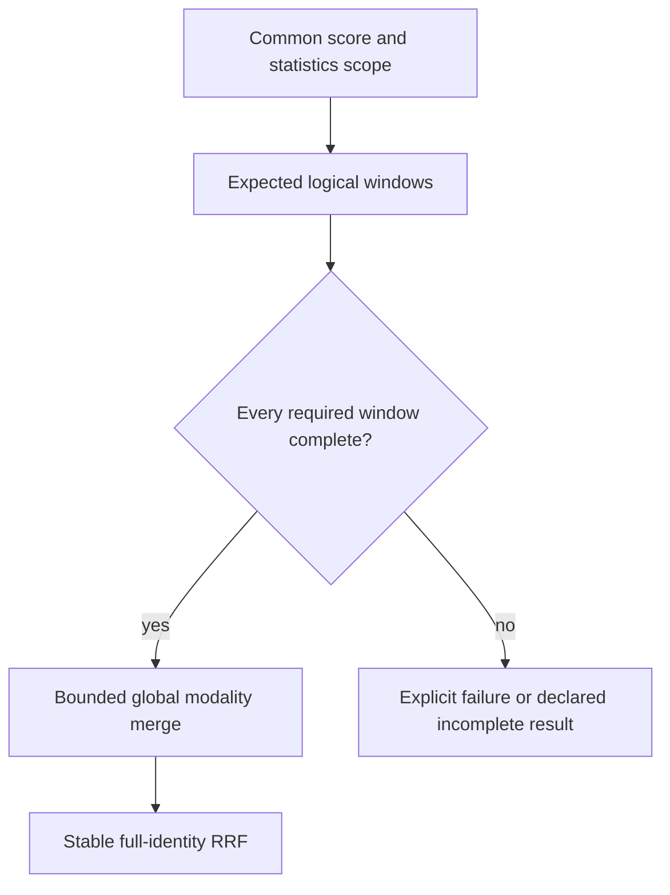

# ADR-096: Bounded comparable global modality windows before fusion

Status: Accepted; implementation and qualification pending. Date:2026-10-04.

Current fusion tie-breaks only the entity Id and only sees one partition. Adopt
the internal kernel and actual local-adapter contract in
[GlobalBranchWindows](../Features/Search/GlobalBranchWindows.md), REQ/AC-RANK-001..004.
Global modality windows precede ranks/RRF, complete identities define tie order,
duplicates must agree, scores share exact profile/corpus/statistics witnesses,
and missing/approximate/truncated sources cannot masquerade as exhaustive output.

Multi-partition claims additionally require native bounded fan-out across partition grains, a per-partition read-cut vector, current persisted policy and strict text statistics generation.

No public client or persisted format changes are accepted; generated
internal aliases/IDs are frozen before any future inter-grain publication. Single-partition strict text remains valid
only within its current local scope. Rollback changes no canonical data; global qualification requires actual results from partitions on separate silos.

