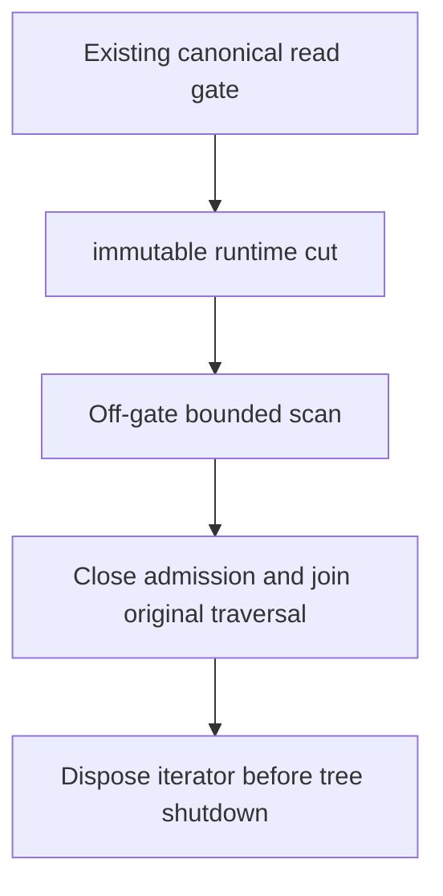

# ADR-097: Provider-owned read-cut leases

Status: Accepted; implementation and qualification pending. Date:2026-10-04.

Adopt [RuntimeReadCuts](../Features/StorageRecovery/RuntimeReadCuts.md),
REQ/AC-CUT-001..004, as the canonical contract. A runtime snapshot pin is
preferable to unbounded copying or holding the canonical gate throughout an
index build. Keep one provider-owned finite lease, copied callback bytes, exact
scalar identity and joined shutdown. The existing gated-view interface remains
unchanged and cannot escape; the new capture entry is internal to the provider.

Implement capture, bounded visitation, disposal, then mapped consistency/budget/lifetime tests. Review exact file hashes, full Release build, format/governance, serialized Aspire normal/scalar/recovery/cluster and exact-SHA Linux results before qualification.

Pinned ZoneTree1.9.8 snapshot creation and iterator advance are synchronous and
non-cancellable. Check and charge before/after; do not claim an interruptible
deadline or abandon original work. No canonical format, WAL, public wire,
cluster topology or acknowledged-write authority changes. Leases are disposable on restart or activation movement and retain no signing
material. Rollback drains the actual
leases after stopping admission and removes only runtime helpers.

Whole-tree replacement must reject ResourceExhausted while a cut is leased.
InstallSnapshot checks under its existing write gate after health/stale validation
and before staging, fault callbacks or publication. No waiting or poison-on-failure
replacement path is entered for this rejection. The gate also excludes a new
capture until replacement completes. Ordinary Compact does not replace the execution
tree and remains allowed. Prove unchanged current health/identity after rejection,
successful installation after disposal, and exact old-cut reads after compaction.

disposal failure retains the actual unsettled iterator and active slot;
later attempts retry that same handle and concurrent callers join the actual
attempt. Clear ownership and release admission only after disposal succeeds.
Keep primary plus cleanup failures. Budget reporting after successful cleanup
does not retain a closed handle. Construct scalar cut before opening the iterator.

Shutdown joins leases before cache closing/tree disposal. Failed execution
cleanup leaves tree/cache/owner handles owned for a subsequent joined retry and
closes new lease admission. Reentrant disposal while this thread holds the runtime
read/write gate rejects before state changes or waiting. Sequential prefix visits
share one snapshot, one active traversal and cumulative record/byte/advance/time
budgets; returned counters describe cumulative work across every visit.

Existing REQ/AC-CUT-003 maps to stronger exact-state oracles in the already executing shutdown/reopen case, as lifetime evidence. Preserve original traversal/cancellation/join/deadline/cleanup behavior. Capture committed bytes/position/full identity, assert them after joined shutdown and reopen, perform a healthy write/read, reopen again and assert updated state with the original identity. No hook, fake failure or duplicated lifetime scenario. No package, format, public API or topology change; rollback removes only the stronger test oracle. Other product gates remain independently open.

Online publication ([ADR-095](ADR-095-online-generation-leases.md)) remains responsible for same-cut outbox/policy/applied metadata and retention,
ordered delta catch-up, validated catalog switch and interrupted-build recovery.
Neither this primitive nor leased generations alone closes the original
concurrent-write/online-index/restart acceptance criteria.

### Bounded read-only frozen lookup under the original one-slot ceiling
The accepted public retained-reader successor maps original CUT-001..004 to the public retained reader in [OnlineGenerationLifetime](../Features/Search/OnlineGenerationLifetime.md). Storage owns internal IScopedReadCapture and ZoneTreeCapturedReadBuilder/View/Lookup, not Query live-view emulation. Complete the admitted canonical lookup/range/metadata closure with original examined-work and separate retained-buffer/capacity admission, join that SAME snapshot before releasing its single slot, then retain the SAME independent selected FTS reader through actual posting/ranking. Public IAtomicStore/IKeyValueView are unchanged; no live view, snapshot iterator, span or missing-key fallback escapes. Scope completion/observed absence are exact, keys use bounded owned sorted lookup, and no unbounded database copy/new quota exists. All original snapshot cancellation/disposal/InstallSnapshot rules remain mandatory. Source integration/rollback and real positive/denied/cancel/file/cold tests are defined in the linked feature contract; measured heap/resource/runtime gates remain open.
