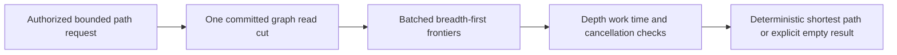

# ADR-098: Bounded authorized shortest paths

Status: Accepted; implementation and qualification pending, 2026-10-05.

Graph traversal requires unweighted shortest paths and batched frontiers beyond existing
reachability. Select one versioned directed same-partition path operator over
node-local ZoneTree adjacency in one current authorized committed cut.
Explicit depth frontiers batch local work without per-edge RPC. Orleans retains
one request grain and ManagedCode CQRS; storage handles remain node-local.
A nonempty `Labels` predicate is authorized as field use of graph `/label`: the
persisted field policy's `RawUseGrant` is required even when the principal has a
separate `RawReadGrant`. Missing use authority returns `PermissionDenied` before
adjacency traversal; null/empty labels do not invoke that use check. A cluster
restart scenario asserting a filtered path must persist this grant before its
initial path read.

The implementation contract is [ShortestPath](../Features/GraphTraversal/ShortestPath.md),
REQ-GRAPH-007..010, AC-GRAPH-006..009. It freezes new version1
aliases/IDs, deterministic BFS ties, empty/zero-hop results, conservative metadata
retention, real read/time/cancellation caps, Q1.GraphPath.v1 literal/parameter
grammar and shared deadline. Existing ADR-004/005/010/014/034/082 continue to own
committed reads, keys, persisted authority and routing/lifecycle.

The official MCP join also updates ADR-039 and the independent ClientApi name/schema/hint oracle for both shortest-path tools. The current independent canonical inventory has 68 names; that inventory count is distinct from the three public gateway tools and must be checked independently before real cluster discovery qualification. Packages, shared configuration and formats stay unchanged. Neither source presence nor focused passes complete the acceptance; normal/scalar, recovery and full cluster/client gates, including failover/revocation, remain required.

No canonical data, existing alias/ID, journal or acknowledgement
changes occur. The request does not alter canonical stored data. Rollout adds explicit v1 capabilities;
unknown versions fail closed. Rollback removes new read registration without
rewriting acknowledged data. Weighted/cross-partition paths, full SQL/protocol
and measured performance leadership remain separate mandatory workstreams.
