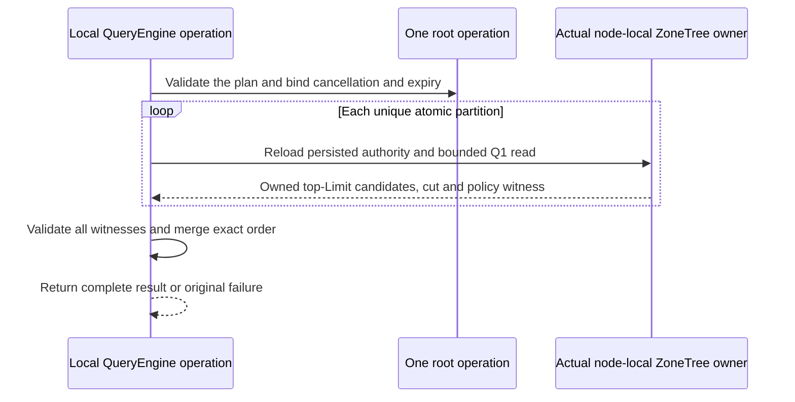

# ADR-100: Internal bounded Q1 merge across local atomic partitions

Status: Accepted; implementation and qualification pending.
Date: 2026-10-05. Scope: prerequisite for distributed query fan-out only.

[ADR-149](ADR-149-no-operation-limits.md) governs operation bounds: leaves carry no read, record or result allowance.

The cancellation-observation amendment implements
AC-DQUERY-PREREQ-005 with an already-armed, owned observation thread and
the unchanged synchronous real ZoneTree query. Exact case/helper ownership,
15-second observation/join bounds, original token and operation, no-result and healthy
follow-up requirements are frozen in DistributedQueryExecution before code.
No product boundary or stored-data/wire-format change;
rollback may revert this test synchronization but cannot weaken its assertions.

## Context

Distributed query execution requires query fan-out across logical partitions.
A cross-partition query is a fan-out over ordinary Orleans partition grains: each
leaf reads its own silo-local ZoneTree owner and a calling grain gathers and merges
the bounded results ([ADR-136](ADR-136-orleans-partition-ownership.md)).
`QueryRequest` today addresses one `PartitionRef`; `QueryEngine.Execute` performs
one local authorized query. Calling several partitions on the same local
`DatabaseEngine` a distributed query would be false evidence.

The safe first code stage is therefore an internal prerequisite: exercise the
real Q1 leaf operator on multiple atomic partitions in one `TestDatabase`, then
merge only its bounded owned results. It prepares generated structures
and verifies correct order/cut/policy bookkeeping without publishing a route or
calling another grain. The existing request envelope identity, persisted
authorization, `QueryEngine` admission/compiler and `DatabaseEngine.WithQueryView`
remain authoritative.

## Decision

Add five internal Orleans-generated value types under the QueryExecution
feature: `PartitionQueryPlan`, `PartitionQueryLeafPlan`,
`PartitionQueryCandidate`, `PartitionQueryLeafResult`, and
`PartitionQueryResult`, with aliases and IDs frozen in
`DistributedQueryExecution.md`. The plan is valid only for 1–8 unique atomic
partitions all executed by the same actual store owner identity. It carries no
trusted principal or caller-selected node. A leaf plan carries
one identical normalized Q1 AST with only `PartitionRef` varied and a candidate
count equal to the root limit. The executor uses the authenticated principal already passed
to QueryEngine; each leaf reloads persisted principal/resource policy through
the existing read path.

Capture canonical encoded Q1 order keys while each document is still an
authorized pre-projection candidate. Retain only the requested local top-L,
including full `EntityRef` and projected/redacted `QueryRow`; never export
borrowed database views or raw unprojected documents. For every unredacted row
emitted by this partition-query path, `RedactedFields` is a present initialized
empty immutable array;
redacted rows carry the exact omitted field paths. Null and empty remain
distinct serialized values, so callers and parity checks must not normalize
one into the other. Merge with order-key
direction followed by ordinal full-identity components. Preserve a vector of
per-leaf owner, read-generation, cut, policy and schema witnesses; there is no
single cross-partition snapshot position. Require the same owner and policy
epoch for every leaf, fail the whole result on a missing/denied/inconsistent
leaf, and expose no partial rows.

Leaves carry no record, raw-byte or retained-byte share, and nothing is
measured or charged. Each leaf retains at most the query's `Limit` candidates
and the merger returns no more than `Limit` rows. There is no work stealing. A
root token and the operation's explicit expiry cover parse, all leaves and
merge. Current local leaf calls
are synchronous, so this ADR does not claim remote capacity/backpressure or
slow-owner settlement.

## Ordered implementation and evidence

1. The exact requirements, aliases/IDs, comparator, error map and truthful limitations are frozen in `docs/Features/QueryExecution/DistributedQueryExecution.md`.
2. Query adds only feature-local internal contracts, models, validation,
   coordinator and leaf execution helpers. It reuses `QueryValidation`,
   `QueryEngine` admission, SQL compiler, `PreparedQuery` sort encoding,
   `QueryCandidateReader`, and `DatabaseEngine.WithQueryView`.
3. UnitTests seed real ZoneTree records in at least two distinct
   `PartitionRef`s using `TestDatabase`. Expected order and result projection
   come from a separate seeded scalar model, not from production leaf order or
   merger code. Include ties, hidden sort fields, duplicate textual IDs,
   persisted permission denial/revocation, invalid plan shape, cancellation
   after an observed actual read and a healthy follow-up. Assert positions and policy witnesses per leaf; never
   assert a synthetic scalar global cut.
4. The full solution build, format, governance and Aspire suites run after the stage. Passing local unit tests only qualify this prerequisite implementation. Distributed query execution remains pending all actual leaf-on-other-silo, Orleans, SDK/official MCP, fault, bounded fan-out and Linux delivered-source acceptance.

## Rollback and exclusions

Remove only the new internal plan/leaf/merge code and its tests after stopping
any future internal caller. This stage writes no data and changes no persisted
format, public DTO, query grammar, server route, SDK/MCP tool, Orleans grain
dispatcher, index, or authorization policy. Do not add test-only delays, fake leaf
providers, synthetic node identities, or a private cluster topology. The future
contract must separately define per-leaf deadlines and backpressure for
leaves on other silos, slow-leaf timeout/cancel/join, all-leaf failure, SDK/MCP
results and actual Aspire cluster evidence.

## Ownership and join points

The canonical file and role map is in the linked feature specification.
There is one existing local query read capability and no second dispatcher.

The accepted local top-L implementation uses a custom L+1-reference binary
heap for the internal partition leaf, with full EntityRef ties before selection.
The public Q1 PriorityQueue path keeps its existing UTF-8 EntityId comparator.
Draining the heap yields the ordered leaf candidates and releases its slots.
This ADR does not authorize fresh per-leaf deadlines, changing public Q1 tie
ordering or a configured operation limit. Execution helpers belong in
QueryExecution/Execution.

The narrow integration is an internal PartitionQueryExecution extension in
QueryExecution/Execution plus one internal QueryEngine owner accessor. It
reuses existing Bind/Project and the actual DatabaseEngine, keeping the shared
QueryEngine within the mandatory type-size limit without a second dispatcher.
Generated aliases use named constants with their exact frozen strings.
