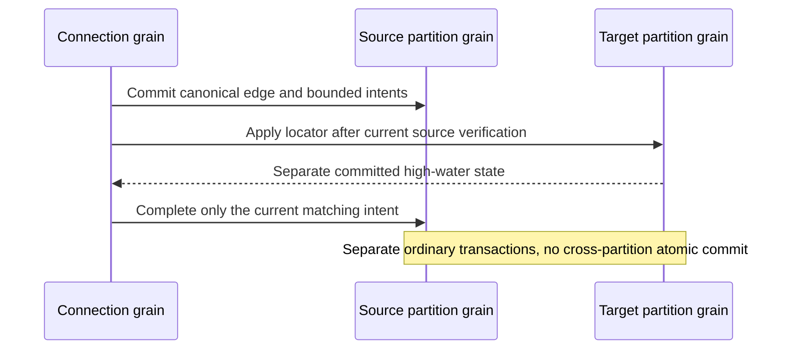

# ADR-102: Cross-partition graph edge delivery

Status: Accepted implementation contract; source integration and actual tests remain required. Related REQ/AC-GRAPH-XPART-001..005. See [CrossPartitionEdges](../Features/GraphTraversal/CrossPartitionEdges.md).

## Decision

The source atomic partition remains the canonical owner of each graph edge. For a distinct target atomic partition, the source mutation commits a revisioned graph-owned delivery intent in its ordinary atomic transaction. The destination reverse adjacency is a derived record applied in a separate ordinary atomic transaction; the apply reaches the target partition grain through an ordinary Orleans call and runs on that partition's silo-local ZoneTree owner ([ADR-136](ADR-136-orleans-partition-ownership.md)). Source completion is another separate source transaction. We do not claim cross-partition atomic commit. The delivery uses the existing authenticated signed-CQRS envelope and persisted current grants as trust authority; locator fields and original principal/policy metadata never authorize a caller. Completion reloads the committed receiver high-water state through the target partition grain.

## Ordered implementation stages

1. Freeze the stable generated aliases/IDs and source/version/intent/receiver/completion contracts in GraphTraversal Abstractions. The accepted feature table additionally fixes the generated capacity record, direction enum and canonical fingerprint tuple before their implementation; checked capacity accounting and the exact tuple are authoritative.
2. Core source mutation writes the canonical edge, source owner version, coalesced target intent and normal outbox entry in one existing transaction. Target apply validates the actual source intent, canonical owner state and current source/target graph grants in the target transaction; active delivery validates both visible endpoints. It writes the derived reverse row and receiver high-water together.
3. `ReadIncomingGraphEdgesRequest` performs one current local store read on the target partition. It admits at most `MaxResults`, scans at most `MaxScanRecords`, charges point/range/result bytes through the existing `ReadExecutionBudgetReadGrant` and `BudgetedReadView`, and checks the original deadline. It verifies the current source canonical edge/version plus destination high-water in that read cut and returns only visible, matching rows. If more eligible rows remain than the requested result limit, it returns no page and fails visibly; no partial result or completeness claim is allowed. Its output marks `eventual-reverse`.
4. Source completion validates the actual target receiver state, the exact current source intent and current source plus destination graph-write grants before retiring/accounting the intent. Target applied/source completion lost is safe to retry; superseded old messages are harmless stale no-ops. A later service stage may automate bounded page/apply/complete calls through ManagedCode CQRS; no task fanout or network under the apply gate.
5. Tests are actual ZoneTree tests for source atomicity, exact aliases/serialization, duplicate/out-of-order/tombstone behavior, target/source separate commits, incoming query privacy/read budgets, revocation, endpoint deletion, capacity, corruption, retry and source completion failure.

## Limits, rollout and rollback

The source-stage fingerprint correction implements REQ/AC-GRAPH-XPART-001 before this feature's first qualified release. Freeze a fixed independently owned record and string-occurrence tree before encoding the unchanged generated fingerprint tuple; CLR reference sharing cannot determine a delivery or corruption decision. Verify equal digests after separate actual edge-frame decoding, independently allocated equal references, and changed full identity/content. Keep all aliases, field IDs, exact content and global serialization behavior unchanged. Invalid digests fail closed; no fallback or automatic rewrite is accepted. Real restart and cluster qualification remains required for populated data. Rollback retains canonical data, intents and high-water records.

Use `MaxScanRecords` and `MaxBatchBytes` for pending intent and receiver-state capacity, plus `MaxResults`/`MaxScanRecords`/`MaxBatchBytes` per bounded repair page and the original request deadline. Failed reservation prevents source commit. Do not discard unresolved intents or receiver tombstones automatically. Rollout uses the current schema without rewriting existing records. Rollback stops new cross-partition writes/repair but retains canonical source records, unresolved intents and target high-water state. No restart is allowed to reinterpret an unknown envelope as success.

## Verification

The exact public Batch union/discriminator registration is frozen in [CrossPartitionEdges](../Features/GraphTraversal/CrossPartitionEdges.md#mutation-and-delivery-rules). Delivery remains existing SDK `CommitAsync(CommandRequest)` with no separate write endpoint or dispatcher.

No document may mark cross-partition edges implemented or qualified from unit source alone. The automatic background delivery service (a StatelessWorker batching pattern per [ADR-094](ADR-094-orleans-due-coordination.md)), SQL join, frontend and complete delivery-window qualification remain open.
