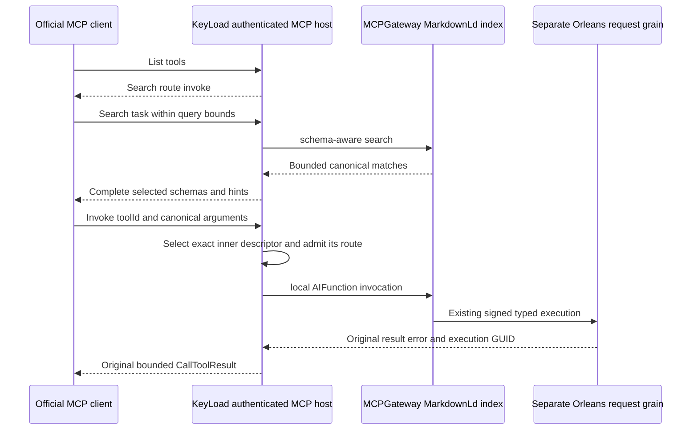

# ADR-104: ManagedCode gateway and graph-based MCP discovery

Status: Accepted for implementation; verification pending. Date:2026-10-05.
Related: [ClientApi ToolDiscovery](../Features/ClientApi/ToolDiscovery.md),
REQ-MCPGW-001..007 / AC-MCPGW-001..007, [ADR-039](ADR-039-official-mcp-agent-api.md), [ADR-036](ADR-036-orleans-foundation.md),
[Authorization](../Features/Authorization.md), [TestInfrastructure](../Features/TestInfrastructure.md).

## Decision and reason

The owner requires our MCPGateway and Markdown-LD knowledge graph to make the
large tool inventory usable. Expose the package's search/route/invoke meta-tool pattern as the public MCP
entry point. Use the actual published
ManagedCode.MCPGateway0.4.17 and ManagedCode.MarkdownLd.Kb0.2.10 graph
APIs. Keep the canonical operation inventory inside KeyLoad and return selected
complete schemas/effect hints on demand.

Reuse KeyLoad's official stateless MCP host and fresh persisted authentication,
bounded framing/admission, typed operation decoder, signed Orleans gateway and
silo-local ZoneTree owners. The package's outbound OAuth is not incoming authentication.
Its current aggregate MCP exporter lists every operation and normalizes results,
so adopt factory/search/invoke APIs rather than that exporter. This is a
transport adapter over the original execution, not another operation dispatcher.

The exact wire, metadata permission boundary, index/input/output bounds,
canonical-adapter seam, cancellation/drain contract and test matrix are owned
once by ToolDiscovery. AC-MCP-001 separately verifies the current independently
enumerated 68-name internal canonical catalog and exact schemas/hints through the
official client; that count is not the three-name public initial listing. Metadata
is public operation documentation visible to a
fresh authenticated principal, never actual resources/data or an access grant.
Invocation revalidates persisted authorization even after discovery. The graph is
disposable metadata; ZoneTree remains canonical for every database model.

## Implementation contract

Guidance (REQ/AC-MCPGW-007): the same official host exposes the one fixed Markdown resource and one static no-argument prompt specified in ToolDiscovery, without adding an operation tool. Fresh persisted authentication and existing control admission/output/privacy budgets apply. resource/prompt objects are fresh per call; unknown names, nonempty cursors and arguments fail before effects. Guidance is static source metadata, not model data, policy or credential state. Rollout/rollback moves guide, handlers, registration and tests together; no data format changes. Build, normal/scalar and actual Aspire cluster tests must prove exact content, bounds, rejection and revoked credentials before this extension is qualified.

1. Pin only live-published packages; normal NuGet references, no local package or temporary project reference. Existing MCP/Orleans packages stay centrally pinned. Dependency defects follow the authorized owning repair, regression, patch/release/publication/feed-verification workflow.
2. The server `Features/ClientApi/Discovery/` owns the graph catalog, metadata hints and the local `AIFunction` adapter; relevant UnitTests live in `Features/ClientApi/{Cases,Helpers,Assertions}/`. It uses the frozen `McpToolDispatcher.InvokeCanonicalAsync` integration seam, not another engine.
3. Preserve whole-frame charging and actual typed `CallToolResult` lifetime. No catalog/graph-engine implementation.
4. Source changes are not accepted until the combined build and actual caller gates succeed.
5. Restore/Release build and analyzers; focused and related Aspire units, scalar,
   recovery and genuine cluster tests through discovered endpoints; formatter and full
   required gates; main checkpoint commits/pushes with honest evidence. Original
   source/version/job/artifact Linux qualification closes acceptance. No skipped
   suite, static check or package presence counts as a runtime pass.

AppHost owns topology/test runner readiness, dependencies and shutdown. Every test maps to ToolDiscovery acceptance; no mock gateway or storage replaces real libraries/cluster callers.

## Rollout, rollback and unresolved qualification

This is the accepted public discovery contract for ADR-039. The meta names
are the package's canonical pattern; existing database DTOs, SQL, HTTP SDK,
request envelopes and persisted formats do not change. Update callers and docs
atomically and remove obsolete direct operation-tool routes. No second full
catalog endpoint or compatibility fallback remains. Source-only rollback reverts
the composition/caller changes together without touching data or receipts.

graph cancellation cannot promise immediate SPARQL interruption; owners
remain held until actual work settles. Fixed metadata/count/source/reply bounds
are required; total index allocation/peak RAM, full operation parity,
revocation/concurrent identity, recovery/restart, genuine cluster and complete
delivered-source Linux gates remain open. No production-readiness or performance
claim follows from this decision. ADR remains Accepted until all mapped evidence
exists.
