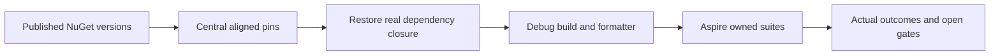

# ADR-105: Published NuGet dependency refresh

Status: Accepted; local dependency integration checked. Complete delivered-source qualification remains open.
Date: 2026-11-04.
Feature: [RepositoryGovernance](../Features/RepositoryGovernance.md).

## Context and decision

Every NuGet dependency is updated to its latest published version. Inspect every central
PackageVersion, including transitive pins, and the Aspire.AppHost.Sdk pin against
the configured NuGet.org feed. Use the newest published stable release. Do not
introduce previews into stable package families.

The current pins live in [Directory.Packages.props](../../Directory.Packages.props).
The feed review includes the existing prerelease channels for Orleans Journaling
and Durable Jobs. Orleans peers and the Aspire MSBuild SDK stay aligned with
their corresponding package families. MCPGateway's existing Apps and Tasks
dependencies track the MCP SDK patch because Tasks requires that exact version.

[ZoneTree 2.1.2](https://github.com/ZoneTree/ZoneTree/releases/tag/release-v2.1.2)
adds transactional and object-storage live backup support. The guarded full-text
file provider implements the public non-overwriting `MoveFile` operation used
by durable metadata creation. It verifies both paths and updates the ownership
ledger after the native move. Occupied, unowned and outside targets must
preserve the original files and ledger. KeyLoad's process-recovery and released
performance qualification remain separate.

Retain central version management, dependency APIs, .NET 10/C# 14,
warnings-as-errors and SDK-owned Roslyn compiler assets for analyzer tests.
Keep all Orleans packages and Roslyn peer packages aligned. Update active
version assertions and development-capture metadata with the selected packages;
retain immutable historical measurements and source receipts.

Microsoft.CodeAnalysis.Workspaces.Common stays pinned alongside Common/CSharp
at 5.9.0 to preserve their exact peer constraints and avoid NU1608. These pins
align the existing dependency closure; they add no new provider or compiler host
and preserve all diagnostics.

Updating only patches would leave requested published minor/major upgrades undone.
Floating versions would undermine reproducibility. Local replacement packages,
duplicated implementations and consumer workarounds are rejected. Any discovered
ManagedCode defect follows its owning-repository repair, release and verified-feed
delivery contract before consumer adoption.

## Implementation contract

1. Audit current policies, the dirty manifest and all feed versions; identify active version checks and protected historical records. Reviewed exact paths join the change.
2. Directory.Packages.props owns the selected versions. Update active version assertions, Orleans development-capture metadata and current documentation while preserving concurrent package additions and immutable historical evidence.
3. Restore, solution Debug build, governance, formatter and Aspire-owned analyzers/unit/recovery/cluster suites; retain original failures and artifacts. Scope comparison checks to changed version assertions through the same AppHost. Linux GitHub qualification uses Release and remains distinct from local checks, public performance, endurance and power-loss durability.
4. Inspect the combined diff, complete the canonical Debug build after final edits and formatting, record exact outcomes, and commit only this refresh stage when verified. Unrelated unfinished work remains with its author.

## Rollout, rollback and failure contracts

Serializer aliases/field IDs, cluster membership and node-local ownership stay
with their current owners. The ZoneTree native MVCC integration and current KeyLoad identity are
specified in [NativeMvcc](../Features/StorageRecovery/NativeMvcc.md). The existing
recovery/serialization tests must detect dependency integration defects. No compatibility or performance claim follows from version alignment or compilation.
Restore failure, downgrade, analyzer failure, runtime regression or missing
infrastructure leaves qualification open. A reproducible dependency defect must
be repaired at its actual owner; never suppress diagnostics to complete refresh.
Rollback restores only this stage's version/assertion changes, preserving other
checkout work and historical receipts. Product release remains separately gated.
