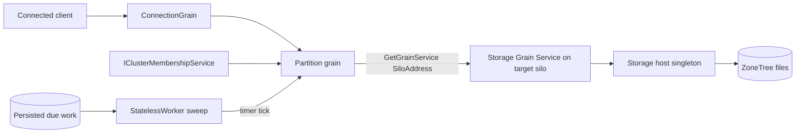

# ADR-110: Orleans primitives used by KeyLoad

Status: Accepted (rewritten 2026-10-18 from the Orleans 10.4.0 source and documentation). Implementation in progress. Requirements: REQ/AC-ORL-001..013 in [ExecutionPrimitives](../Features/OrleansExecution/ExecutionPrimitives.md). Related: [ADR-136](ADR-136-orleans-partition-ownership.md), [ADR-125](ADR-125-connection-owned-execution.md), [ADR-036](ADR-036-orleans-foundation.md).

Source basis: Orleans 10.4.0 (commit `d114d7522a53b8cce4c6b97d44293e5c7273d766`), Microsoft.Orleans.DurableJobs and Microsoft.Orleans.Journaling 10.4.0-alpha.1, and the official documentation at learn.microsoft.com/dotnet/orleans. Where the documentation and the 10.4 source disagree, the source wins.

## Decision

Each KeyLoad responsibility uses exactly one Orleans primitive:

| Responsibility | Primitive | Why this one |
|---|---|---|
| A connected client | `ConnectionGrain` (ADR-125), `[Immovable]`, `[PreferLocalPlacement]` | One activation per connection on the silo that accepted the transport; default non-reentrant turns protect session invariants; `[AlwaysInterleave]` only on close/cancel |
| A logical partition | Partition grain keyed by the canonical partition id | Serializes commands of one partition; holds no files; migration moves only in-memory values |
| A node's ZoneTree | One DI singleton storage host per silo plus one Grain Service as its remote surface | A Grain Service is one per silo, never collected, and can be called on a specific silo with `GrainServiceClient<T>.GetGrainService(SiloAddress)` |
| Copies of a write | The writer calls the storage Grain Service on each target silo | Orleans replicates no application data; target silos come from membership |
| Finding silos | `IClusterMembershipService.CurrentSnapshot` / `MembershipUpdates` (or `ISiloStatusOracle.GetActiveSilos()`) | Execution, public, per-silo view of Active silos; `IManagementGrain.GetHosts` is for clients and diagnostics |
| Background work (queue deadlines, due and recurring work, ANN projection, time-series chunks) | `[StatelessWorker(1)]` grain with a grain timer sweep | One polling activation per silo reads persisted work pages on a `RegisterGrainTimer` tick; no leadership check |
| Durable periodic work of a minute or more | Reminders (`IRemindable`, `RegisterOrUpdateReminder`) | Definition is persisted and reactivates the grain; minimum period 1 minute; missed ticks are skipped |
| One-time due work | Durable Jobs (`ILocalDurableJobManager.ScheduleJobAsync`, `IDurableJobHandler`) | Persisted, at-least-once, handlers must be idempotent; alpha package |
| Per-request context | `RequestContext` through ManagedCode.Orleans.Identity | Small values flow down the call chain, never back; carries the verified subject only |
| Streaming results | Grain methods returning `IAsyncEnumerable<T>` | Batched, backpressured, cancellable, scoped to the call |
| Placement and balancing | Default resource-optimized placement, `AddDistributedGrainDirectory()` (`ORLEANSEXP003`), `AddActivationRepartitioner()` (`ORLEANSEXP001`) | Execution; `[Immovable]` opts a grain out of automatic migration |

## Rules taken from the Orleans source

1. **Grain Service lifetime.** `Init` runs at `ServiceLifecycleStage.RuntimeGrainServices` (8000) and `Start` at `Active` (20000). `Stop` runs at `Active` stop, before `GrainDeactivation` (19998), and is skipped entirely on a cancelled shutdown or a crash. Therefore ZoneTree is opened and closed by the storage host singleton through `ILifecycleParticipant<ISiloLifecycle>` (open before workload admission, close at `ApplicationServices` stop), never in `GrainService.Stop()`.
2. **Grain Service scheduling.** Every request to a Grain Service starts its own task on one single-threaded scheduler, so requests always interleave at `await`. Keep ZoneTree calls short and asynchronous; never block a turn.
3. **Exposing ZoneTree locally.** `AddGrainService<T>()` registers only an `IGrainService` singleton. ZoneTree lives in its own DI singleton; local grains and workers inject it directly (no hop, no serialization) and the Grain Service is the remote surface.
4. **Calling a specific silo.** Use the protected `GetGrainService(SiloAddress)` through a public wrapper on the client. The `GrainId` and `uint` overloads route by the consistent ring, which changes on every membership change, and are not used for data ownership. A restarted silo has a new `SiloAddress`.
5. **Messages.** Grain calls are at-most-once with no ordering guarantee. Replication calls carry a per-partition sequence number, apply is idempotent and retries are explicit; a write is acknowledged after every configured copy confirms durable apply.
6. **Single activation is not a storage fence.** The directory may briefly allow a duplicate activation; correctness of persisted effects comes from idempotent, sequence-checked apply at the storage owner.
7. **StatelessWorker identity.** All activations of a stateless worker share one `GrainId`; each has only an ephemeral, non-addressable `ActivationId`. KeyLoad pins `maxLocalWorkers` to 1, so each silo runs one activation per pool key. A stable worker identity comes from the grain key (one key per queue, index, series or silo), produced by the shared ID helper. Use `[StatelessWorker(maxLocalWorkers, removeIdleWorkers: false)]` for buffering workers.
8. **Nothing is buffered.** A worker holds no in-memory event queue; every tick re-reads persisted records from a watermark, so a silo crash loses no work and nothing is acknowledged before the authoritative commit.
9. **Timers.** `RegisterGrainTimer` with `GrainTimerCreationOptions { DueTime, Period, Interleave, KeepAlive }`; the period counts from callback completion, ticks never overlap, and timers stop on deactivation. The flush interval is a typed option (for example 5 seconds).
10. **Keys are case-sensitive.** String grain keys are compared as raw UTF-8 bytes with no normalization, so "Tenant" and "tenant" are different grains. Every key is produced by one shared helper per identity kind that sanitizes user input, strictly validates at every routing and storage boundary (an id is valid only if sanitizing it changes nothing), compares ordinally and encodes order-preserving storage keys — the same pattern ZoneTree.Analytics uses (`Text.Name`, `Text.ValidateStoredName`, `RollupDefinition.Id`, `KeyCodec`, `Text.StableHash`).
11. **Caches.** Per-entity hot state lives in grain activation memory; per-silo shared caches live in the storage host singleton, bounded and tagged with the policy/commit epoch they were built from. Broadcast channels reach one grain per subscribing type, not every silo, and observers are best-effort, so per-silo invalidation is a Grain Service call to each Active silo or validation on read.
12. **Transactions.** Only `ITransactionalState<T>` participates in Orleans transactions; ZoneTree writes do not enlist. KeyLoad's atomicity is the same-partition atomic batch.

## Verification

TUnit tests against the Aspire-owned cluster through the real .NET SDK and official MCP client: restart of a silo with the same files, a Grain Service call to a chosen silo, replication to `ReplicaCount` silos found through membership, worker buffering and timer flush with a crash in between (no acknowledged data lost, buffered work rebuilt), and case-variant keys rejected by the helper. Process-kill tests do not prove power-loss durability.
