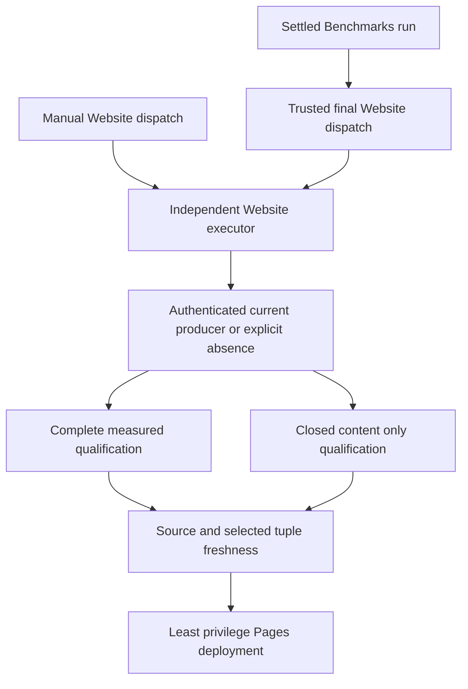

# ADR-112: Independent Website publication with optional benchmarks

Status: Accepted; complete measured qualification pending.
Feature: BenchmarkComparisons, REQ/AC-BC-WEB-001..007.

## Decision and trust boundary

Website/website.yml owns website source qualification and Pages publication.
Its executor accepts trusted own-main site pushes and workflow_dispatch, either manual or from the final Benchmarks trigger. Build and Tests
retains every build/analyzer/unit/scalar/recovery/cluster gate independently.
Benchmarks owns measurements and the final settled aggregate. Its final
website-trigger job dispatches Website on main only after successful aggregation.
A failed image, preparation, worker or aggregation prerequisite does not dispatch
an automatic replacement of the deployed site. Independent manual content
publication remains available. Cancellation
still stops dispatch. Exact trusted repository/event admission is required.
Only that job has actions:write; database jobs remain read-only.
Trigger failure is visible. Website retains its independent trusted-main push
and manual entries. Benchmarks only deploys public released database images,
measures workloads and may dispatch Website after completion; it does not call
Release or Build and Tests.

An optional benchmark_run_id authenticates the triggering own-main Benchmarks
run and waits for its completion. This is only a completion barrier: publication
still selects the latest completed successful full measurement run. Failed,
cancelled and incomplete runs never provide public figures or clear already
verified data. Contracts-only runs have no measurement workers and are not data
producers. The selected successful run must retain all 32 original session
artifacts with their complete declared workloads, source/run/attempt/topology,
TRX, hashes, correctness and resource evidence. Missing, expired or corrupt
selected evidence fails closed; it cannot cause an empty replacement.

The current report format retains the case inventory of its original producer.
Newly added workloads do not invalidate an earlier successful run or acquire
invented historical results. Server resource telemetry remains honestly labelled;
recorded operation figures do not claim matched hardware or production readiness.

With no successful measurement run at all, an independent manual content-only
publication can retain explicit absence. A failed newer run is not that state.

## Qualification and acceptance

Measured publication requires complete original archive/provenance/source,
coverage, browser and source/selected-tuple freshness gates. Content-only
publication has its own closed SiteContent TUnit selection through the same
Aspire site entry and proves every emitted/executed asset, browser action/result
and source path with applicable coverage thresholds, including critical90.
Measurement/archive numeric proof is N/A for an artifact that contains no metrics;
content-only success cannot be advertised as measured qualification. TRX
has no skipped cases, owned resources settle, and fresh source/control identities
and selected tuple (including null) are checked again before deployment.
Pages/OIDC writes are confined to the needs-gated deploy job.

## Ordered implementation and delivery

1. REQ/AC, policies, exact workflows/events and the ownership split are frozen before code.
2. Selection owns site-isolated-github capture/runs/contract; the builder owns site/Features/BenchmarkComparisons/build-site.mjs. Preserve exact original artifacts, bounded calls and source closure. Capture is limited to the current executor and REST selection/wait inputs; it has no event-file parsing, preserving REST workflow_runs and artifact.workflow_run provenance, actual authenticated capture and latest-selection operation flows.
3. Qualification owns SiteContent cases/helpers/contracts and the current coverage/source inventory joins. file/Node/Chrome flows prove successful admission, absence, foreign executor, corrupt evidence and healthy follow-up. Workflow-shape review uses actionlint/YAML and is not product runtime proof.
4. Workflows/composites, dispatch/admission/wait, tests, inventories and docs join once; verify build/format/governance, Aspire cases and actual exact-source Linux Website/Pages/freshness evidence. Release context consumes Build and Tests with its actual four job labels and all source/attempt/success protections.
5. All REQ/AC-WEB gates retain original failing and passing results. A commit or successful trigger alone does not qualify Website publication or the database.

Dependencies are official Pages actions, GitHub REST, Node, Chrome, TUnit/MTP and
Aspire. No database/package/DNS change. Rollout joins producer/consumer/builder/
tests/docs in one source checkpoint. Rollback preserves the independent Website,
final dispatch, every required gate and immutable measured originals. Keep Accepted
until actual measured and content-only qualification, freshness and Pages proof exist.

## Trigger scope, navigation and diagnostics requirements

REQ/AC-BC-WEB-008: Website's manual entry and Benchmarks' final dispatch follow the decision above. Verification: source/event admission and dependency outcome rejection are source checks; GitHub scheduling, completion waiting after a failed trigger and selection only of the latest successful measurement producer in actual Linux execution are required provider evidence, not claims from static inspection. Independent site changes can still publish without benchmark figures when no authenticated producer is ready. Rollback preserves the independent Website executor and all source/metric/coverage/browser/freshness/permission checks.

REQ/AC-BC-WEB-003: the menu action and restored fragment finish their actual CSS-adjusted target scroll, clamped to the document's real scroll range, before subsequent hero navigation. The actual Chrome/CDP caller clicks the observed visible menu toggle and link centers through mouse press/release rather than DOM `.click()`. Test helpers own bounded observation of location and geometry; they cannot force renderer state or focus, accept paused output, increase timeouts or lower coverage. Popover closure, repeated opening/viewport closure, scene lifecycle and joined child cleanup remain mandatory. `SiteContentBrowserTests` retains the full action chain with genuine pointer inputs; failure diagnostics additionally retain active-element tag/id and real scroll bounds, never credentials or user payload. No new dependency or provider boundary.

REQ/AC-BC-EXECUTION-FAILURE-DIAGNOSTICS-001: capture retains bounded process diagnostics after joined cleanup, with credential exclusion and unchanged safe public envelopes. This refines the current capture ownership and fail-closed contract and adds no provider, retry or fallback decision.
