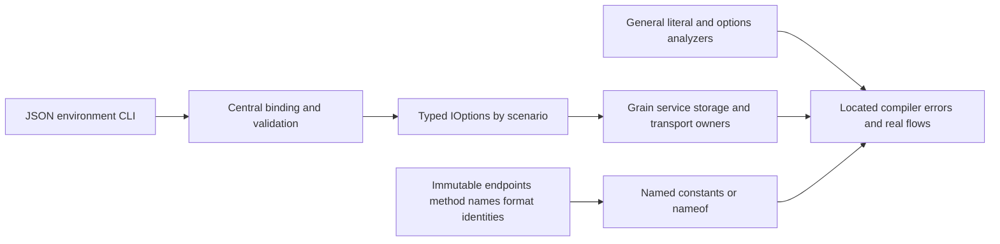

# ADR-113: General runtime literals and centralized typed options

Status: Accepted (implementation and verification pending)
Date: 2026-10-06

The current runtime contract centralizes operational policy in validated execution
IOptions<T>, consumed by its execution owner. Immutable protocol identities use
feature-owned constants or nameof. CodeQuality REQ-CQ-012/013 and AC-CQ-033..035/037/038
are the governing requirements for this contract.

Keep scenario options in their owning Features/<Slice>/Configuration role; register
them through the server/AppHost composition boundary. Defaults retain current
values and live only in these canonical definitions. Group settings by actual
ownership; do not build a universal untyped dictionary or a giant options bag.
Mark actual configuration options/binding boundaries with KeyLoad-owned metadata
so semantic compiler rules can distinguish them from public request DTOs. The
marker is descriptive: it never replaces actual registration, validation or tests.

Existing NodeOptions binds under its unchanged KeyLoad section, with existing
strict section validation before options execution. Feature constructors
receive IOptions<NodeOptions> and retain one validated snapshot. AppHost must bind
and validate its typed selection options before building the resource graph; its
options factory/DI lifecycle is owned and disposed, and no raw provider
escapes to feature execution. CLI/env names and malformed/unknown-setting failure
contracts remain exact. Persisted authorization and replica acknowledgement cannot be
configured away. Preserve serializer Id/Alias, bytes and canonical digests.
This options contract does not alter SQL/client protocol behavior, Orleans
activation movement, node-local storage authority, recovery ordering or
acknowledgement from every configured copy requirements.

Persisted user policies (queue/subscription/retention) and explicit caller request
parameters are domain data, not server execution configuration. Their stable
public/serialized default values remain feature-owned named protocol constants;
keep generated Alias/Id contracts and bytes. Do not inject IOptions into
payloads or mark arbitrary execution helpers as policy definitions. Host limits,
implicit execution defaults and timing/admission/cache budgets still require their
actual options owner. Required qualification sample counts remain contract identities.

Fixed temporal corpus data uses named constants in genuine static readonly execution
TimeSpan fields marked with the field-only `ImmutableTemporalDataAttribute` owned
by KeyLoad.Abstractions. KLD0037 permits only the TimeSpan construction in
that exact immutable declaration, with constant arguments; it does not exempt a
class, method, mutable field, counterfeit marker or execution owner. Policy sinks
such as Task.Delay, CancellationTokenSource, HTTP timeouts and semaphore waits
still inspect the initializer recursively and reject the same field as hardcoded
execution policy. Every runtime clock read, deadline, delay and timer uses its
owning validated TimeProvider. Select TimeProvider.System only at a composition or
default boundary, then pass that provider through the operation and cleanup helpers;
helpers do not silently select a different clock. Controlled providers are used
only where an authorized test contract requires them. Corpus bucket widths and
timestamp offsets keep their original digest bytes and remain distinct from the
execution deadline options.

Public JSON report and manifest records retain their existing option metadata as
data. The property-only `SerializedOptionsSnapshotAttribute` identifies an actual
immutable record's automatic get/init snapshot property; the analyzer validates
the genuine owning attribute and declaration shape and permits only that property
and its matching positional data parameter. Mutable properties, ordinary service
classes and counterfeit markers still fail. This boundary does not excuse raw
configuration reads, policy sinks or execution owner injection, and adds no JSON
field or serializer behavior. Calculated workload selections instead expose the
actual factory's IOptions.Value; their execution path consumes that wrapper.

Benchmark composition also binds the isolated HTTP admission scenario and its
replay pools before container creation. The same configured HTTP scenario
values are forwarded to the runner and derived into node and observer options;
replay pools are bound independently from ordinary production defaults. Existing
32-slot/2-GiB HTTP and 835,584-nonce defaults remain unchanged. Actual configured
values must reach the generated resource environments and matching runtime
observers; the real admission/replay regressions cover rejection and cleanup.

AppHost resource observation binds ScaleServerResourceOptions before graph
composition and shares the same wrapper through collector/process/helper joins.
Configured sampling, cleanup, file/output and work budgets must retain their actual
values in observation evidence. Frozen provenance options are populated only
from original environment values at the central boundary; execution classes cannot
read environment directly. Preserve original source/run/attempt/job authentication
and never refresh published measurements from this refactor.

DueCoordination first removes DispatchDeadlineSeconds/DispatchDeadline and the
service PollInterval from arbitrary classes. A feature-owned options type supplies
both grain and grain service via silo DI; central registration binds defaults and
overrides and validates ranges on startup. Capture configured values per operation;
do not introduce live policy mutation mid-dispatch or alter joined shutdown.

The canonical CodeQuality feature specification owns the exact file map, execution
order and acceptance tests for runtime options. Each execution owner consumes the
validated wrapper supplied by its composition boundary; shared option registration
and call-site changes are joined in the same source checkpoint. These
contracts define runtime policy ownership and do not add database features.

The registries group actual owners: Core database/due-work/messaging/query/
graph/change-feed/time-series/search/cache execution; Server node-derived authority,
replication/transport/routing/admission/MCP/probe/text/restore/admin
execution; AppHost startup/selectors/test/process/image/profile/cluster composition/
benchmark deployment and observation. CLI and comparison hosts use execution
OptionsFactory/OptionsManager before client or file construction. Strict immutable
comparison connection/identity snapshots use the factory's CreateInstance
hook with the existing validating parser, preserving unknown-input diagnostics and
secrets. No temporary provider or Options.Create fallback supplies runtime defaults.

AppHost's startup selectors are admitted before dashboard selection.
Private-profile byte/path/buffer/depth options reach reads, parsing and writes;
oversized writes fail before creating a staged file. Source/run/attempt/job identity
remains original environment provenance. Resource observation emits version2 with
the actual primitive policy; aggregation validates it, enforces its sample/mount
ceilings and rejects different policies within a comparable cohort.
This metadata schema change does not change persisted database formats or qualify
new performance measurements.

cluster published host ports consume `ClusterDeploymentOptions.FirstPublicPort`,
centrally bound from `KeyLoad:FirstPublicPort` with the preserved default5101.
Validate the complete range for the configured node count against execution `IPEndPoint` bounds
before profile-directory or Aspire-resource creation. Ordinary composition uses
the captured value plus node index; ephemeral composition still delegates port
assignment to Aspire. Internal container HTTP/silo ports remain frozen image
identities. `ClusterPublishedPortPolicyTests` verifies binding, every
actual endpoint annotation, snapshot lifetime, the inclusive upper range and
rejection before resource/file ownership (AC-CQ-034/035).

Verification order is a real full Release build, scoped formatting and a
final full build, then Aspire-owned analyzers/unit/scalar/recovery/cluster plus the
existing coverage/architecture gates. Configured behavior tests include
CentralAppHostOptionsTests, ProfileBoundedReadTests, resource
policy/mismatch cases in ScaleServerResourceEvidenceParserTests, and the real
DueCoordination/ReplicaExecution/ZoneTreeStorage execution regressions. Each suite
must retain its original outcome and exact source; compiler previews remain
diagnostic tools only.

comparison CSV character buffers, report/proof/control file buffers and
vector cancellation/yield cadences also belong to the centrally validated execution
execution group. Preserve their original defaults and inclusive ceilings, exact
report bytes, corpus hashes and qualification criteria. Semantic enforcement
includes actual framework file-buffer properties and constructor parameters;
same-named source types must not impersonate those framework symbols.

The options groups also own grain reply initial reservation, administrator
failure-log retention and Mongo/KeyLoad/Redis/OpenSearch seed batches. Preserve
defaults 4096/50/256/100/256/64 and their
inclusive ceilings. Actual allocation and chunking owners consume the snapshot;
command inbox scheduling uses its
own nonserialized `KeyLoad:CommandInboxExecution` group, with configurable
MaximumControlBurst 1..8 and the original default 8. Keep the immutable fairness
ceiling 8 and every existing admission Id/JSON contract; central server binding,
borrowed silo registration and physical coordinator construction share the same
validated wrapper. Configured lower-burst tests verify actual dequeue ordering.

MongoDB replica-probe and seeded-copy verification consume the same centrally
bound ComparisonExecutionOptions.OperationTimeout as their target;
probe deletion has its independent CleanupTimeout. Frozen scaled-profile timeout
metadata cannot supply either execution deadline. The Mongo connection
pool also consumes MongoPoolSessionMargin 1..4 and MongoPoolMinimumSize 1..16 from
that group, retaining defaults 4/16 and the original Max(concurrency + margin,
minimum) formula. Validate those options before client creation and preserve the
actual majority/journal concerns. ComparisonMongoPolicyTests maps
these configured-owner and invalid-policy checks to AC-CQ-034; genuine replicated
Mongo execution remains an exact-source comparison qualification requirement.

The existing selected cluster coverage fixture must receive all12 validated execution
coverage-option values from the owning AppHost, using its actual environment
handoff and invariant numeric/TimeSpan representations. Its feature-local execution
binding boundary validates the complete selected group before IO; ClusterFixture
retains one original `IOptions<CoverageExecutionOptions>` and passes it to
source/run/context readers, streaming hashes and receipt writers. Reject any
mismatch against the admitted run policy. Preserve the existing source64MiB,
run/receipt4MiB and output64KiB format fences, exact schemas, original
process settlement and disabled ordinary-cluster selection. Forward the existing
fixture-mode/source aliases coherently; this repairs the typed consumer join,
without introducing a coverage architecture or qualifying collector execution.

Keep the typed join maintainable under the unchanged200-type/50-unit limits:
`ClusterFixture` retains common actual cluster orchestration; its existing graph
admission/logging/topology configuration moves to the feature-local
`ClusterFixtureComposition`. Optional collector ownership belongs to
`CoverageClusterFixtureOwner`, which atomically retains admitted context, source
image, original options, started-node identity and the bounded selected
case ledger. It controls selected image verification and receipt publication only
after original stop/reader/cleanup settlement succeeds. Cleanup uses the captured
options deadline; failures retain their original order/type, ordinary cluster
selection stays disabled without configuration, and unsuccessful settlement keeps
the original evidence/root. These cohesive responsibilities preserve exact
resource membership, image/schema/source trust, filesystem and lifecycle order.

`ClusterFixtureApplicationShutdown` owns the transferred actual AppHost's ordered
stop, optional original-node settlement proof and joined disposal. The fixture
retains diagnostics/root/receipt ordering and combines failures only after that
original application owner settles; this boundary does not create or replace a
resource, detach work, alter a timeout, or delete unsuccessful evidence.

SQL trivia parsing receives a required explicit configured work chunk. Query and
Server consume QueryExecutionOptions.SqlBudgetCheckInterval, 1..256 with default
256. SQL comment pairs have immutable atomic width two, so a configured
one-character interval permits that minimum grammatical atom while retaining
bounded positive progress. The SDK does not parse: its read/write classification
scans the first KeyLoadClientExecutionOptions.MaximumSqlInspectionBytes
characters (1..65 536, default 65 536) for a complete leading SELECT keyword and
classifies a keyword cut by that bound as a possible write.
SqlTriviaExecutionPolicyTests joins AC-CQ-034/035 to the real parser and SDK owners.

TimeSeries chunk encoding requires the centrally registered execution
TimeSeriesExecutionOptions wrapper at its codec entry. HashChunkBytes 1..65536,
default 65536, controls checksum and UTF8/UTF16 cancellation slices; text sizing
uses a distinct TextCancellationCheckIntervalCodeUnits 1..16383/default 16383.
Preserve atomic UTF16 code-unit/surrogate widths, all envelopes, checksum
bytes and independent goldens. Explicit benchmark/test caller composition uses
the same actual typed factory, with no codec fallback. These are execution
cadences, while frozen chunk wire/version/record-size ceilings stay identities.
SampleChunkExecutionPolicyTests maps configured roundtrip/cancellation and reject
before work to AC-CQ-034 without claiming performance or live storage adoption.

KeyLoad and Redis corpus readback sessions consume the target's existing
ComparisonExecutionOptions.ReadbackBatchCapacity instead of separate fixed
256-record pages. Preserve default paging, exact corpus order/bytes, cancellation,
continuation and SCAN/MGET validation. Configured lower-cap regression
uses the genuine already selected Aspire comparison topology and observes actual
requests/pages; a total-only assertion cannot prove the policy join.

The separate ComparisonDiagnosticOptions group (ComparisonDiagnostics)
owns comparison diagnostic policy without expanding the workload options
type beyond its aggregate type-size gate. It is bound/validated once by the real
host and standalone fixture factories and passed as a required execution
wrapper through KeyLoad/Redis/Kurrent target and cleanup/failure owners:
Kurrent setup cause/frame/identifier ceilings 3/8/64 and initial builder reservation
4096; cleanup exception traversal/output ceilings 8/4096; Redis replica projection
ceiling4096; KeyLoad outbox output/consumer ceilings512/64. Lower overrides must
remain positive and fit each immutable overflow/unavailable projection. Required
wrappers flow from actual target/cleanup/failure owners to the projections;
preserve default output, redaction whitelists and protocol identities. Builder
reservation is not a new output truncation guarantee. diagnostic projection
regressions map AC-CQ-034 to exact independent golden and lower-cap/invalid-policy
oracles; preserve whole-line and privacy assertions.

File payloads use ManagedCode.Storage physical providers. The removed raw-part
engine has no runtime options group. file metadata, physical restore and
resource-bound integration remain open under [ADR-038](ADR-038-chunked-blob-storage.md).

Scaled raw ZoneTree's existing ScaledStorageExecutionOptions owns
MutableSegmentSlackRecords 1..2/default2. Actual mutable segment sizing
uses the validated snapshot with the original minimum-capacity formula and
checked arithmetic; corpus identity, complete retained-record verification and
durability choices stay unchanged.

Static JSON and serializer helpers own fixed internal buffer constants.
They do not read environment variables or bind process-global options. The JSON
text pool retains arrays up to 262144 bytes with two arrays per bucket;
fingerprint and DOM string segments use 4096 characters. Preserve cryptographic
buffer zeroing, one production pool, surrogate-atomic positive progress, exact
fingerprints/envelopes and frozen JsonDefaults.Options web/case/depth
semantics. SerializationExecutionPolicyTests checks exact bytes and Unicode
boundaries; source inspection does not qualify allocation or performance claims.

Storage stream buffering is distinct from transfer/chunk buffering. The execution
storage options group owns StreamBufferBytes 1..4096, default 4096, for metadata,
backup and checkpoint FileStream owners, including FileStream entry points
that otherwise select an implicit
buffer. Preserve existing 65536-byte transfer/chunk defaults, original frame and
manifest bytes, recovery validation and synchronous Flush(true) barriers.

text file providers apply the bound FileBufferBytes ceiling to actual
ZoneTree stream creation, including calls that omit the interface's
optional buffer parameter. Preserve smaller caller buffers and unbuffered
requests; reject invalid configured ceilings before taking file ownership. Real
unflushed-file observations verify that lower configuration reaches the IO sink.

Executable ComparisonHost lifecycle helpers consume the same central
binding contract through `ExecutionPolicyFixture.Harness()` and a typed
`KeyLoad:ComparisonHarness` section. Ownership is feature-local
Configuration/ComparisonHarnessOptions, the fixture composition entry,
and the actual PostgreSQL/Redis/Kurrent/teardown helper sinks. Preserve default
budgets, exact fixture isolation, independent assertions and original-task
failure identity; do not turn their mutable timeouts/buffers/workers into protocol
constants. Integration and Recovery API/ownership joins use the same actual
rebuilt contracts and retain their original cluster/restart assertions.

Dependencies use centrally pinned Microsoft.Extensions.Options/Binder
packages already present or explicitly added in the canonical package manifest;
do not copy framework or ManagedCode implementations. Options.Create is
permitted for explicitly validated standalone/test caller composition, not a fake
options implementation or a hidden fallback replacing central server DI.

Projection of environment settings into a configuration provider omits
absent variables rather than supplying null-valued keys which overwrite typed
defaults. Explicit supplied values retain validation. Configuration validation
runs at composition before dataset allocation; invalid standalone wrappers fail
with the canonical Validate exception. After valid configuration, target
validation still precedes corpus construction. Private request-probe mode
validation precedes unrelated suite selectors in the central AppHost factory.

The CLI explicitly references the already centrally pinned environment
configuration provider for KEYLOAD_STORAGE__ and KEYLOAD_POINTCACHE__. Omitted
variables preserve canonical typed defaults; supplied budgets are validated before
opening any storage files. No nullable-key inventory or parallel options defaults
substitute for binding. Actual CLI backup/reject/restore flows cover this
composition repair.

Rollout is one coherent source rebuild. Preserve defaults/sections and fail invalid
configuration before readiness/admission. Constructor/configuration ownership
changes update every actual call site and real regression in the same stage. No
constructor may restore hardcoded policy. A source rollback restores the
complete pre-checkpoint source state while preserving persisted data and previously
qualified gates. Do not mark this decision Implemented until complete build, formatter,
Aspire full analyzer/unit/scalar/recovery/cluster, coverage and exact-source evidence
exist. Local compiler previews and passing focused tests remain development proof.

This options stage also covers the CLI archive policy. A cohesive
`CliBackupExecutionOptions` is ly bound at `CliStorageConfiguration` from
`KEYLOAD_BACKUP__`, eagerly validated before file ownership and passed as the same
`IOptions<T>` to `CliBackupRestore`. `PieceBytes` defaults to 268435456 and accepts
1024 through the existing archive format ceiling of 1073741824. The archive API
requires its explicit piece-size operand; it must not restore an implicit static
default. Actual CLI process tests use 1024-byte pieces, independently verify all
piece counts and exact extracted backup bytes, and prove invalid settings reject
before archive creation while a following configured invocation remains healthy.

The raw storage slack regression observes the genuine initialized ZoneTree
owner through a narrow internal forwarding of `Maintenance.CloneOptions()` at
the pinned ZoneTree1.9.8 source, then verifies the actual mutable-segment capacity,
real loaded/read values and residence under default/lower slack. The diagnostic
clone contains configuration and does not replace storage, recalculate an
expected capacity or change the public benchmark receipt/schema. Invalid execution
options must reject before owner file IO; no performance claim follows from it.

The scoped-outcome contract preserves an already selected canonical outcome on
rejected replay. REQ/AC-DSTORE-009 and ADR002/011 require conflicting or
reauthorization-failed retries to retain exact prior outcome/locator/domain bytes
and the local committed cut. `AtomicCommandCommit` therefore disables publication
after failure against a selected existing outcome; the no-publication branch still
writes the positive replicated apply watermark, but must not rewrite a business
clock or publish a replacement outcome. New authorized domain failures retain
their existing durable-result behavior. Corruption/format/recovery exceptions
remain exact thrown failures that abort commit. Genuine existing scoped-outcome
cases retain exact cuts/bytes and denied authorization controls. AC-DSTORE-005
measures the actual bounded current locator/outcome reads;
transaction-scoped document images and paired-size payload work remain unchanged.
Removed alternate-key lookups are not part of the active read-count contract.

The full-suite OpenLoop fixture retains bounded actual stage evidence after its
original child exit and both stream readers settle. Seed, rejection intake/extra,
accepted aggregation and reuse stages record genuine duration, exit/result,
captured-output lengths/digests and existing bounded captured failure output in a
test-owned evidence file outside the cohort inventory. Evidence IO failures join
the original failure chain and cannot replace or hide it. This diagnostic join
does not change the20-second child deadline, assertions, plan workload,
source-freeze validation, process-tree cleanup or production scheduling. The
observed timeout's cause remains unqualified until actual stage evidence exists.

Canonical JSON writing owns a fixed 65536-byte pending-output flush threshold.
The time-series intensive digest writer owns a fixed 256-byte UTF-8 stack buffer;
larger fields use the existing pool. JSON spelling/order, digest framing
and exact hashes remain unchanged. Independent golden bytes, Unicode boundaries
and flush checks cover these internal execution choices.

`AnnSeedOptions` owns the allocated hash scratch (default4096). Its lower bound
must hold the largest already-valid identifier's strict UTF-8 encoding and at
least one complete integer/float component. The collector passes that captured
setting to `AnnSeedBuffer`; fixed/owned/peak admission accounting includes the
actual configured allocation. Never admit a smaller scratch that rejects valid
canonical identity text or stalls float-block progress. Existing corpus digest,
authorization, read cuts, work accounting and cancellation remain authoritative.

A cohesive comparison serialization options group owns SurrealDB SQL
builder reservations for batch records (default12000 characters per record) and
vector components (default12 characters per component), each positive and no
larger than its existing reservation. comparison composition binds and
validates this required group before target ownership, and the SurrealDB target
captures the same wrapper. Actual protocol builders consume the
settings; syntax, finite-vector validation, canonical workload/index parameters,
HTTP limits and evidence provenance stay unchanged. Independently constructed SQL
and digest goldens, configured lower reservations
and invalid-policy pre-ownership rejection regressions verify these joins through
the Aspire entry point.

The same comparison serialization group owns PostgreSQL vector text reservation
(default14 characters per component, inclusive1 through14); both vector target
owners record their actual settings in the existing index-parameter dictionary.
The ordinary KeyLoad time-series adapter also consumes centrally bound
`KeyLoadTimeSeriesReadLimit` (default1000, inclusive1 through1000) from the existing
adapter options. Its original request cap must not be replaced with the
unrelated default256 readback page size. Required options are validated before
client/target ownership; a real SDK regression verifies the sent request, exact
returned sample content, cancellation and a following healthy call. Existing
corpus, time-window/error contracts, transport and cluster qualification remain.

The shared signed-claim decoder's implicit8192-character policy is also
operational admission. A nonserialized `ClaimsExecutionOptions` under the
InternalSerialization configuration responsibility owns
`MaximumTokenCharacters` (default8192, inclusive1 through8192). Server and genuine
embedded/test composition bind and validate a required wrapper before
ownership; DatabaseEngine captures it and its one-argument Verify entry
uses that captured cap. The explicit maximum-character operand entry remains
available for already bounded remote-transfer calls and preserves their existing
MaxBatchBytes contract. No timeout/default parameter or format helper may silently
restore8192. All actual constructors join the same required dependency. Persisted
signing authority, KLT2 prefix, claim bytes, MAC, aliases/field IDs and
reauthorization stay unchanged. Real signed-claim and leased-message regressions
prove lower-policy rejection retains exact state and a following valid configured
operation succeeds; invalid options reject before store IO. The engine signature,
composition/helper joins, cohesive options, Verify dispatch and focused regressions
are verified together.

The CodeQuality cluster IO contract requires the centrally bound execution
CoverageExecutionOptions.ReadBufferBytes to reach source-manifest reads,
invocation/base-image receipts and run-manifest writes. A path-format ceiling is
not an IO buffer default. Bind that wrapper before startup control
selection and share it through the actual selected settings, preparation and
cleanup owners, together with the original TestExecutionOptions wrapper;
do not reconstruct Options.Create around captured snapshots. Each IO entry
validates its required wrapper before work, then passes the captured scalar to
the actual FileStream. Preserve CreateNew, write-through, explicit durable flush,
original source/image trust, cleanup and all schemas. The frozen source64MiB and
run4MiB evidence admission fences remain distinct from the context-manifest
MaximumManifestBytes setting. This joins AC-CQ-034 to the actual coverage
consumer without implementing a new coverage architecture or claiming coverage
qualification. Shared registration/settings/prerequisite joins and the six cluster
reader/writer/protocol/selection files consume the same wrapper.

### Phase-bank operational policy

This options stage applies AC-CQ-034/035/038 to ADR-063's bank as
well as active host consumers. `DatabasePhaseExecutionOptions`, in Abstractions'
ResourceExecution/Configuration responsibility, owns the disabled-by-default
mode, stripe reservation (default4; only1/2/4) and maximum CAS attempts (default4;
inclusive1..4). Server's central registration binds and validates the execution
wrapper before ownership; startup projects its captured values to the
BCL-only process facade. There is no Diagnostics dependency. Unknown properties,
malformed values and a scalar whole section are rejected before bank
construction rather than silently selecting defaults.

The required primitive signatures are `DatabasePhaseBank(bool enabled, int
stripeCount, int maximumCasAttempts)`, `DatabasePhaseTelemetry.Initialize` with
the same three required operands, and `TryIncrement(ref long, int)`. No primitive
supplies hidden policy defaults. Constructor validation occurs before allocation.
The bank captures immutable scalars and its actual allocation,
stripe selection, snapshot merge and CAS loop use those exact operands. Setup
idempotence compares all three values; any different later value is rejected.
The initially unpublished facade remains disabled without constructing policy.

This owner-requested join refines ADR-063's fixed-four source defaults and API,
preserving four as the qualified ceiling/default, its32-slot bank capacity with
ten current phase boundaries, six outcomes and16 buckets,
128KiB startup ceiling, saturation/sticky degradation, no hot allocation/callback
or gate, and no live reconfiguration/reset. It adds no request, wire or stored
field. The options owner, Server registration/preflight/startup, Diagnostics bank,
arithmetic/facade and DatabasePhase* TUnit cases are qualified together through
the integrated current-source checks. Regression criteria include every allowed
reservation, invalid pre-allocation rejection, actual lower-stripe memory,
unchanged detached snapshots, contention/saturation and zero hot-path
allocation. A source rollback restores the complete preceding source checkpoint before new
work is admitted; stored data is unchanged. Full build/format, Aspire
unit/scalar/recovery and cluster remain required. This source join or a narrow case
does not close the separate profiling/overhead/export qualification in ADR-063.

### Semantic policy coverage integration

This options stage joins AC-CQ-009/034/037 to the six new executable
analysis helpers: HardcodedPolicyReturns, HardcodedPolicySearch, TimerPolicy,
OptionsSnapshotOverrides, OwnedDiagnosticsPolicy and PolicyArgumentSources.
The coverage contract and KLD0037 critical pipeline include the exact
inventory of54 sources:45 executable and9 declaration-only. Every new helper
contributes to module coverage and the
critical pipeline; none is a declaration exclusion. Module80/70 and critical90
thresholds, integer semantics, source hashing and closed inventory checks
remain unchanged. Controlled XML boundary fixtures retain their independent
integer expectations for the expanded450-line synthetic corpus; these are parser
regressions, never measured coverage. The existing coverage process,
threshold and source-inventory tests must pass through the Aspire entry point,
followed by actual source-bound functional coverage before numerical qualification.
The source checkpoint includes all six analysis helpers and their inventory
entries. A rollback removes those together; stored data and collector format are
unchanged.

The same AC-CQ-037 semantic traversal includes conditional values, coalescing
fallbacks and switch-expression arm values. Inspect result operands rather than
predicate/pattern constants, and retain the existing depth32, symbol-cycle and
cancellation guards. compiler regressions reject a constant deadline in
any reachable result arm, preserve configured/dynamic result arms and execution
zero/infinite sentinels, and assert exact sink spans. HardcodedPolicySearch
and its feature-local conditional-flow cases are verified
with the source inventory and analyzer gates.

### OpenSearch health-wait policy

This options stage assigns the OpenSearchNames.HealthParameters
timeout=60s to centrally validated execution policy.
ComparisonExecutionOptions' existing adapter responsibility owns
OpenSearchHealthWaitTimeoutSeconds (default60, inclusive1..60). The existing
central binding/validation creates the wrapper before target ownership.
OpenSearchTarget passes that same wrapper to both pre/post-seed ObserveAsync calls;
the vector fixture passes its bound execution wrapper too. A cohesive
health URI builder validates the wrapper and formats the configured whole-second
operand using invariant culture. Green status, all active copies and shard-level
evidence remain protocol invariants; only the timeout operand changes.
Record the effective setting with the existing adapter evidence.

Source-controlled configuration, contracts, options/validator/evidence members,
OpenSearchNames/ClusterEvidence/Target, vector call sites and TUnit
regressions are one integration scope. Tests cover configured URI
parameters, the unchanged default and invalid-option rejection before observation.
Existing real OpenSearch cluster
tests retain their actual operations and acknowledgement assertions. Run focused
unit cases through Aspire, then full build/format and all mandatory gates;
URI regressions alone do not qualify the cluster. A source rollback restores these
joins together. No schema, stored state or
workload comparison contract changes.

The numeric self-review requires keeping aggregate partial types below200
code lines. Move the existing seed validation/exception join into its already
owning ComparisonSeedExecutionOptionsValidator, preserving exact exception
metadata and failures; the general options owner calls that cohesive validator.
OpenSearch URI/observation regressions live in their own OpenSearchHealthPolicyTests
case class. Preserve the existing all-adapter boundary table and every assertion.

### Qualification status

AC-CQ-037 covers synchronization, configuration, timer, provenance and
conditional-flow analysis, with the expanded inventory and parser regressions.
Qualification requires a fresh canonical current-source build and formatter, the
runtime-options suite, full unit/scalar/recovery/cluster gates, source-bound functional
coverage and delivered Linux results. No earlier run substitutes for those gates;
this ADR remains Accepted with implementation and verification pending.

### test-runner admission join

REQ-TEST-016 / AC-TEST-016 extend this
existing options contract to TUnit admission. Bind `MaximumParallelTests` only in
execution `TestExecutionOptions`, default8 with supported range1–64, reject invalid
configuration before constructing resources, and transfer its validated captured
value through TestSuiteSettingsReader/TestSuiteSettings to the real runner
argument. Keep named command identity and invariant numeric formatting. No
environment fallback, unlimited value, test assertion/deadline change, benchmark
matrix cap or parallel options defaults are introduced. The ordered stage is
central definition/validation, runner propagation, genuine Aspire model regressions,
then current-source build/format and required suites. The AppHost admission
join and focused model tests are qualified together with
shared feature evidence. Every run retains its original failure evidence. A source
rollback restores the preceding checkpoint; binary/storage/public API formats and
dependencies remain unchanged. Full and delivered-source Linux verification
remain open.

The REQ/AC-BACKUP-002 input-rejection contract applies to the owning ZoneTree
manifest reader and its two real missing/empty-directory cases. Only FileNotFoundException or
DirectoryNotFoundException from the manifest read becomes the existing bounded
FormatUnsupported Problem. Canonical data, identity, backup bytes and a healthy
following restore are asserted; no storage format, resource limit, broad catch or
dependency replacement is introduced. Focused runtime and admission regressions
execute through the test-owned Aspire
entry point and retain their original reports. Source review or a previous local
run does not qualify the current source checkpoint. Full execution
unit/scalar/recovery/cluster, source-bound functional coverage and delivered Linux
acceptance remain mandatory and open.

### Independent delivered-source analyzer coverage join

The CI join maps REQ-CQ-006/012/013 and AC-CQ-009/033..035/037/038 to the
existing Linux `analyzer-rules` job in `.github/workflows/build-and-tests.yml`. Prepare the
unchanged 54-source analyzer inventory and exact settings copy after the execution
Release build, run the complete analyzer suite through the existing Aspire
entry with the Cobertura collector, then verify the original report
against its prepared source hashes. Preserve the existing 80 percent module
line, 70 percent module branch and 90 percent critical pipeline thresholds.

The ordered implementation is this contract, the workflow preparation/collection/
verification join, static governance review, exact-source Linux execution and
original artifact review. caller arguments, source identity and failure paths
are reviewed with the
workflow and documentation join.
Collection failure remains a failed test step; verification also runs after that
failure and writes its original failure evidence. Always retain reports, settings,
manifest, raw coverage and derived gate evidence in the existing analyzer artifact.
Require exactly one original analyzer TRX with a positive total, all tests
executed and all tests passed; retain its counters, source SHA and original file
hash in a derived receipt. Skipped tests cannot qualify this full-suite gate.

This runs the analyzer gate independently of benchmark selection and retains the
website coverage gate. No dependency, product contract,
storage format, threshold, source inventory or required runtime suite changes.
A source rollback restores this workflow join and its documentation. Only a
completed successful original collector report and source-bound verification
qualify coverage; unit/scalar/recovery/cluster acceptance remains separately required.

### deterministic PDB source binding

The PDB path-map stage joins REQ-CQ-009 and AC-CQ-043/044 under ADR-033. The
source binder handles deterministic portable-PDB paths using the strict contract
below.
Execution .NET CI builds map source roots through PathMap. The compiled identity
resolver recognizes only the exact deterministic `/_/` prefix and validates its
suffix through the confined source-path resolver. Preserve physical/original
compilation roots, digest-redacted unknown external paths, complete inventory,
SHA256 checksums, PE/PDB GUID/stamp checks, artifact/document/path bounds and drift
checks. No unbound source becomes measured and no fallback mapping is introduced.

The source map, compiled-identity verifier and its feature-local compiler fixtures
form one source checkpoint. TUnit cases exercise matched DLL/PDB/source
bytes through the bounded ProductionSourceManifestProcess lifecycle. Qualification
then uses exact-source Linux preparation and the complete recovery/cluster gates.

Compiler fixtures use the installed SDK compiler in an owned temporary directory,
with PathMap and portable PDB emission. Verify
canonical mapped sources bind and retain their real checksum; altered source
bytes fail against the original PDB, restored bytes succeed, and unknown or
escaping mapped roots fail binding without exposing their original path. Preserve
the existing full production manifest/tamper/healthy-follow-up regression,
every original child/reader/disposal join and centrally admitted test deadlines.
A source rollback restores the resolver and its fixture joins. Storage/public
formats and dependency versions remain unchanged. Builds, source review and fixture
results alone do not qualify runtime suites or numeric coverage.

The fixture join exercises process settlement:
always observe the original task, including a fault completed between deadline
and cleanup; retain the complete primary/cleanup aggregate, including fatal
members; and join every original child and reader before process disposal or
owned-root deletion. ProductionSourceManifestProcessSettlement and the existing
failure projection in
CoverageImageNodeSettlement retain feature-local child/cancellation
and aggregate-retention regressions. Existing centrally admitted operation and
settlement deadlines remain unchanged; an exceeded cleanup deadline stays a
failure and does not authorize detached cleanup or success. Shared coverage-copy
implementation remains with its current owner. The complete join is verified with
a fresh canonical build and focused Aspire
execution.

The Linux CI integration executes the ten source-ownership cases through
the existing Aspire unit entry before the full unit suite. Their original TRX must
contain exactly ten executed and passed cases and remains in the always-uploaded
TestResults artifact. This focused receipt supplements the required
unit/scalar/recovery/cluster and product-coverage gates without changing their status.
Suite, timeout, coverage threshold and source inventory remain unchanged; a source
rollback removes this focused CI join.
