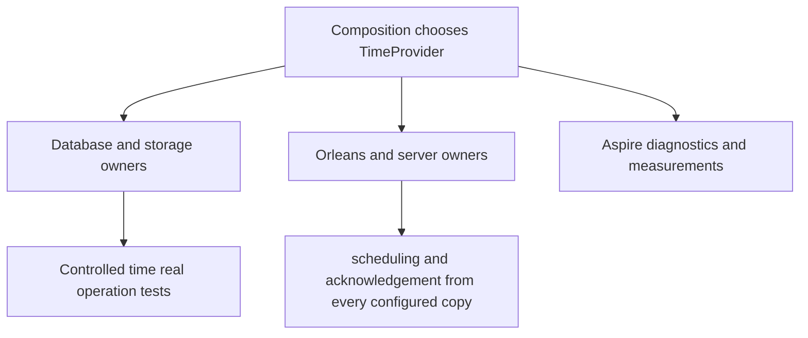

# ADR-115: TimeProvider ownership

Status: Accepted (implementation and qualification pending).
Date: 2026-10-06.

## Decision

Use execution .NET TimeProvider throughout KeyLoad-owned C# clock access. Execution owners borrow an injected or explicitly passed provider. Constructor defaults and process/DI composition roots may choose TimeProvider.System. UTC time uses GetUtcNow; durations use matching GetTimestamp/GetElapsedTime and TimestampFrequency. Relative delays and deadline cancellation use provider overloads; linked tokens retain cancellation and dispose every owned timer. Orleans timers/jobs stay under Orleans scheduling and persisted required-copy acknowledgementnowledged authority.

A controlled test clock is authorized by the owner for real operation tests; storage, authorization and transports remain real. No new dependency is required. Do not derive durations from UTC subtraction, change persisted timestamp formats, turn expiry into a caller-authorized effect, or claim a performance improvement from mechanical source refactoring.

## Implementation contract

[ResourceExecution TimeProvider](../Features/ResourceExecution/TimeProvider.md) owns REQ-TIME-001..005, AC-TIME-001..005, the exact source/test ownership and ordered stages. Public constructor/call-site additions do not change serialization identities or signed payload bytes. Optional provider parameters preserve current System defaults; injected clocks are borrowed, never disposed by a consumer. The current persisted format remains fixed. Rollout follows required gates; rollback restores a coherent current-format source checkpoint while retaining persisted data and journals. Review timer cancellation, registration and joined shutdown before accepting runtime changes.

## Verification

Canonical Release solution build and dotnet format; real TUnit analyzer/engine workflows through Aspire; required unit, process recovery and Docker cluster via real SDK/official MCP clients. Benchmark measurements remain original authenticated GitHub evidence. Source review is additional evidence, never a passing runtime gate. Status remains Accepted until required evidence exists.

## Exact current wall-clock projection

REQ/AC-TIME-KIND-001 preserves UTC/local DateTimeKind: borrowed GetUtcNow().UtcDateTime, GetLocalNow().LocalDateTime and local Date. DateTimeOffset uses GetUtcNow/GetLocalNow. System selection stays in composition; provider timezone review is separate from machine-local DateTime conversion. monotonic budgets/timers, original evaluated timestamps, explicit dates and parsing remain unchanged. Existing TimeProviderOperationTests and genuine Roslyn SystemClockSemanticTests own complete current command/replay/read-budget and compiler controls; no new scalar profile or claimed runtime gate. KeyLoad KLD0022 owns this rule independently of Prostir. Private implementation/test stage joins only through root with source/image/field/clock evidence.
### System-local projection versus provider-local offset

The exact DateTime.Now/Today replacement preserves machine-local DateTimeKind through LocalDateTime. This does not redefine an injected provider's timezone. GetLocalNow applies the provider's LocalTimeZone offset, whereas DateTimeOffset.LocalDateTime converts to the local system timezone. Preserve a custom provider's DateTimeOffset and review its owning domain before any DateTime projection; this stage changes no such persisted or signed clock field. Existing UTC stamps and monotonic budgets retain their own provider and units. See the execution [GetLocalNow contract](https://learn.microsoft.com/en-us/dotnet/api/system.timeprovider.getlocalnow?view=net-10.0) and [LocalDateTime contract](https://learn.microsoft.com/en-us/dotnet/api/system.datetimeoffset.localdatetime?view=net-10.0).
