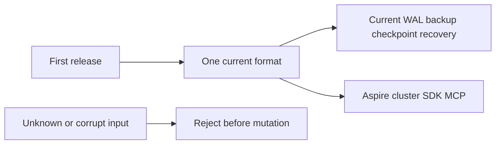

# ADR-116: one current format before the first release

Status: Accepted, 2026-10-06. Requirements and measurable acceptance:
[StorageRecovery CurrentFormat](../Features/StorageRecovery/CurrentFormat.md).

## Decision

Deliver and qualify one current database contract for the first release.
The root [data rules](../../AGENTS.md#data-authorization-and-integrations)
exclude persisted-data migration and legacy readers. Product completion
does not authorize adding such a path.

Deliver one strict current format. Remove obsolete old-format execution,
tests, preparation resources, settings, routes and active documentation together.
Keep current identity epoch7/WAL4/checkpoint5 bytes and Orleans serialization
unchanged. Preserve node-local ownership, current backup/restore, corrupt-format
rejection, signed-purpose fencing, process recovery and genuine Aspire cluster SDK/MCP.
Current stores are created with reader capability1 and magic `0x364449444C4B`;
reject an absent/zero/unknown capability and remove unmarked-store conversion.
Keep current outcome identity and locator integrity without old-key/old-frame
fallbacks. Remove configuration migration commands and prior-KeyLoad binary/image
compatibility fixtures; preserve external SQL protocol and actual current cluster
failure/authorization/lifetime operations. Qualification must bind current source,
runtime and original operation reports.

The linked feature is the implementation contract: ordered stages, exact module ownership, consumer audit, bounded whole-operation tests.

Current node-root admission is REQ/AC-EXECUTION-007.
The linked feature freezes exact optional current entries, pre-mutation rejection,
exclusive ownership and the second admission check before provider opens, with
real rejection/preservation/healthy-follow-up operations. Every node reads its own
local files with the single current-reader contract; a store with an absent, zero
or unknown reader capability is rejected before any mutation.

Rollout uses the current unreleased source on the intended current cluster topology.
No user stores are converted or deleted. Rollback restores a coherent source
checkpoint; it never opens current data with an unsupported reader. Future
released-format migration requires separate owner direction and an explicit ADR.

The complete current file no-mutation oracle is preserved under AC-EXECUTION-002/006. The test controls its live owner; the internal Storage.IO observation handle is read-only, validates regular-file identity and never acquires or releases the owner's advisory lock. It uses the validated storage buffer and reads all actual file bytes. The linked feature freezes this deterministic test boundary, original lock checks and full healthy follow-up. Concurrent-writer snapshot semantics and production lock bypasses are outside this contract.

Required verification is the enabled full Release build, formatter, governance,
analyzers, actual Aspire normal/scalar and real process recovery, followed
by exact-source Linux Docker/Aspire cluster and functional coverage. This ADR remains
Accepted until implementation, all mapped tests and delivery evidence exist.

## Verification: local-store corruption and repair

REQ-STORAGE-007/021 → AC-EXECUTION-001/002/005. Whole operations on real current stores
corrupt or alter one fixture-owned input, require the exact strict refusal
(Corruption or FormatUnsupported) with the complete recursive file inventory unchanged,
then restore only the captured original bytes after the rejected owner has settled. The
covered faults are a corrupt compacted checkpoint checksum, a missing identity file, an
unsupported identity version, an invalid or unsupported-signature journal frame and
checksummed invalid binary payloads of every typed shape. After each repair the same
owner must reopen with its exact original identity, reader capability and committed
position, return the literal original record, accept a distinct healthy write with a
one-position increment, and survive close/reopen with the complete raw key/value
inventory. The continuation then pauses dispatch, takes a backup, compares the complete
backup files before and after a restore through the unchanged API with a
genuinely new incarnation, signing authority and node identity, reopens the restored
owner twice, and rereads the original source authority. A successful snapshot install
retains source authority and increments only the read generation. No conversion, repair
API, adoption, alternative checksum or identity regeneration is introduced; no
production format, alias, field ID, default or quota changes. Process recovery and
cluster flows are independent mandatory gates, and local store evidence
qualifies neither them nor power-loss durability.
