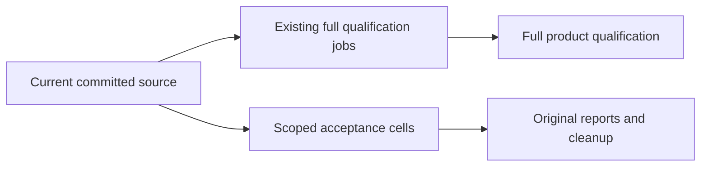

# ADR-117: Native TUnit CI entry

Status: Accepted; compilation and static verification passed, runtime qualification pending.

## Decision

CI starts native TUnit/Microsoft.Testing.Platform after build. TUnit fixtures use DistributedApplicationTestingBuilder, await readiness, execute real C# SDK/official MCP/native comparison clients and dispose the owned Aspire applications. Unit and recovery suites do not acquire an unnecessary cluster topology. Benchmarks remain in their separate pipeline. Native `--output Detailed` exposes original results during execution; no console-log file bridge or custom outcome counter is needed.

REQ-TUNIT-ENTRY-001: every CI suite and isolated benchmark workload invokes TUnit directly; infrastructure remains Aspire-owned within tests. AC-TUNIT-ENTRY-001: native command selections preserve project, filter, bounded parallelism, original TRX/coverage output and nonzero exit codes. AC-TUNIT-ENTRY-002: cluster coverage preparation executes as a TUnit session lifecycle using the existing Aspire preparation resource, propagates its verified original manifest and policy, joins output and cleanup, and does not recursively launch a test runner. Existing real fixture and workload tests remain mandatory Linux acceptance evidence.

The comparison host is a native TUnit workload case using the existing C# client library. Aspire still owns the pinned load-generator container and its dependencies; the container runs TUnit with Detailed output and copies its bounded original TRX into the cell qualification artifact. Native TRX stays separate from website measurement JSON archives. No package, storage, serialization or authentication contract changes. Rollback requires owner review. Static checks cannot establish runtime qualification.

## Isolated measurements and heavy load scheduling

REQ/AC-TUNIT-ENTRY-013/014 (execution rules in [NativeTUnitEntry](../Features/TestInfrastructure/NativeTUnitEntry.md)): the ordinary independent native default is 50 slots. Retain the original 20-slot results for real duration/resource comparison; configuration alone does not prove 50-case overlap. Comparison selections require one native test at a time and reject greater concurrency before startup; concurrent workload clients remain independently configured. Independent benchmark jobs keep their genuinely isolated Linux native topology and resources. Heavy functional ingestion/mixed-operation scenarios require a separate exclusive selection and no coverage contribution. No client workload, deadline, database format, API or provider change belongs to this scheduling stage. Native 1/10/500-client million-record and mixed-load complete-flow qualification remains open until implemented and executed.

## Scoped task acceptance

REQ/AC-TUNIT-ENTRY-010: independent acceptance scopes run as isolated Linux task/profile cells in the Build and Tests workflow with no cross-task dependency, no arbitrary concurrency cap and fail-fast disabled, while every full build, analyzer, unit, recovery, cluster and coverage job stays mandatory. A closed manual `task` input defaults to `all`; selecting a task executes standard repository governance plus only that task's cells. Default push/PR/manual-all preserves every full mandatory job. Scoped execution is sequential with the native TUnit slots for independently owned cases inside each scope; true shared-resource exclusions require an invariant audit before removal. Each cell discovers its native cases, retains source/DLL/PDB identities and original reports, and admits only the exact declared cases without retries or skips. The actual executor input determines scope; a focused green workflow cannot become full product or coverage evidence.

## Normal-only SIMD profile (REQ-CQ-SIMD-PROFILE-001)

Native SIMD execution is mandatory, so qualification has a single normal profile: the unit normal full census plus exactly five disjoint normal functional groups, recovery, all 11 cluster contributors and the unchanged required ordinary controls. The contributor registry is 49 Unit + 1 recovery + 11 cluster = 61 contributors. The three real test images (Unit/Recovery/Integration) are independently source/PDB/compile-receipt bound.

AC-CQ-SIMD-PROFILE-001 maps to the complete ProductionSourceManifestOperationTests native operation, the CLI profile refusal controls, the full native report/descriptor merge and the delivered normal functional collection; all preserve thresholds and genuine shutdown. The descriptor unitCensus has exactly the normal entry, run-status exactly one full normal run plus five groups, and suiteRuns exactly five groups plus recovery plus cluster; unknown keys, suites, status or profile reject before file acquisition under exact-key guards. The task profile accepts normal only. An inherited disabled-intrinsics environment is rejected before current work starts, and the original environment is restored in finally.

All report/TRX UID, source/PDB/image equality, maximumParallelTests 50, create-only, file/byte/path/reparse/inventory/refusal/disposal/charged-read and 80/70/90/noDecrease/repeated-input gates apply. No coverage or task acceptance follows from source, discovery or a partial selection.

Whole regression: NativeImagesProduceClosedManifestAndRejectTamperingWithoutReplacingEvidence performs native prepare, full literal inventory and compile identity checks, a failed edited input left unchanged, exact repair with healthy verify, create-only refusal, and an unsupported scalar contributor/image manifest refusal with unchanged exact repair. Native report merge, repeated input, read confinement, process settlement and cluster contributor controls remain in the complete selected operation set.

## Normal-only suite composition

TestSuiteProtocol and ProjectForSuite admit only analyzers/unit/recovery/cluster/comparison/site; any other suite name (including a former scalar suite) is unknown and refuses before resource creation. TestSuiteResources has no disabled-intrinsics runner branch. Native 50 ordinary / exclusive heavy 1 parallelism, comparison isolation 1, all project/argument/TRX/coverage/path selection and genuine Aspire preparation/readiness/clients/shutdown are unchanged. TestSuiteApplication, TestSuiteSettingsReader and the typed execution policy have no profile-specific behavior, so their cancellation, output/process joins and failure ledgers are byte-exact.

AspireTestEntryModelTests verify the complete six-suite model, the exact native argument/project/results shape and the absence of an injected disable environment. FilterIsOneNativeArgumentAndIsBoundedBeforeResourcesAreAdded refuses an unknown suite before its genuine healthy model; full negative and healthy controls/disposal remain. The default ordinary parallelism is 50, while the explicit rejected comparison configuration stays 20. This model lives in ComparisonTests and executes only through authorized GitHub Benchmarks. FunctionalTestParallelismTests/NativeTUnitSelectionTests normal controls and the final all-source compiler/format/native census remain mandatory.

No product, public or persisted ID or storage-format change, clock, deadline or resource increase. Current execution, coverage and Linux qualification stay OPEN until actual source/DLL/PDB/discovery/reports/cleanup bind; native source-path/count arithmetic is not a UID or PASS.
