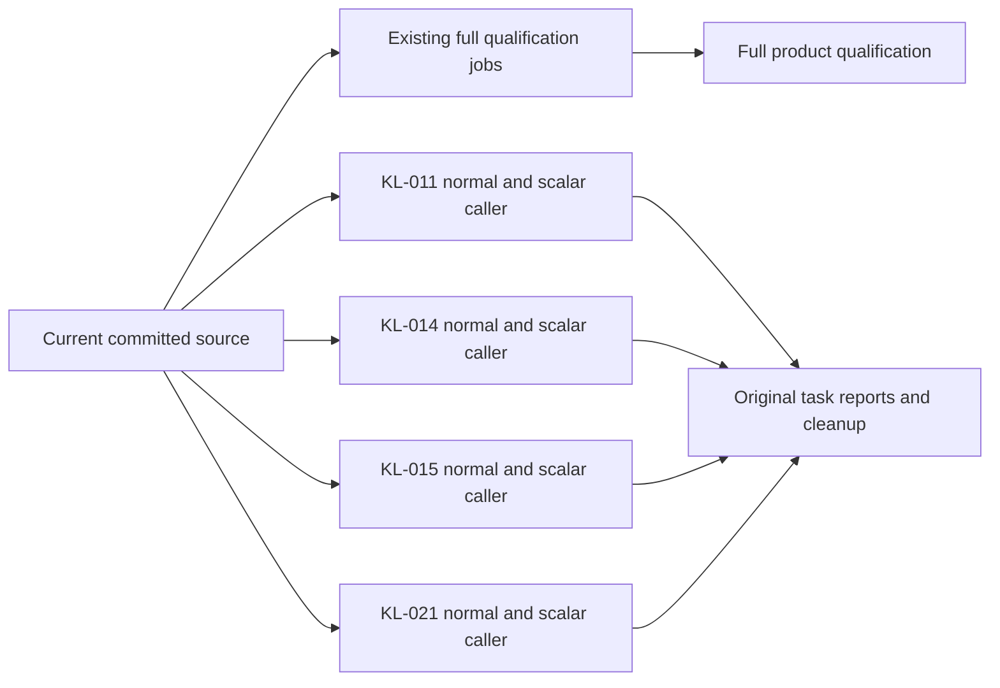

# ADR-117: Native TUnit CI entry

Status: Accepted; compilation and static verification passed, runtime qualification pending.

## Isolated measurements and heavy load scheduling (2026-10-09)

Owner clarification binds REQ/AC-TUNIT-ENTRY-013/014 in [NativeTUnitEntry](../Features/TestInfrastructure/NativeTUnitEntry.md). The latest explicit owner selection sets the ordinary independent native default to 50 slots. Retain the original20-slot results for real duration/resource comparison; configuration alone does not prove50-case overlap. Comparison selections require one native test at a time and reject greater concurrency before startup; concurrent workload clients remain independently configured. Independent benchmark jobs keep their genuinely isolated Linux native topology and resources. Heavy functional ingestion/mixed-operation scenarios require a separate exclusive selection and no coverage contribution.

TASK-TUNIT-ISOLATED-MEASUREMENTS-013 freezes this policy before source edits: scheduling worker updates the Node selector and typed AppHost selection with real selection regressions; root owns direct ComparisonHost container/process one-test arguments, docs, final review, canonical build/format and original native regression outcomes. Read-only inventory review verifies native measurement workers and workflow isolation. No client workload, deadline, database format, API or provider change belongs to this scheduling stage. Rollback removes the source delta only; prior qualification gates and this owner requirement remain. Native 1/10/500-client million-record and mixed-load complete-flow qualification remains open until implemented and executed.

Owner correction 2026-10-07 supersedes ADR-074's outer AppHost test-runner entry. CI starts native TUnit after build. TUnit fixtures use DistributedApplicationTestingBuilder, await readiness, execute real C# SDK/official MCP/native comparison clients and dispose the owned Aspire applications. Unit and recovery suites do not acquire an unnecessary RF3 topology. Benchmarks remain in their separate pipeline. Native --output Detailed exposes original results during execution; no console-log file bridge or custom outcome counter is needed.

REQ-TUNIT-ENTRY-001: every CI suite and isolated benchmark workload invokes TUnit directly; infrastructure remains Aspire-owned within tests. AC-TUNIT-ENTRY-001: native command selections preserve project, filter, scalar environment, bounded parallelism, original TRX/coverage output and nonzero exit codes. AC-TUNIT-ENTRY-002: RF3 coverage preparation executes as a TUnit session lifecycle using the existing Aspire preparation resource, propagates its verified original manifest and policy, joins output and cleanup, and does not recursively launch a test runner. Existing real fixture and workload tests remain mandatory Linux acceptance evidence.

Stages: TASK-TUNIT-ENTRY-001 records this correction; TASK-TUNIT-ENTRY-002 updates scripts/Features/TestInfrastructure native selection and CI callers; TASK-TUNIT-ENTRY-003 moves RF3 coverage preparation into IntegrationTests Features/CodeQuality/Lifecycle and verifies compilation and command syntax. Root owns all joins; no delegated roles. Feature specification: [NativeTUnitEntry](../Features/TestInfrastructure/NativeTUnitEntry.md), ../Features/TestInfrastructure.md and ../Features/BenchmarkComparisons.md.

No package, storage, serialization, authentication or workload contract changes. Existing AppHost model seams remain available to tests; their old CLI caller instructions are superseded. Rollback requires owner review because reinstating the outer caller contradicts the correction. Runtime tests and infrastructure must not be launched during this editing task at the owner's direction; static checks cannot establish runtime qualification.

TASK-TUNIT-ENTRY-004 replaces ComparisonHost's standalone Program with a native TUnit workload case and its existing C# client library. Aspire still owns the pinned load-generator container and WaitFor dependencies; the container runs TUnit with Detailed output and copies its bounded original TRX into the existing cell qualification artifact before deleting temporary report roots. Keep native TRX separate from website measurement JSON archives. This retains the isolated load-generator network/resource contract, rather than moving client execution onto a different machine. TUnit cancellation joins the existing bounded workload lifetime. Host process contract regressions pass their workload settings through configuration environment and retain native failure outcomes.

Current stage evidence: [NativeTUnitVerification](../Features/TestInfrastructure/NativeTUnitVerification.md). The existing status.json runtime gates remain unqualified; this editing stage cannot mark them passed.

TASK-TUNIT-ENTRY-005 implements REQ/AC-TUNIT-ENTRY-004 from NativeTUnitEntry by changing only the bounded aggregate `docker-rf3` job timeout from 60 to 180 minutes in `.github/workflows/build-and-tests.yml`. The complete same-image coverage cohort requires two full uninstrumented unit censuses, ten positive instrumented groups, native recovery/RF3 and strict descriptor/product admission, alongside the required RF3 suite and build. The observed unchanged local full unit census lasted 19 minutes 28 seconds; that failed development run informs scheduling and provides no acceptance or coverage evidence.

Stages are: freeze the linked requirement; join the workflow together with its source-bound native coverage producer and qualified unit inventory; parse the actual YAML/PowerShell; execute the original complete Linux job; retain all original exits, TRX, source/image hashes and coverage admission receipts. Root owns final integration and the agent's private workflow overlay. Every individual native deadline, bounded operation, coverage threshold, no-skip and fail-closed publication contract remains unchanged. Rollback removes the scheduling amendment and its overlay without admitting partial evidence. This amendment is Accepted, with complete Linux runtime qualification pending.

TASK-TUNIT-EARLY-RF3-DIAGNOSTICS-008 implements REQ/AC-TUNIT-ENTRY-008 from NativeTUnitEntry. The original ordinary RF3 test step has a stable `rf3-required` identity. After its native process and fixture cleanup return with success or failure, portable native `find` checks the actual result directory without following links and requires an existing nonempty TRX; missing reports fail that check before upload. Authenticated Linux run37835972588 retained the original 130-case partial TRX but its prior `rg` check exited127 because that executable was absent. Replace that check without changing test outcomes. The existing pinned artifact action uploads unchanged `TestResults/rf3-required/**` plus the original prepared source/image receipts to a separately named `docker-rf3-original-diagnostics` artifact before covered discovery/execution starts. Root owns docs-first workflow integration and actual GitHub provenance verification; agents may diagnose their real failed cases from that authenticated original archive.

The diagnostic archive does not replace or admit the final `docker-rf3-qualification` artifact. Existing full suites, collector ownership, final source/image verification, descriptor/product admission, thresholds, deadlines, outcome/cleanup behavior and permissions remain unchanged. No report transformation, extra test runner or synthesized status is introduced. Rollout is the next normal workflow source revision; rollback removes only the diagnostic upload. Native workflow/source syntax review and original successful upload with exact API/archive digest verification are required evidence. Status remains Accepted with current Linux verification pending.

TASK-TUNIT-COVERED-SHUTDOWN-IDENTITY-009 implements NativeTUnitEntry REQ/AC-TUNIT-ENTRY-009 and existing REQ/AC-TEST-010/014/015 and REQ/AC-CQ-039/040/042. Before shutdown, IntegrationTests Features/CodeQuality/Lifecycle/NativeCoverageRf3FixtureOwner retains a bounded copy of the actual fixture-selected three container names alongside successfully verified running container/image identities. ClusterReplication/Lifecycle/ClusterFixture/ClusterFixtureApplicationShutdown stops the actual application, then calls that same coverage owner without resolving services from the stopped application. The owner inspects the retained original names and exact original started identities under the existing absolute cleanup deadline. No alternative names, new process, duplicate application owner, ignored disposal error or inferred collector flush is admitted.

Ordered stages are the docs-first lifecycle contract, the two owning source changes, native solution build/format and current-source full covered RF3 verification with original artifacts. Root is the integration/compiler/Git owner; independent agents continue their feature scopes. The existing complete Q2 relational join and three join-budget SDK/official-MCP flows are the regressions, followed by unchanged full contributor/collector/descriptor/product merge gates. Original Linux run37821315110/attempt1/source3458 retains four failures from an IServiceProvider lookup after Stop. Rollout uses the next normal source/image cohort; rollback removes this paired lifecycle amendment, without any persisted-data or provider migration. Accepted; runtime qualification remains pending until genuine covered RF3 and exact-source checks pass.

TASK-TUNIT-PARALLEL-TASK-ACCEPTANCE-010 implements NativeTUnitEntry REQ/AC-TUNIT-ENTRY-010 after the owner's 2026-10-09 direction to run independent acceptance on GitHub concurrently. Add eight isolated Linux task/profile cells to the existing Build and Tests workflow, with no cross-task/full-suite dependency, no arbitrary concurrency cap and fail-fast disabled. Keep every existing full build, analyzer, unit/scalar, recovery, RF3 and coverage job. The exact KL-011/014/015/021 method/parameterized-case contract lives in `scripts/Features/CodeQuality/task-acceptance.contract.json`; these scoped artifacts cannot admit numeric product coverage or replace any complete suite.

Ordered stages: freeze this contract and the linked feature criteria; root prepares the canonical task inventory/workflow; session and security agents implement disjoint private native selection/discovery and original report admission files; root reviews and joins them, parses real YAML/PowerShell, commits the complete wave and pushes main; then owners authenticate and repair their exact-source Linux outcomes. Every cell prepares only the current genuine server image, compiles Release once, captures actual source/DLL/PDB identity, discovers its exact native selectors, executes complete native TUnit operations with Detailed output, verifies source/image after all children settle and joins its own image/fixture cleanup. Failed independent selectors do not suppress later selectors or become successful diagnostics; no retries, synthetic outcomes or skipped cases. Retain unchanged original census/process/TRX and image receipts with current GitHub run/attempt/SHA and pinned artifact uploads.

Keep existing 180-minute aggregate and 30/60-minute native selection budgets, actual fixture bounds and least privileges. Selected scopes are sequential, with 20 native TUnit slots for independently owned cases inside each scope under the owner's subsequent correction. True shared-resource exclusions require an invariant audit before removal. RF3 scalar cells cover the caller runtime only because the actual Docker server resources do not propagate `DOTNET_EnableHWIntrinsic`; never infer scalar server qualification. Dependencies are the existing native entry, actual test methods, current source/image producers and original native report contracts. Integration points are the root-owned task contract/workflow plus session-owned `task-acceptance.ps1` and security-owned `task-acceptance.verify.ps1`. Tests/evidence are every declared complete operation, exact discovery/TRX union, no skips, unchanged native identity and joined cleanup on the real committed Linux source. Rollout uses normal main push; rollback removes only additive task jobs/tooling, with no persisted-data migration or product contract change. Accepted; GitHub qualification pending.

The owner's subsequent 2026-10-09 clarification authorizes selected task-only iterations. A closed manual `task` input defaults to `all`; selecting KL-011, KL-014, KL-015 or KL-021 executes standard repository governance plus only that task's two cells. Default push/PR/manual-all preserves every full mandatory job and the full eight-cell task matrix. The workflow's actual executor input determines its scope; a focused green workflow cannot become full product or coverage evidence. No required final gate is bypassed. Root owns the bounded input/conditional join and source-bound review; task owners authenticate only their declared original outputs.

The native process helper's optional `ForwardToConsole=false` seam forwards each original admitted stdout/stderr chunk during execution from the existing owning reader, after capture under the same shared bound. Task selection enables it and removes post-exit duplicate writes; default callers remain unchanged. Console writer exceptions retain the original failure and enter existing tree/process/reader settlement. Session authors its guarded private `functional-coverage.native-merge.process.ps1` amendment; root joins after review and verifies real native output/exit/reader settlement. No parallel reader, custom counter, output rewrite or log-file polling bridge is introduced.

Before joining that helper, freeze its observed failure-settlement repair under the same REQ/AC-TUNIT-ENTRY-010: native tree termination precedes closing pending readers, by swapping only those existing owner actions. The genuine original overflow retained returned Dispose and Kill calls but a faulted stderr task and unjoined native exit; both original controls and initiating failures remain evidence. Repaired overflow and native-deadline flows must retain failed native exits and initiating errors, join and dispose every original owner, and complete a healthy Unicode stdout/stderr continuation using the same helper under unchanged bounds. Root reviews Session's actual before/after process originals; no internal runtime cause beyond observed states is asserted. Rollback of this amendment restores those two actions and forwarding behavior together; no product data or API changes.

Root also joins the source-provenance amendment to the four existing CodeQuality owners: shared, inventory, production-source-manifest and native-merge.files. A single closed case-sensitive predicate admits precisely the two task PowerShell files and their JSON contract; any other task-acceptance-prefixed name fails. Both native script producers and original-manifest admission reuse it, retaining the functional-coverage roster, `.dockerignore`, unchanged schema and all confinement/hash/reparse/output bounds. Security prepares the guarded private patch; root reviews and verifies actual source prepare/verify after the complete tooling join and before delivery. Task artifacts remain outside numeric coverage/product admission.

TASK-TUNIT-EMPTY-ORIGINAL-010 and TASK-TUNIT-ORIGINAL-REPRESENTATION-010 implement the original-admission contract under the same REQ/AC-TUNIT-ENTRY-010 and REQ/AC-CQ-039/040. Ordered stages: preserve the authentic fe8 failed jobs and original bytes; freeze the exact stream, environment and native-census versus TRX representations in NativeTUnitEntry; Security prepares a guarded private amendment to task-acceptance.ps1, task-acceptance.verify.ps1 and the existing functional-coverage.native-merge.trx.ps1; root reviews and joins those owners; exercise unchanged originals, strict altered-copy denials and healthy re-admission, then compile and deliver the coherent source for fresh Linux task execution. Zero-byte streams retain a non-null zero-length byte array, single results retain array cardinality, canonical class/method and exact instance bind separately, and both TRX definition/result displays must match the declared instance. Normal caller environment is truly absent, scalar is exactly 0, and the exact inherited state is restored. All bounds, source/image/UID/hash and complete case/outcome/counter/cleanup checks remain unchanged. No old job becomes passing through reinterpretation; the actual two failed scalar operations remain rejected. These are repairs to the existing tooling contract, with no new product boundary, persisted format, dependency or topology; rollback removes this coherent amendment without admitting partial evidence. Accepted; fresh exact-source Linux qualification remains required.

TASK-TUNIT-NATIVE-PARALLELISM-011 implements NativeTUnitEntry REQ/AC-TUNIT-ENTRY-011 after the owner's explicit request for 20 simultaneous tests inside TUnit. Root changes the native selector and centrally validated typed TestExecutionOptions default from8 to20, updates the existing whole selector operation regression, binds its actual unchanged case identities to the new source/PDB census and runs a coherent build plus focused independent operation batch with original timestamps. Task adapters pass20 rather than1. No native outcomes or concurrency percentages are synthesized. Original TRX start/end overlap demonstrates actual scheduling only for the executed independent batch; shared fixture/fault/global exporter invariants remain mandatory and blanket native exclusions need explicit source-backed audit. The existing64 supported ceiling and explicit invalid-limit rejection remain unchanged. Rollout is normal source delivery; rollback of the owner-required default needs explicit owner direction. No persisted-data, provider or product API changes. Accepted; exact native execution and Linux proof pending.

# TASK-CODEQUALITY-SIMD-NORMAL-ONLY-001

Owner 2026-10-11 SIMD-always correction supersedes active forced-no-intrinsics qualification. Related REQ/AC-TUNIT-ENTRY-001, current functional coverage identity/threshold/confinement and original native product acceptance retain all complete operations.

REQ-CQ-SIMD-PROFILE-001 requires a single current normal profile with native SIMD enabled, exact normal/full-group/recovery/RF3 source-bound inventories, and closed refusal of former scalar inputs without evidence replacement. AC-CQ-SIMD-PROFILE-001 maps to the existing complete ProductionSourceManifestOperationTests native operation, current CLI profile refusal controls, full native report/descriptor merge and delivered normal functional collection; all must preserve thresholds and genuine shutdown. ADR-117 owns this current profile schema/admission change; historical receipts are read only as immutable history, never by a current compatibility reader.

Scope: private CodeQuality PS/JSON producers, descriptor/merge/profile/report/contributor/task validators, independent native C# whole-operation assertions. Exclude workflows, run-tests.mjs, runtime/kernel/startup, root-owned ProductionSourceManifestScriptAssertions and NativeTestSelectionProcess/NativeTUnitSelectionTests. Root solely composes shared contract joins.

Current profile inventory becomes unit normal full census plus exactly five disjoint normal functional groups, recovery, all 11 RF3 contributors and unchanged required ordinary controls. Contributor registry is independently frozen 49 Unit +1 recovery +11 RF3 =61; remove only 49 scalar duplicates. Exact remaining operation identities/requirements/modules/state descriptions stay unchanged. The three real test images Unit/Recovery/Integration remain independently source/PDB/compile-receipt bound; redundant scalar Unit reference disappears.

Current descriptor unitCensus has exactly normal, run-status exactly one full normal +five groups, suiteRuns exactly five groups +recovery +RF3; unknown scalar keys/suites/status/profile reject before file acquisition under unchanged exact-key guards. Task Profile ValidateSet accepts normal only. Reject inherited disabled-intrinsics environment before launching current normal work, restore unchanged original environment in finally; do not manufacture historical profiles or accept scalar receipts through compatibility readers. Historical original evidence bytes/hashes remain untouched.

All remaining report/TRX UID, source/PDB/image equality, maximumParallelTests50, create-only, file/byte/path/reparse/inventory/refusal/disposal/charged reads and 80/70/90/noDecrease/repeated-input gates remain unchanged. No successful coverage or task acceptance from source/discovery or partial SELECT.

Whole regression: existing NativeImagesProduceClosedManifestAndRejectTamperingWithoutReplacingEvidence performs native prepare/full literal inventory and compile identity checks, failed edited input unchanged, exact repair/healthy verify and create-only refusal. Deepen same operation with actual unsupported scalar contributor/image manifest refusal and unchanged exact repair; no property-only tests. Existing native report merge/repeated input/read confinement/process settlement/RF3 contributor controls remain in complete selected normal operation set. One complete owning batch compile/normal execution after all edits; root integrates then delivered Linux required. No new scalar runs. Rollback only this current normal-only schema admission change under owner direction; no legacy reader.

## TASK-TEST-APPHOST-NATIVE-SIMD-001 — current normal-only suite composition

Owner2026-10-11 mandatory native SIMD supersedes every earlier active unit-scalar/runner-disabled-intrinsics clause, including REQ/AC-TEST-009 and historical suite examples. Immutable original scalar reports remain history, never current qualification. Current TestSuiteProtocol and ProjectForSuite admit only analyzers/unit/recovery/rf3/comparison/site; former unit-scalar is unknown and refuses before resource creation. TestSuiteResources removes only its explicit DOTNET_EnableHWIntrinsic=0 runner branch; native50 ordinary/exclusiveheavy1, explicit supported parallelism, original comparison isolation1, all project/argument/TRX/coverage/path selection and genuine Aspire preparation/readiness/clients/shutdown remain unchanged. No old ignored alias, scalar alternate or limits/configuration fallback.

Native audit proves TestSuiteApplication, TestSuiteSettingsReader and typed execution policy have no scalar-specific behavior, so their cancellation, output/process joins and failure ledgers remain byte-exact. Existing AspireTestEntryModelTests same declarations verify the complete six-suite model, exact native argument/project/results shape and absent injected disable environment. FilterIsOneNativeArgumentAndIsBoundedBeforeResourcesAreAdded now refuses old unit-scalar before its original genuine healthy model; full negative and healthy controls/disposal remain. Its independent default ordinary literal is50, while the explicit rejected comparison20 configuration remains independently20. This source-owned model remains in ComparisonTests and executes only through authorized GitHub Benchmarks under its local policy; no local benchmark workload is started. Existing FunctionalTestParallelismTests/NativeTUnitSelectionTests normal controls and final all-source compiler/format/native census remain mandatory.

Ordered source owners: this spec/local AppHost policy/ADR first; exact protocol and selection retirement; resource branch retirement; original complete model assertions. Root alone joins/builds/executes live inputs. No product/public/persisted ID or storage-format change, migration, clock/deadline/resource increase. Rollback cannot reinstate the superseded scalar mode; preserve originals and repair the same normal-native contract. Current execution/coverage/Linux qualification is OPEN until actual source/DLL/PDB/discovery/reports/cleanup bind. Native source-path/count arithmetic is not UID or PASS.
