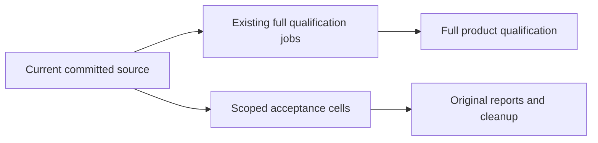

# ADR-117: TUnit CI entry

Status: Accepted; compilation and static verification passed, runtime qualification pending.

## Decision

CI starts TUnit/Microsoft.Testing.Platform after build. TUnit fixtures use DistributedApplicationTestingBuilder, await readiness, execute real C# SDK/official MCP/comparison clients and dispose the owned Aspire applications. Unit and recovery suites do not acquire an unnecessary cluster topology. Benchmarks remain in their separate pipeline. Execution `--output Detailed` exposes original results during execution; no console-log file bridge or custom outcome counter is needed.

REQ-TUNIT-ENTRY-001: every CI suite and isolated benchmark workload invokes TUnit directly; infrastructure remains Aspire-owned within tests. AC-TUNIT-ENTRY-001: command selections preserve project, filter, bounded parallelism, original TRX/coverage output and nonzero exit codes. AC-TUNIT-ENTRY-002: cluster coverage preparation executes as a TUnit session lifecycle using the existing Aspire preparation resource, propagates its verified original manifest and policy, joins output and cleanup, and does not recursively launch a test runner. Existing real fixture and workload tests remain mandatory Linux acceptance evidence.

The comparison host is a TUnit workload case using the existing C# client
library. The separate LoadTests AppHost owns selected database infrastructure and
exposes actual endpoints; tests start the workload client outside its
resource graph, retain Detailed output and original TRX, and join its real
completion and readers before disposing infrastructure. Ordinary execution has no
KeyLoad/workload-client image prerequisite. TRX remains separate from
benchmark result files. Static checks establish no runtime qualification.

## Isolated measurements and heavy load scheduling

REQ/AC-TUNIT-ENTRY-013/014 (execution rules in [TUnitEntry](../Features/TestInfrastructure/TUnitEntry.md)): the ordinary independent default is 50 slots. Retain the original 20-slot results for real duration/resource comparison; configuration alone does not prove 50-case overlap. Comparison selections require one test at a time and reject greater concurrency before startup; concurrent workload clients remain independently configured. Independent benchmark jobs keep their genuinely isolated Linux topology and resources. Heavy functional ingestion/mixed-operation scenarios require a separate exclusive selection and no coverage contribution. No client workload, deadline, database format, API or provider change belongs to this scheduling stage. 1/10/500-client million-record and mixed-load complete-flow qualification remains open until implemented and executed.

## Scoped task acceptance

REQ/AC-TUNIT-ENTRY-010: independent acceptance scopes run as isolated Linux task/profile cells in the Build and Tests workflow with no cross-task dependency, no arbitrary concurrency cap and fail-fast disabled, while every full build, analyzer, unit, recovery, cluster and coverage job stays mandatory. A closed manual `task` input defaults to `all`; selecting a task executes standard repository governance plus only that task's cells. Default push/PR/manual-all preserves every full mandatory job. Scoped execution is sequential with the TUnit slots for independently owned cases inside each scope; true shared-resource exclusions require an invariant audit before removal. Each cell discovers its cases, retains source/DLL/PDB identities and original reports, and admits only the exact declared cases without retries or skips. The actual executor input determines scope; a focused green workflow cannot become full product or coverage evidence.

## Normal-only SIMD profile (REQ-CQ-SIMD-PROFILE-001)

SIMD execution is mandatory, so qualification has a single normal profile: the unit normal full census plus exactly five disjoint normal functional groups, recovery, all 11 cluster contributors and the unchanged required ordinary controls. The contributor registry is 49 Unit + 1 recovery + 11 cluster = 61 contributors. The three real test images (Unit/Recovery/Integration) are independently source/PDB/compile-receipt bound.

AC-CQ-SIMD-PROFILE-001 maps to the complete ProductionSourceManifestOperationTests operation, the CLI profile refusal controls, the full report/descriptor merge and the delivered normal functional collection; all preserve thresholds and genuine shutdown. The descriptor unitCensus has exactly the normal entry, run-status exactly one full normal run plus five groups, and suiteRuns exactly five groups plus recovery plus cluster; unknown keys, suites, status or profile reject before file acquisition under exact-key guards. The task profile accepts normal only. An inherited disabled-intrinsics environment is rejected before current work starts, and the original environment is restored in finally.

All report/TRX UID, source/PDB/image equality, maximumParallelTests 50, create-only, file/byte/path/reparse/inventory/refusal/disposal/charged-read and 80/70/90/noDecrease/repeated-input gates apply. No coverage or task acceptance follows from source, discovery or a partial selection.

Whole regression: ImagesProduceClosedManifestAndRejectTamperingWithoutReplacingEvidence performs prepare, full literal inventory and compile identity checks, a failed edited input left unchanged, exact repair with healthy verify, create-only refusal, and an unsupported scalar contributor/image manifest refusal with unchanged exact repair. report merge, repeated input, read confinement, process settlement and cluster contributor controls remain in the complete selected operation set.

## Normal-only suite composition

`scripts/Features/TestInfrastructure/run-tests.mjs` admits only
analyzers/unit/recovery/cluster/site. Other suite names are rejected. Ordinary TUnit
execution uses 50 parallel tests; the explicit heavy-load selection uses one.
The selector preserves bounded original arguments, TRX and coverage settings.

Real distributed fixtures use `TUnit.Aspire` and the current AppHost. TUnit owns
initialization and disposal; the owning fixtures retain actual process readiness,
abrupt-fault and joined-cleanup evidence. Benchmark jobs run
`benchmarks/KeyLoad.ComparisonHost` separately in the Benchmarks workflow.

No product, public or persisted ID or storage-format change, clock, deadline or resource increase. Current execution, coverage and Linux qualification stay OPEN until actual source/DLL/PDB/discovery/reports/cleanup bind; source-path/count arithmetic is not a UID or PASS.
