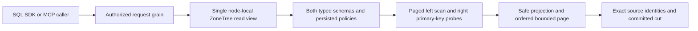
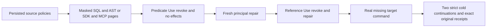

# ADR-118: bounded typed-row INNER JOIN

Status: Source joined with local operation evidence; public cluster, complete negative inventory and original Linux qualification pending. Date: 2026-10-07. This is a first operator slice under existing REQ-REL-004 and REQ-QUERY-007; it does not close either requirement or the full SQL workstream.

[ADR-149](ADR-149-no-operation-limits.md) governs operation bounds: the join has no scan, read-byte, result-count or result-byte ceiling.

## Product boundary

Implement one read-only SQL INNER JOIN for two typed relational Collection resources inside the single PartitionRef already present in a query request. The left relation is an explicitly opted-in bounded collection scan. For each visible left row, the executor probes the right relation by its declared non-null Text primary key through the existing canonical document key. The left join column must also be declared Text. The right source column in ON must be exactly the right table's declared primary-key column. This is a primary-key indexed nested-loop join; it does not require a new secondary index encoding or another storage engine.

Accepted exact form (aliases and projected names are identifiers, values are data, and this first form has no WHERE):

    SELECT l.order_id AS order_id, r.id AS customer_id, l.total AS total
    FROM orders AS l INNER JOIN customers AS r ON l.customer_id = r.id
    ORDER BY l.order_id ASC LIMIT 100

The left ORDER BY path must equal the left schema primary key and be ascending. The executor orders the bounded result with ordinal string comparison on that key; it MUST NOT assume ZoneTree/KeyCodec byte order equals SQL string order. Since each left primary key is unique and each right primary-key probe returns at most one visible row, the ordering has no ties. LIMIT uses the existing query limit validation/default and is applied after deterministic ordering. AllowFullScan=true is mandatory because the left source is scanned. Caller cancellation, the explicit request expiry, the query `Limit` and concurrent-query admission bound the operation; add no join-specific default or cap.

Only two different collection names, two distinct identifier aliases, one INNER JOIN, one equality predicate, explicit non-star projection, unique output aliases, one primary-key ascending order term and the existing bounded limit are admitted. Projection is top-level declared relational columns only. Join key values compare only as exact text: no cast, collation override, normalization, expression, or implicit coercion. A missing/null left join key and an unmatched key produce no pair, as required for an inner equality join. Tombstoned or row-denied records never produce output. Reject LEFT/RIGHT/FULL/CROSS, comma joins, self-join, multiple joins, WHERE, GROUP BY, aggregation, subquery, USING/NATURAL, non-PK right key, non-text key, SELECT *, duplicate aliases, descending/non-PK ordering, EXPLAIN, model/event/queue sources, and any cursor explicitly before storage scanning. Rejection is a fixed safe UnsupportedCapability or Validation outcome according to the existing parser/validation category; never fall back to client evaluation or a broader scan.

## Versioned request, AST, and result shape

Keep unified SQL envelope SqlOperationProtocol.Version=1, existing Q1 scalar SQL, AST1, routes, operation names, and all existing field numbers/aliases intact. Add explicit query-language selection:

- Append QueryDialectVersion (field ID 5, default 1) to QueryRequest; value 1 preserves Q1 and value 2 opts into the closed Q2 subset.
- Append QueryDialectVersion (field ID 6, default 1) to SqlOperationRequest; its existing outer envelope Version field ID 5 remains 1. The server SQL compiler forwards this value to the canonical QueryRequest.
- Add the optional typed InnerJoin member as field ID 8 on SelectQuery. Q1/AST1 require it to be absent. Q2 join AST requests use AstVersion=2; AST1 remains unchanged and rejects join metadata. Q2 is the explicit superset for Q1 plus this single operator, not a promise of complete SQL.
- Add source-alias fields only additively: Selection.SourceAlias at ID 2; the join clause stores right collection/right alias/left key path/right key path. Existing selection IDs 0–1, SelectQuery IDs 0–7, and all existing serialized contracts stay unchanged. Add a stable alias for the new join contract in ContractAliases; never repurpose or renumber an alias/field.
- Add QueryDialectVersion=2 / a stable Q2.InnerJoin capability profile to the existing capability manifest. Existing Q1 adapters and every prior capability stay present. Capability/schema tests prove Q1 is unchanged, Q2 is explicit, and unsupported version/shape fails closed.
- Preserve QueryPage and QueryRow existing fields/IDs. Append QueryRow.Sources at field ID 5, null/omitted on every existing Q1 row. Add a generated aliased QueryRowSource value containing exact source alias, entity ID, and revision. A Q2 pair row keeps EntityId and Revision as the left row's identity and includes exactly two Sources entries in declaration order (l, then r) so the pair is unambiguous. Json is a flat JSON object containing only explicitly projected output aliases; duplicate aliases reject before scan. Redacted is true if either source projection redacted fields; RedactedFields uses source-qualified paths such as l.ssn and r.ssn. QueryPage.CutPosition is the cut captured inside the owning view; AccessPath is a stable bounded-primary-key-join profile; Cursor is always null and any supplied cursor rejects.

The exact current HTTP/SDK query response and official MCP keyload_query_execute / keyload_sql_execute result must serialize the same QueryPage/QueryRow shape. No new route, dispatcher, grain, caller role, SQL protocol claim, or private extension result is introduced.

## Read, authority, execution, and resource contract

QueryEngine counts the operation once as an analytical read and constructs one ReadExecutionBudget from the request cancellation token and explicit expiry. It calls existing DatabaseEngine.WithQueryView for the left collection; inside that single Store.Read view it loads the persisted principal and left resource, then requires Capability.Query | Capability.DocumentsRead for the right collection and resolves it with DatabaseEngine.Resource(view, partition, name, ResourceKind.Collection). Both resource resolutions validate transaction-domain equality. Both persisted relational schemas and the typed key declarations, all query-field-use requirements (including both join keys and the order field), and input/projection aliases are validated before the first document scan or point read. Client-supplied roles have no effect.

The executor pages through the complete canonical left collection prefix from DocumentStorageKeys.Prefix through the existing view, in storage range pages. For each live row that passes Authorization.CanReadRow, it probes the right primary key with DocumentStorageKeys.RecordKey and ReadExecutionBudget.ReadRecord<DocumentRecord>. Every scan step and probe checks cancellation and the explicit expiry; no scan, probe or byte count is kept. No result is disclosed unless both left and right records pass their persisted row ACLs.

Both rows are projected using the existing DatabaseEngine.Project(principal, resource, row) on that same view before the selected values are assembled. This preserves per-resource field redaction and canonical JSON; the output assembler qualifies redaction metadata by alias and never returns a raw unprojected row. Sorting retains at most offset plus limit pairs, compares left primary-key strings ordinally, and checks cancellation/deadline at each scan/probe/sort/projection phase. The page is not measured and has no byte ceiling. No streaming/materialization beyond the existing bounded page, no hidden retry, no second read cut, and no work after the read callback.

The page cut is captured from database.Store.Position inside the same WithQueryView callback before reads; because all rows and resource metadata are read under one Store.Read gate, the result is one local committed cut. This does not claim a cross-node global snapshot or power-loss durability. Replication acknowledgement stays with the ordinary Orleans write path; the join adds no cross-partition reads and runs in the connection-owned execution grain ([ADR-125](ADR-125-connection-owned-execution.md)).

## Stable criteria under existing requirements

These are subcriteria for existing REQs, not new product REQs:

- AC-REL-004-JOIN-001: exact Q2/AST2 positive shape compiles; Q1/AST1 and all unsupported join variants preserve their existing behavior and reject unsupported inputs before storage access.
- AC-REL-004-JOIN-002: same-partition typed-row join returns only exact text-key matches, ordered by ordinal left primary key, with explicit output aliases and exact Sources identity metadata; null/missing/unmatched, deleted, and row-denied cases emit no pair.
- AC-REL-004-JOIN-003: persisted Query/DocumentRead, both resource transaction domains, both row ACLs, both join-key field-use policies, safe projection/redaction, and no-disclosure error behavior are demonstrated with real persisted policy.
- AC-REL-004-JOIN-004: caller cancellation and an elapsed explicit expiry fail closed with no partial page and no persisted change; candidate retention stays within offset plus limit; there is no scan, raw-byte, result-count or result-byte ceiling and no join-specific default.
- AC-REL-004-JOIN-005: SQL/AST capability manifests, serialization, HTTP SDK, and official MCP expose the same explicit versioned result and keep every Q1 contract/output unchanged.
- AC-REL-004-JOIN-006: actual whole-operation cluster SDK + official MCP read-after-write flow, denial/error with unchanged persisted rows, successful healthy follow-up, and recovery/reopen result are verified. Exact-source Linux qualification remains pending until authentic artifacts exist.
- AC-QUERY-007-JOIN-001: declares the supported Q2/AST2 operator and exact unsupported cases; no silent client evaluation, partial/cross-shard execution, cursor, or global snapshot claim.
- AC-QUERY-007-JOIN-002: real QueryEngine and public callers prove the single persisted authorized read cut, deterministic pair order, exact source identity/redaction, cancellation, the `Limit` bound, and safe failure behavior.

An integration test must seed both schemas and rows through real SDK commits, read through SDK plus official MCP, compare exact Rows, Sources, AccessPath and JSON, and assert each cut is at/after the seed commit. A deterministic concurrent cluster scenario uses one atomic command to move a left reference and update the matched right generation; every observed join must show one consistent generation pair. Persisted identities lacking right Query/DocumentRead or field-use permission must be rejected without disclosing values, and an administrator query afterward must return the original expected rows. Unit cases use real ZoneTree and test actual store close/reopen; the cluster suite reopens by its owning test fixture/process recovery flow only if that exact scenario is supported by existing harness, otherwise keep reopen evidence in the real ZoneTree unit flow and report cluster process restart as a separate gate. Denial, malformed-input and cancellation flows are read-only, assert exact existing error categories and no persisted state change, then run a healthy query.

## Deliberately open scope

This stage does not implement or qualify arbitrary/multiple joins, self-joins, non-primary right indexes, cross-partition or federated joins, outer/cross joins, filters on joined sources, derived tables/subqueries, aggregate/group/window expressions, DML, foreign keys, checks, defaults, cascades, constraint deferral, distributed snapshots, resumable join cursors, generalized typed AST predicates over source aliases, full SQL grammar, PostgreSQL wire protocol, or a standard SQL client connection protocol. These remain required product work; they need their own bounded contracts/ADRs and measurements. REQ-REL-004, REQ-QUERY-007, full SQL syntax and protocol remain open after this slice. Do not update status to Implemented or advertise full SQL.

## Implementation ownership

1. This ADR and the current owning RelationalStorage.md / QueryExecution.md requirement mappings are frozen first.
2. Abstractions owns `src/KeyLoad.Abstractions/QueryExecution/Contracts/QueryAst.cs`, the new `InnerJoinClause.cs`, `QueryRequest.cs`, `SqlOperationContracts.cs`, `QueryRow.cs`, the new `QueryRowSource.cs`, `ContractAliases.cs` and the Query capability manifest contracts, appending fields without changing existing IDs or aliases.
3. Query owns `src/KeyLoad.Query/QueryExecution/Execution/SqlParser.cs`, `SqlSyntax.cs`, `SqlTokenizer.cs` only if needed, `Validation/QueryValidation.cs`, `Validation/QueryFieldAuthorization.cs`, `Contracts/QueryCapabilityCatalog.cs`, `Queries/QueryEngine.cs` and the new relational join executor.
4. Server/API updates `src/KeyLoad/QueryExecution/Queries/SqlOperationCompiler.cs` to forward the dialect version. Existing QueryApi, GrainQueryReadCapabilities, route, SDK send path, MCP query operation and official SDK registration remain the same unless source review shows otherwise.
5. Unit tests add `tests/KeyLoad.FunctionalTests/QueryExecution/Cases/SqlInnerJoinContractTests.cs`, `SqlInnerJoinExecutionTests.cs` and a feature-local fixture only if the existing TestDatabase cannot express a real store reopen; each type stays within local policy and uses real stores.
6. Use the existing ClusterFixture, SDK and official MCP APIs; no fake nodes, application-side join or manually started containers.
7. Failed or missing gates remain open; local source review does not qualify product behavior.

## Required operation-level tests

Unit, real ZoneTree:
- exact 2-table match and multiple left rows that point to one or more right PKs; verify exact ordinal pair order, aliases, source IDs/revisions, cut and explicit projection; insert in reverse/random order to prove result order is SQL ordinal, not byte order.
- null/missing/unmatched left key, deleted row, denied left and denied right row; each omits output. A nullable/redacted column remains safe in JSON and RedactedFields is correctly alias-qualified.
- both resource permissions, both join-field-use permissions, missing/wrong-kind/untyped resource, cross-domain resource, wrong join type/right non-PK, missing full-scan consent, duplicate aliases, star, invalid versions, all unsupported join forms, supplied cursor; each rejects before scanning where applicable and never returns raw payload.
- operation expiry/cancellation during the left scan and right probes, and an actual successful query after each rejected/canceled call.
- concurrent atomic writer toggling paired generation values while queries execute; every returned pair shows the same generation. Close/reopen a real store and repeat the exact expected join and identities.

Real cluster, existing AppHost-owned fixture:
- configure both typed schemas and seed cross-table rows with authenticated SDK command operations; query through KeyLoadClient.QueryAsync and official MCP keyload_query_execute (and unified SQL MCP adapter if existing wrapper is the intended target) with dialect 2; assert same complete page, row JSON, pair identities, access path and cuts after the seed commit.
- use a persisted principal with left-only and then missing join-key field use; SDK and official MCP receive safe PermissionDenied, no source values leak, all seeded state stays unchanged, then admin reruns and gets exact expected result.
- concurrently commit an atomic generation/reference update on one request while cluster reads execute; only whole old or whole new joined generation is allowed. Assert normal acknowledgement from every configured copy via the existing fixture; no new topology or durability claim.
- cancellation is visible as a typed safe error, settled through the existing SDK/MCP path, and followed by a successful admin read. Actual recovery/reopen flow stays with the existing process-recovery/AppHost fixture; do not claim a test fixture rebuild is a process restart.

The exact additive request/result shape is frozen before scoped source work. This stage leaves the parent relational/full SQL requirements open.

## Implementation refinements

One current SELECT and AST format supports scalar, model and bounded inner-join
operations. With no join, source-alias metadata must be absent. Invalid join
shapes and any noncurrent format value reject before operation execution.
The SQL, JSON and C# surfaces use the same query format and execution semantics.

The capability manifest publishes the current AST format. Its
`SupportedAstVersions` at ID16 and `SupportedQueryDialectVersions` at ID17 each
contain exactly [1]. The inner-join profile describes an available operation,
not a second language or an older execution path.

Use `JsonIgnore(Condition = WhenWritingNull)` on QueryRow.Sources and other new
optional join members so current non-join row bodies omit new null metadata.
The common typed public SDK/MCP schema intentionally adds the optional join
metadata; existing schema properties, required members, type sets and hints stay
current. schema oracles must include the exact optional extension and its
two-source bounded item shape, based on actual official SDK output. Q1 result
bodies and operations remain unchanged; do not claim the common typed schema is
byte-identical after adding a public member. Preserve every current generated
serializer alias/field ID and add only new explicit aliases.

Require field-use authority for both join keys and the left ordering key before
scanning. Project selected values through existing field-read/redaction rules;
a projected-only field does not gain a new unconditional field-use requirement.
Validate declared columns and unique aliases first. Do not expose a right probe
or projected source unless both row ACLs permit it. Define a redacted projected
value using the current safe omission/null semantics and qualify its metadata by
source alias without returning raw source JSON.

Retained candidates, including strings/projection/identity metadata, stay
bounded by the requested deterministic offset plus LIMIT candidates. Never assume
key order equals SQL ordinal text order. Cancellation/deadline checks
must preserve their original typed error even if sorting callbacks throw; do
not allow a library wrapper exception to become a fabricated Validation result.
LIMIT is ordinary SQL truncation and not a continuation.

The exact source map permits cohesive feature-local files prefixed SqlInnerJoin,
RelationalInnerJoin or RelationalJoin under the declared roles when required by
200-type/64-method limits; no partial-type bypass or repository-wide layer.
Existing current conformance cases which use version2 as the formerly unknown
control must move that negative control to unknown version3 while preserving
their complete-operation assertions. QueryApi/SDK/Orleans transport stays shared;
only exact optional-schema conformance assertions in the existing Integration
QueryExecution/ClientApi slices may join the additive metadata changes. All
other expansion requires root source-map review before code.

Rollout is one homogeneous current-source cluster image and the existing public routes, with explicit language/AST selection. Rollback removes this operator, new optional members/profiles and matching tests together; no persisted data, replication/atomic journal format or deployment topology changes. No old-format reader, migration, compatibility fallback, FK promise, full SQL or SQL client protocol qualification is introduced.

## Superseding finite extension: Q2.InnerJoin.LeftPredicate

The initial no-WHERE profile above remains Q2.InnerJoin history and its unfiltered contract. REQ/AC-QUERY-JOIN-FILTER-001..003 extend the same AST2/dialect2 with all normalized existing safe predicates over declared top-level LEFT relational columns, with literals and bound scalar parameters. Existing IN/parameter bounds remain; no artificial one-parameter cap. Current field Use and referenced parameter validation precede document scans/probes. Predicate evaluation uses PredicateEvaluator after LEFT row ACL; false/unknown eliminates the right probe, never the LEFT scan. Projection and Sources/redaction/read-cut/result/cold authority stay and unchanged. Right/nested/metadata fields remain unsupported before IO; model-source/cross-model SELECT JOIN and arbitrary expressions remain open.

A literal left-source WHERE is a real positive full operation; its negative fixture uses an actually unsupported right-source predicate, with every no-effects/healthy assertion. The new SqlLeftFilteredJoinTests/LeftFilteredJoinClusterTests carry literal+parameter/logical parity, raw unchanged source/cut, persisted field policy denial/repair/redaction/revoke, cancelled caller, original seed receipt and two strict cold continuations. Current-source UID/compiler/runtime/cluster/Linux gates are pending; source review alone is not qualification.

## Additive finite queue-reference join

Q2.QueueEntityRefJoin extends the existing version2 AST without aliases/field-id/public DTO changes. The one left queue model source uses the existing WithModelQueryView/VisitModelQueryRows owner; its original gate and budget remain authoritative. Only q.payload.to = d.entity_ref is lowered to a complete validated canonical reference and the existing DocumentStorageKeys point read. The declared right collection is independently authorized and validated before selection. No alternate scanner, dispatcher, storage provider, reference decoder or full SQL claim is created.

Left predicates reuse bounded normalization and PredicateEvaluator. Queue field/header policies are rebased through existing ModelQueryPolicies; right document row and safe projection policies remain execution. Synthetic virtual queue RowAccess cannot replace actual queue scope authority. A false predicate eliminates its probe. Missing/null/row-denied rows are omissions; malformed/mismatching references and unconfigured declarations are refusals, never manufactured empty pages. Original id/revision/source/redaction/cut/result bounds are retained.

REQ/AC-QUERY-QUEUE-SELECT-001..003 map to the two complete operation cases in QueryExecution, with original receipts, actual persisted grant repair and two strict cold continuations. Source proposals alone do not qualify compiler/runtime/UID/cluster/Linux gates.

## Explicit right predicate alias refusal

REQ/AC-QUERY-JOIN-ALIAS-001 closes a parser-origin ambiguity: preserve the current declared right alias inside the expression parser and refuse right-qualified operands before lowering left paths. An alias named payload or headers cannot acquire left-source meaning. Existing left-qualified nested roots and unqualified left semantics remain supported. This is a causal UnsupportedCapability guard, not implementation of right-side WHERE or a new serialized AST contract.

## Event-reference SELECT extension

Event-source INNER JOIN is admitted only for the closed Q2.EventEntityRefJoin shape in REQ/AC-QUERY-EVENT-SELECT-001..003. Reuse retained stream generation/contiguous-history/event-id checks and the single-view operation budget (cancellation and explicit expiry). Full canonical reference resolves only the declared typed target; revision order, fresh field Use even on empty stream, no remote probe and all current authority remain mandatory. Source-only tests/compiler/cluster/Linux are distinct; no aliases/IDs/defaults/storage format or compatibility path changes.

## Composed projection lineage qualification

REQ/AC-QUERY-COMPOSED-LINEAGE-001 and REQ/AC-QUERY-COMPOSED-PLAN-001 add whole-operation qualification for existing source-aware SQL/AST projections. Use authority to resolve a canonical reference does not grant Read authority to expose its nested fields. Project current persisted policies independently on both original source records before scalar selection; preserve explicit aliases and exact redaction/source metadata. No new right-predicate capability or serialized contract is introduced. Masked/forged/current-policy/repair/replay/cold proof remains separate from compiler and authentic cluster/Linux qualification.

## Composed projection and predicate authority
REQ-QUERY-COMPOSED-LINEAGE-002 / AC-QUERY-COMPOSED-LINEAGE-002: Preserve the original single Unit declaration and all forged-source/no-effect/seed+repair-replay/two-cold assertions. Add a genuine queue score field policy with independent score.read and score.use. Current reference Use permits resolution without reference Read; each source projection masks only its denied fields. Revoking predicate Use while keeping predicate Read and reference Use must refuse PermissionDenied without changing complete source bytes or cut. Repair the persisted principal with a higher epoch, then independently revoke reference Use and repair it. Current source aliases remain explicit; right WHERE remains unsupported before left lowering. No production changes are justified by this acceptance gap.
REQ-QUERY-COMPOSED-PLAN-002 / AC-QUERY-COMPOSED-PLAN-002: ComposedProjectionLineageClusterTests uses the existing Aspire ClusterFixture and actual SDK ExecuteSql/official MCP Sql tool, persisted resource+principal updates and original QueueReferenceSelect corpus. Independently assert every projected field, both source identities/revisions, ordinal order, redaction metadata and bounded page before transport parity. Predicate/ref-use refusals and forged right WHERE must retain all original source documents, all queue metadata/payload/headers, and exact original seed receipt replay. Repair the missing target with a genuine acknowledged command; preserve the seed receipt at the first same-volume all-node cold continuation and both seed+repair receipts at the second using existing ModelSqlClusterCold. No fake storage, dispatcher, caller roles, right-predicate capability, new limit/deadline, public schema or package change. New case UID/compilation/execution50/SIMD/cluster/Linux remain OPEN.

