# ADR-120: bounded persisted time-series rollups

Status: Accepted; implementation and qualification pending.

Superseded in part by [ADR-149](ADR-149-no-operation-limits.md): the `DatabaseLimits` operation limits it references are removed.

## Persisted explicit buckets

This bounded stage implements the sum/count/min/max bucket and explicit correction path. It does not supply an automatic retention scheduler, chunk/sketch encoding, performance or cluster qualification. Original REQ-SERIES-006 and AC-SERIES-006 remain mandatory. This ADR is Accepted before implementation.

| Requirement | Exact acceptance and whole-operation tests |
|---|---|
| REQ-SERIES-021: bounded canonical persisted bucket | AC-SERIES-021: explicit nonempty half-open UTC [From,UntilExclusive) bucket, UTC-equivalent offsets share one key; no floor-rounding or tick addition/overflow; published ManagedCode.TimeSeries accumulator folds ordered raw UTC/sequence values into persisted finite sum/count/min/max and raw sequence/retention watermark; average is reconstructed by the same owned accumulator from sum/count; empty uses zero/null. SampleRollupWholeFlowTests and real SDK/MCP/SQL parity. |
| REQ-SERIES-022: revision, late correction, retention and lifecycle | AC-SERIES-022: ExpectedRevision0 creates; negative or long.MaxValue revisions reject Validation before increment, avoiding overflow; exact current revision corrects after any raw-sequence or exclusive-retention-floor change; stale snapshot read fails HistoryUnavailable until correction; From below floor rejects, equal floor allowed. Drop creates a monotone revision tombstone with no retained statistics, read returns that revision plus absent bucket, and recreate requires tombstone revision (no ABA). Matching original stable command replay returns the exact original receipt without new effects. reopen preserves stats/revision/watermark/tombstone; actual store read leases precede commit publication. |
| REQ-SERIES-023: authority and complete bounds | AC-SERIES-023: refresh requires current SeriesManage and SeriesRead; drop current SeriesManage; read current SeriesRead at the same node-local scoped cut. MaxSamples must be positive and <=existing MaxScanRecords; charged overflow lookahead fails the complete atomic batch. Selected state/watermark/raw reads obey existing MaxQueryReadBytes, generated final frame/outcome limits, and centrally typed MaximumRollupBuckets bounds lifetime bucket identities including tombstones. Nonfinite aggregate/unknown or corrupt typed state fails closed. Read shares original token/deadline/raw/result budget; failed read changes no bytes/position and healthy follow-up succeeds. Replicated apply remains deterministic and finishes the existing admitted atomic log entry; it cannot introduce wall-clock mid-apply failures or rollback claims after submission. |
| REQ-SERIES-024: one public execution path | AC-SERIES-024: RefreshSampleRollup and DropSampleRollup are actual typed Batch mutations through existing SDK CommitAsync, official MCP keyload_documents_commit and SQL dialect1 CALL of that canonical commit tool. ReadSampleRollupRequest maps one added GrainReadKind through the existing separate request/read grain, typed SDK/HTTP/official MCP/on-demand schema/hints and shared SQL dialect1 CALL keyload_series_read_rollup. Raw samples/IDs/sequence/floor remain authoritative and unchanged by refresh/drop. Genuine cluster SDK/MCP complete result parity, stable command replay, persisted-policy denial, late correction and healthy continuation are required. Full SQL/TIME_SERIES SELECT syntax and protocol claims remain open. |

Public typed contract: RefreshSampleRollup(SeriesSet,SeriesId,From,UntilExclusive,ExpectedRevision,MaxSamples); DropSampleRollup(SeriesSet,SeriesId,From,UntilExclusive,ExpectedRevision); ReadSampleRollupRequest(Partition,Set,SeriesId,From,UntilExclusive). SampleRollupResult exposes Revision and nullable Bucket so tombstones remain explicit. Bucket exposes normalized UTC endpoints, source sequence, nullable exclusive retention floor and SampleAggregate. No stored average or user tag/document/header content is persisted in rollup state. Each explicit bucket is one interval; adjacent intervals share no end sample, and no arbitrary width or implicit dense bucket allocation is accepted.

Append after the snapshot (including a late sample) changes the canonical per-series sequence and conservatively invalidates every snapshot of that series, even an unrelated interval. Identical retained IDs do not advance sequence and leave the snapshot current. Expiry-floor movement also invalidates snapshots without returning expired history. Raw values are never inferred from old snapshots. Correction recomputes the complete admitted range against actual raw records under the ordered atomic transaction; deterministic ordinal numerical semantics and finite overflow rejection remain unchanged. Wrong revision rejects the whole batch; original stable command receipts are subject to existing fresh authorization/incarnation/fingerprint checks.

Persistent current-format state has a version discriminator, permanent generated Orleans alias and stable field IDs, normalized endpoints, monotone revision, dropped flag, raw sequence/floor watermark and count/sum/min/max. Validate shape/key/ranges/count/extrema/finite values before use; unsupported version is FormatUnsupported and malformed state is Corruption. One new partition record family participates in the existing partition family inventory. No runtime JSON fallback, old-format reader, raw rewrite or separate provider is introduced. MaximumRollupBuckets is centrally bound through existing TimeSeriesExecutionOptions; tombstones count against the limit and are not silently purged. Reader lease ownership remains the existing real node-local store read/commit gate; no grain owns an open storage handle.

```mermaid
flowchart LR
  Caller[SDK official MCP shared SQL] --> Request[Connection-owned Orleans grain]
  Request --> Apply[Ordered silo-local atomic commit]
  Apply --> Raw[Canonical bounded ordered raw scan]
  Raw --> Execution[Published ManagedCode accumulator]
  Execution --> Bucket[Typed stats revision and watermark]
  Bucket --> Read[Current authorized scoped point read]
  Read --> Mean[Same accumulator sum divided by count]
```

Actual tests must seed two boundaries and empty window, literal stats, late stale/error and expected-revision correction, exact stable replay/full-store/position, denial/revocation, overcap and cancellation/no partial/no effects, reopen and healthy operation. Required Linux full normal/scalar/recovery/cluster/coverage gates and original failed receipts stay distinct. This private authored packet claims no inventory/PASS/coverage or task closure.

Current ManagedCode.TimeSeries central pin is 10.1.1; use its existing DoubleTimeSeriesSummer path through SampleAggregateAccumulator without package changes or inferred old-version qualification. An owning dependency defect requires the mandatory sibling repair/release/feed process. Rollout adds only the current typed model/API; rollback requires a coherent reviewed deployment removing routes/mutations and rebuilding or discarding only explicitly disposable derived bucket state while retaining every raw sample/ID/sequence/floor. No automatic destructive rollback, compatibility shim or raw-format migration. Frontend N/A: a bounded database operation has no dedicated UI.
