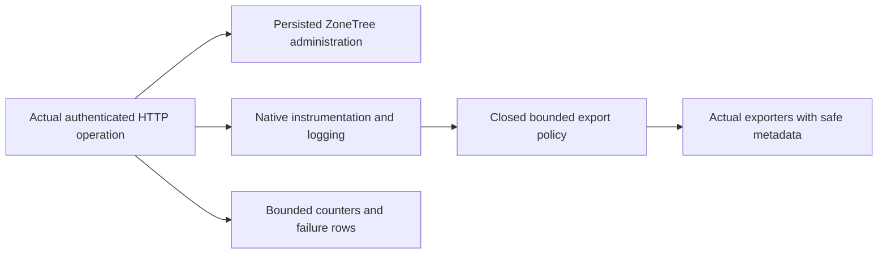

# ADR-121: exported telemetry privacy at the shared service boundary

Status: Accepted; implementation and native normal/scalar local gate delivered; required exact-source Linux cluster acceptance pending. Date: 2026-10-08. Related: REQ/AC-AUTH-TELEMETRY-001, REQ/AC-AUTH-009, REQ/AC-AD-003/008; ADR-014/015/022/029/051/113/117.

## Decision

Keep native OpenTelemetry tracing, metrics and logs/exporters enabled. Existing Orleans source privacy remains its unchanged owner. Add Authorization-owned privacy to the shared ASP.NET/HTTP-client and log export boundary. HTTP server/client spans preserve trace/parent IDs, kind, timestamps, duration and status with fixed operation/display names and closed normalized method, numeric response status and HTTP protocol-version tags. Remove URL/host/path/query/header/custom tags, trace state and bounded baggage; inherited parent baggage which cannot be removed without mutating its owner suppresses the child span; suppress spans containing immutable untrusted events, links outside the closed native connection-context shape below, or excess state rather than export that state. Metrics retain actual values/counts/durations and remove caller-derived dimensions from ASP.NET and HTTP-client instruments. Native Orleans metric policy remains unchanged.

Logs retain timestamps, severity, numeric event ID, normalized closed component category and trace correlation. Replace body/format with fixed runtime event text; clear attributes/exception/trace state and never capture scopes at composition. This is metadata observability, not disabled logging. No production canary comparisons, arbitrary category/path label, formatted state traversal or trusted caller fields are admitted. Typed validated options own bounded span work, including at most 32 local Activity parent links before inherited-baggage enumeration. Deeper local ancestry suppresses the child without mutating ancestor state; HTTP duration measurements and the subsequent normal authorized request remain observable.

## Implementation and verification

- ServiceDefaults Authorization Configuration/Contracts/Diagnostics own the options, policy and span and log processors; Extensions.cs registers them before the exporters and preserves health/service discovery and Orleans configuration. Dashboard source stays unchanged unless a concrete defect appears.
- An actual Kestrel/native ZoneTree operation and real exporter regression cover denied and missing state, a secret-bearing URL, header, body, log scope and error, and a full literal healthy catalog. Safe telemetry must exist and canaries must never be exported.
- Native normal/scalar and cluster cases run against unchanged source and image. Required actual coverage gates remain mandatory; CRAP is unmeasured until matching coverage exists.
- Exact-source Linux workflow, attempt, job and original artifacts close telemetry privacy acceptance only when all three original acceptance predicates pass. Wider lineage, administrator UI, production and endurance gates stay separate. Rollback removes the processors, options, registration, regression and docs together and never weakens database authority or silently restores permissive export.

No package, schema, wire or storage migration or fallback. Existing invalid-body and query-budget whole flows map to the bounded-input acceptance and are natively verified rather than duplicated. This ADR remains Accepted after review until actual evidence exists.

## Native HTTP connection context boundary

.NET 10 natively adds a connection-setup ActivityLink to `System.Net.Http.HttpRequestOut`; both actual baseline requests had exactly one tagless link with null TraceState and no events. [The native activity contract](https://learn.microsoft.com/en-us/dotnet/core/diagnostics/distributed-tracing-builtin-activities#http-connection-setup-experimental) documents this correlation. Treat only a single context-only link on that exact source/operation with Client kind as safe: non-default trace/span IDs, local context, null TraceState, no link tags and only the defined None/Recorded trace flags. Zero links remains valid. Inspect at most two links and one tag per link. For each examined link, check unsafe context/tags before the count bound: a tagged/state-bearing/invalid second link emits unsafe_state; two safe context-only links emit state_limit. This fixed reason priority is part of the acceptance contract. Any event, server link, different operation/kind, invalid/remote context, TraceState, tag or unknown flag remains fail-closed through native Recorded suppression. Preserve the original Activity, span/parent IDs and exact safe link context; never reconstruct a replacement or disable instrumentation. This is a closed metadata shape, not attribution of arbitrary links to a trusted producer.

REQ/AC-AUTH-TELEMETRY-001 maps to the real denied-to-healthy HTTP flow: compare every exported span ID/parent ID with preprivacy native observations, retain literal catalog/state, complete client/server exports, native logs/duration metrics and all canary assertions. Export capture records complete link context/tags, not just link presence. Additional actual HTTP client event/tagged-link/TraceState-link/extra-link cases must suppress only the unsafe request and export its healthy continuation. For a native safe link plus an added tagged link, require the actual preprivacy two-link shape and exactly unsafe_state with no state_limit; removing the tag guard must change the real counter to state_limit and fail this oracle. Two safe links instead require exactly state_limit. A native ConnectionSetup listener independently exercises one state-bearing tagless link; existing server and bounded ancestry negatives remain mandatory.

The bounded preprivacy observation confirms the production inherited-baggage guard correctly suppresses HttpClient children of TUnit's native `test body`/`test case` activities: exactly one `tunit.test.id` baggage item remains inherited, three local parents and six/seven tags are within the resolved 32/8/32 bounds. The positive fixture must establish its owned caller using the actual ambient native trace/span/flags as explicit parent context before Start. This retains ambient trace/parent identity and native Activity.Current restoration without inheriting the test framework's object baggage; native HttpClient.Parent remains that actual owned caller. Additional owned caller activities still form the original local chain, so inherited-canary and excessive-depth negatives exercise unchanged production fail-closed behavior. Do not mutate TUnit/ancestor state, whitelist test keys, detach/reconstruct native HTTP spans, change sampling/bounds or weaken exporter assertions. Native exported IDs remain compared to the actual preprivacy snapshots.
