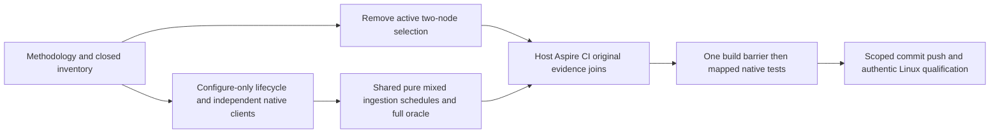

# ADR-122: native single and three-node comparable benchmark methodology

Status: Accepted, 2026-10-09. Implementation: in progress. Canonical slice: BenchmarkComparisons.

Stress admission hardening owns feature-local typed HeavyLoad options, native argument validation and negative controls under integration DocumentStorage. Validate enabled, exact class filter, serial execution and absence of coverage before fixture startup; reject an ordinary broad filter with an explicit native test identity. The native selector rejects an exact heavy filter without opt-in. Rollback reverts this source-bound admission stage; the heavy cluster and full GitHub gates remain required.

## Context and decision

The methodology requires meaningful pure/mixed measurements, actual one-million-record ingestion with 1/10/500 independent clients and only native one-node/three-node comparison topologies. Existing setup seeding and shared client wrappers cannot prove these ingestion claims. Follow the primary-source-backed [Methodology](../Features/BenchmarkComparisons/Methodology.md), REQ/AC-METH-001..005 and REQ/AC-SCALE-024..029. The active inventory contains one-node and three-node configurations only (ADR-034/056/103/109); required-copy ACKs and persisted state are unchanged.

## Implementation contract

1. Topology: scripts/Features/BenchmarkComparisons and site/Features/BenchmarkComparisons inventory/provenance change current 1/3 plans, derived counts and strict aggregate/source admission together. the C# topology changes ComparisonTopologies/contract readers/native topology branches, AppHost selection and mapped admission tests. Reject 2 before allocation; no legacy reader is introduced. Current positive qualification admits only the current inventory.
2. Documents and ingestion: the benchmark library implements `Documents/<Role>/` contracts, lazy schedules, shared execution, histograms and final actual readback, reusing `IComparisonTarget`/`IComparisonSession` and native adapters. Target lifecycle adds explicit configure-only mode and real owned per-session clients; final readers enumerate actual stored identities rather than assuming initial size. No dependency or replacement database is introduced.
3. Evidence: the single machine inventory, ComparisonHost selection/report writing, AppHost forwarding, named database CI group integration and source/run/attempt/job-bound artifacts. Current failed/null authenticity and downstream gates stay mandatory. New family evidence cannot silently populate an old control profile.
4. Stress: a separate exclusive Aspire cluster functional case exercising real SDK and official MCP operations during ingestion, with final state verification, original-operation settlement and owned cleanup. It is not a measurement or coverage substitute. Before qualifying the document cohort, its collector and aggregate authenticate the same-source completed functional job, original artifact/archive, exact native passed-test TRX and matching image receipts. Preserve and revalidate original bytes; missing, failed, skipped, changed or mismatched evidence blocks qualification. This join applies to the document cohort and does not change control publication policy.
5. Freeze source/image mutations, build the full Release solution once, run format/governance and mapped native TUnit contract/native flows; independent resource lanes may overlap only when their resources are isolated. Preserve original failures and report unexecuted full gates. Scoped completed stages are committed/pushed to main under standing authorization; exact-source Linux workflow records close actual scale/correctness qualification.

## Rollout and rollback

This first-release active contract accepts only the current canonical inventory. Deploy new source, host, planner and validator together; old cohorts remain history and are not accepted as current measurements. No storage migration or compatibility reader is required. Rollback is a normal reviewed source revert of the coherent benchmark wave, preserving original evidence and all product cluster gates. If a native operation/topology is unavailable, emit the declared unavailable disposition; never substitute a fake cluster or fabricate a number.

## Validation and limits

Methodology AC tables map positive, negative, cancellation/error and edge flows to criteria. Exact required evidence is canonical build/format/governance, original focused TUnit reports, genuine Aspire native client flows and complete source-bound Linux scale outputs. All benchmark-stage verification runs in GitHub Actions. Current unit/process recovery and product cluster gates are retained; selected tests prove only selected scopes. Do not mark this ADR Implemented until every required implementation, join, test and original evidence exists.
