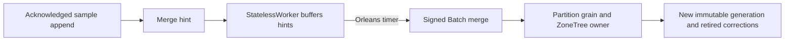

# ADR-124: TimeSeries persisted chunk lifecycle

Status: Proposed; implementation and qualification pending.

## chunk implementation contract

Scope: architecture §27.6; existing REQ-SERIES-017..020 / AC-CHUNK-001..006 remain unchanged transient codec controls. This stage adds REQ/AC-SERIES-CHUNK-007..012. No benchmark, power-loss, acceleration or whole-task PASS is implied by source.

007: A persisted, same-atomic-partition open window receives every new acknowledged sample in its exact half-open UTC range. Equal UTC timestamp uses actual original sample Sequence, original offset and IEEE bits; duplicate EventId retains original existing fingerprint semantics. Enrollment starts only at an admitted canonical source cut; no backfill or migration. Explicit Open rejects any preexisting raw sample in the window (no synthesized old enrollment), overlap and retained identity reuse. Fresh current persisted SeriesManage/SeriesRead and ordinary SeriesAppend remain required.

008: Seal captures exact original open rows and source watermark, writes immutable SampleChunkPayload blocks and immutable complete generation manifest in the same original apply transaction. Raw sample/id/sequence/floor remain the single canonical business authority. A late unique sample atomically appends raw data plus a bounded immutable correction block and advances the exact window revision; overflow rejects the entire attempted mutation before publication. The original sealed manifest is never patched. Same original command replay returns the actual unchanged receipt and cannot append corrections twice.

009: Background maintenance runs in Orleans `[StatelessWorker]` grains (the [ADR-094](ADR-094-orleans-due-coordination.md) pattern): they accept merge hints, buffer them in memory and, on an Orleans timer whose interval is a typed option, submit the batch through the ordinary connection grain -> partition grain -> ZoneTree owner path. They never check leadership, elect a coordinator or run as a singleton. A window retains its original creator and exact expected generation/revision; the worker revalidates current persisted principal/resource/field policy before submitting a separately signed Batch. Duplicate delivery from several workers or after a restart uses one stable command identity derived from the window and expected generation, so the compare-and-set rejects or replays it. Merge publishes a new complete immutable generation and retires bounded prior representation/corrections only in the same atomic apply transaction. No expiry renewal, caller roles, callback-only success or unpublished local provider. Queue admission is centrally bounded; revocation refuses and retains state, exact grant repair allows genuine healthy continuation.

010: New explicit chunk-window read returns the exact complete scoped window identity/generation/revision/source-sequence/retention floor/records at one authorized owner cut. Public tag equality is one scalar JSON pointer/value comparison; field-use permission is checked before pruning and current field projection still applies to every returned sample. Manifest tags conservatively admit candidates; pruning cannot reveal denied/private tags or bypass raw-byte/record/result budgets. Selected encoded block is charged before decode/copy. Missing/corrupt/version-incompatible enrolled representation fails closed, never falls back to old raw rows. Unenrolled series continue their existing deliberate raw read API, with no legacy migration path.

011: Retention floor remains authoritative immediately. Fully expired enrolled windows retire representation only through an authorized bounded mutation; partially expired windows retain charged blocks and filter exact floor on reads. Rollup metadata retains original SourceSequence and RetentionBeforeUtcTicks; chunk-generation selection cannot move either watermark or skip late samples. Rollup refresh/drop keep original CAS and current authorization.

012: Complete normal/scalar codec+canonical lifecycle controls, original process kill/reopen at real open/append/seal/correction/new-generation publication boundaries, genuine Aspire cluster SDK/official MCP/Q1 open→append→seal→late correction→background merge→retention/rollup→cold/replay/healthy state qualify actual correctness. Overload, wrong generation, mixed-model atomic rollback, cancellation/read bounds, corrupt manifest/block, revoked/tag-denied principal must have complete cut/receipt/no-partial oracles then healthy repair. GitHub original comparable bytes/sample/rewrite cost/allocation measurements remain REQUIRED and separate; no source or BDN microcontrol promotes performance.

## identities and schemas (current product, not upgrade/fallback)

All internal fields use generated Orleans serialization. Existing SampleChunkPayload alias and Ids0..9 stay exact. Key families are `sample-chunk-window` (mutable lifecycle metadata), `sample-chunk-block` (immutable generation/ordinal), `sample-chunk-correction` (immutable actual sample sequence), `sample-chunk-manifest` (immutable generation), scoped through KeySpace.Partition with actual tenant/database/domain/partition/set/series/window. WindowId is caller-stable nonempty Guid; no hidden directory/path.

SampleChunkWindow alias `keyload.core.sample-chunk-window`: Id0 Version; 1 WindowId; 2 FromUtcTicks; 3 UntilUtcTicks; 4 Revision; 5 Generation; 6 State(Open=0,Sealed=1,Dropped=2); 7 CreatorPrincipalId; 8 SourceSequence; 9 OpenRecords; 10 CorrectionSequences; 11 MaintenanceCommandId; 12 RetentionBeforeUtcTicks. All counters checked; no current epoch stored as future authorization.

SampleChunkManifest alias `keyload.core.sample-chunk-manifest`: Id0 Version;1 WindowId;2 Generation;3 FromUtcTicks;4 UntilUtcTicks;5 SourceSequence;6 RecordCount;7 BlockDigests;8 TagJsonValues;9 RetentionBeforeUtcTicks. SHA256 binds actual complete bytes per block and actual full manifest, not authority MAC. No invented future error/message bounds.

Public four Batch mutation aliases/discriminators: OpenSampleChunkWindow / `openSampleChunkWindow`; SealSampleChunkWindow / `sealSampleChunkWindow`; MergeSampleChunkWindow / `mergeSampleChunkWindow`; DropSampleChunkWindow / `dropSampleChunkWindow`. aliases `keyload.<TypeName>`; each Id0 SeriesSet,1 SeriesId,2 WindowId; Open Id3 From,4 Until; other mutations Id3 ExpectedRevision. The original inherited Mutation Resource scope is unchanged. New read request alias `keyload.ReadSampleChunkWindowRequest`: Id0 Partition,1 Set,2 SeriesId,3 WindowId,4 TagPointer(nullable),5 TagValue(nullable),6 Limit. Result alias `keyload.SampleChunkWindowResult`: Id0 WindowId,1 From,2 Until,3 Generation,4 Revision,5 SourceSequence,6 RetentionBeforeUtcTicks,7 Records,8 CutPosition. The operation uses existing bounded SDK/MCP/Q1 read infrastructure and one appended GrainReadKind, never a second transport.

## Bounds and ordered apply

New purpose-owned properties on the existing centrally registered IOptions<TimeSeriesExecutionOptions>, retained by the existing constructor without provider defaults or per-call wrappers: maximum retained windows32, records/window4096 (=16 original256-record codec blocks), corrections/window256, pending merge windows32. Each minimum1 and ceiling exactly its declared default; enrollment checks the actual configured DatabaseLimits.MaxScanRecords before any chunk write. This is a feature admission relation; it does not reject unrelated databases with a smaller scan bound at startup. Encoded individual block remains existing8MiB but actual batch/frame/metadata limits can be smaller and still reject. Existing options/deadlines/append10000/results/reader limits are unchanged. These explicit operational caps are not RSS or performance proof.

ApplyCommittedCommand uses the original admitted operation business time and cannot introduce replica-local wall-clock/cancellation decisions after ordered admission. Existing codec read callers retain exact ReadExecutionBudget token/deadline checks. A purpose-owned value-type codec work adapter borrows that same budget for those callers; ordered canonical codec uses only deterministic already-validated record/byte limits and transaction ValidateCommit. No artificial TimeProvider, renewed token, reset deadline or cancellation swallowed before admission. Original caller token remains effective on request preparation/read/transport, while the acknowledged journal remains deterministically applicable.

## Ownership/order/qualification

1. This contract plus TimeSeries/ADR124 appendices precede implementation.
2. Abstractions TimeSeries typed roles; Core TimeSeries contracts/storage/commands/queries/serialization/config; additive shared Mutation discriminators/authorizer/dispatcher; Orleans TimeSeries StatelessWorker maintenance grains and read branch; Server/Client existing typed transport; independent literal catalog tuple addition.
3. Unit full lifecycle/mixed rollback/privacy/corruption/cancel controls; Recovery real RecoveryProcess cuts; Integration genuine Aspire SDK/official MCP/Q1/cold/worker revoke→healthy, all original readers/processes/resources joined.
4. Join, compiler, census and Linux evidence are produced once for the integrated source. New source methods/arguments are not UID/count/PASS. Normal/scalar and every mandatory global suite/performance/fault gate remain open until authenticated exact-source originals.
5. Rollback unpublished source as a coherent stage only; after publishing records no format downgrade, metadata deletion, automatic raw fallback or fabricated current authority.

Chunk window bounds: MaximumChunkWindows=32, MaximumChunkWindowRecords=4096, MaximumChunkCorrections=256 and MaximumPendingChunkWindows=32 are centrally validated purpose-owned properties on the existing TimeSeriesExecutionOptions. Existing registration/OptionsFactory remains. The same original IOptions owner is retained for codec calls; no Options.Create/default wrapper. Merge hints confer no rights; creator/current state is reread at the current barrier before connection-grain dispatch. Worker pool size, buffer size and timer interval are centrally validated typed options. A merge CAS failure is genuine persisted outcome; a revised authoritative window intent has a distinct stable command identity and cannot silently change the body under the failed ID.
