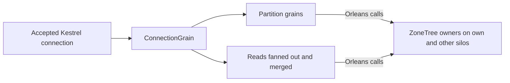

# ADR-125: One Orleans grain per client connection

Status: Accepted (owner decision 2026-10-09, simplified 2026-10-18 under [ADR-136](ADR-136-native-orleans-partition-ownership.md)); implementation and qualification in progress. Related: REQ/AC-CLIENT-CONNECTION-001/002 in [ClientApi](../Features/ClientApi.md), REQ/AC-ORL-013 in [ADR-110](ADR-110-native-orleans-execution-primitives.md), [ADR-082](ADR-082-native-cqrs-streams.md).

## Decision

Every connected client gets one Orleans `ConnectionGrain`. All operations sent over that connection run through this grain; no grain is created per request. The connection grain calls partition grains and the silo-local ZoneTree owners on its own or other nodes through Orleans, gathers the results and returns them.

## Contract

- Identity. The server's connection middleware issues one opaque GUID per accepted physical connection. No client header, principal, HttpClient instance or MCP session id can choose the grain. Native request context carries the connection id; it confers no authorization.
- Operations. Each operation keeps its own signed request id, stable command id, fresh persisted authorization, cancellation and cleanup. Independent operations use the native ManagedCode.Communication streaming contract; operation state stays local to its enumerator. Admission and close invariants use a bounded joined owner instead of a blanket `[Reentrant]`.
- Close. `CloseAsync` is `[AlwaysInterleave]`, accepts only a signed close control, cannot execute a database effect, stops admission, cancels and joins the original operations and then requests `DeactivateOnIdle`. Transport cleanup cancels and joins the native caller enumerators and their producer disposal before the close call, because Orleans sends the final `DisposeAsync` RPC even after enumeration ends.
- Limits (typed validated options). At most 4096 admitted transport connections per node, 8 concurrent operations per connection, no queued admission, two-minute idle expiry when no operation is active.
- Lifetime. Disconnect uses Kestrel `ConnectionClosed`; `RequestAborted` belongs to one operation. Host shutdown closes connection admission and joins connections before the silo and storage stop. Reconnect obtains a new grain. Silo loss discards the disposable grain; command-receipt retry and uncertain writes keep their existing semantics.
- Background work (timers, durable jobs, provider work) uses one bounded execution owner per silo service, never a grain per operation.
- Errors. `KeyLoadException` is serialized natively (`[GenerateSerializer]`, alias `keyload.error.v1`, Code id 0, StatusCode id 1) so domain codes survive Orleans RPC.
- Transport. HTTP/1.1 runs sequential requests per connection. Overlapping calls on one connection use the dedicated HTTP/2 listener (`ServerExecutionOptions.EnableHttp2`, `Http2Port` default 8081); the AppHost exposes it on every node and clients use the Aspire-discovered endpoint. The SDK copies the supplied `HttpClient` request version and version policy into every request.
- Current MCP transport is stateless; this decision does not deliver native SQL session interoperability.

## Verification

TUnit operations through the real .NET SDK and official MCP client against the Aspire-owned cluster: concurrent independent operations on one connection, cancellation of one operation leaving its sibling successful, fresh authorization, disconnect/idle/shutdown cleanup and native activation inventory proving reuse and removal. Performance claims need matched isolated Linux benchmark runs; configuration or architecture alone proves nothing.
