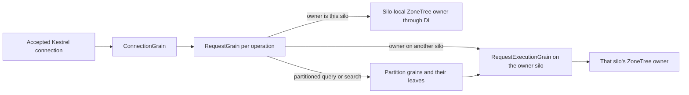

# ADR-125: One Orleans grain per client connection

Status: Accepted (owner decision 2026-10-09, simplified 2026-10-18 under [ADR-136](ADR-136-orleans-partition-ownership.md)); implementation and qualification in progress. Related: REQ/AC-CLIENT-CONNECTION-001/002 in [ClientApi](../Features/ClientApi.md), REQ/AC-ORL-013 in [ADR-110](ADR-110-orleans-execution-primitives.md), [ADR-082](ADR-082-cqrs-streams.md).

## Decision

Every connected client gets one Orleans `ConnectionGrain`. It owns only the connection: admission, the duplicate-request check, close and the join of its live operations. Each admitted operation runs in its own `RequestGrain`, keyed by the operation's request identity and placed on the connection's silo. The request grain is the coordinator: it reloads authority, resolves the storage owner through Orleans, runs the operation beside that owner (in place when its own silo owns the data, otherwise through a `RequestExecutionGrain` placed on the owner's silo), fans composed and partitioned work out to the owners of the required partitions, gathers the results and returns them.

## Contract

- Identity. The server's connection middleware issues one opaque GUID per accepted physical connection. No client header, principal, HttpClient instance or MCP session id can choose the grain. request context carries the connection id; it confers no authorization.
- Operations. Each operation keeps its own request envelope id, stable command id, fresh persisted authorization, cancellation and cleanup. The operation's ManagedCode.Communication response stream and its producer live in its request grain; the connection grain forwards the stream or the settled reply. Admission and close invariants use a joined operation owner instead of a blanket `[Reentrant]`; closing the connection cancels the linked call into every live request grain and waits for it. A duplicate active request id on one connection fails with `Conflict`.
- Close. `CloseAsync` is `[AlwaysInterleave]`, accepts only a signed close control, cannot execute a database effect, stops admission, cancels and joins the original operations and then requests `DeactivateOnIdle`. Transport cleanup cancels and joins the caller enumerators and their producer disposal before the close call, because Orleans sends the final `DisposeAsync` RPC even after enumeration ends.
- Limits (typed validated options). No count limit on transport connections per node or concurrent operations per connection and no queued admission ([ADR-145](ADR-145-no-request-throttling.md)); `GrainRoutingOptions.ConnectionIdleTimeout` (two-minute default) expires a connection when no operation is active.
- Lifetime. Disconnect uses Kestrel `ConnectionClosed`; `RequestAborted` belongs to one operation. Host shutdown closes connection admission and joins connections before the silo and storage stop. Reconnect obtains a new grain. Silo loss discards the disposable grain; command-receipt retry and uncertain writes keep their existing semantics.
- Background work (timers, durable jobs, provider work) uses one bounded execution owner per silo service, never a grain per operation.
- Errors. `KeyLoadException` is serialized ly (`[GenerateSerializer]`, alias `keyload.error`, Code id 0, StatusCode id 1) so domain codes survive Orleans RPC.
- Transport. The AppHost exposes one HTTPS endpoint per node and Aspire allocates every public and Orleans port. TLS negotiates HTTP/1.1 or HTTP/2 on that endpoint; overlapping calls on one connection use HTTP/2. Clients use the Aspire-discovered HTTPS address. There is no separate cleartext HTTP/2 listener or application-selected port range. The SDK copies the supplied `HttpClient` request version and version policy into every request.
- Current MCP transport is stateless; this decision does not deliver SQL session interoperability.

## Verification

TUnit operations through the real .NET SDK and official MCP client against the Aspire-owned cluster: concurrent independent operations on one connection, cancellation of one operation leaving its sibling successful, fresh authorization, disconnect/idle/shutdown cleanup and activation inventory proving reuse and removal. Performance claims need matched isolated Linux benchmark runs; configuration or architecture alone proves nothing.
