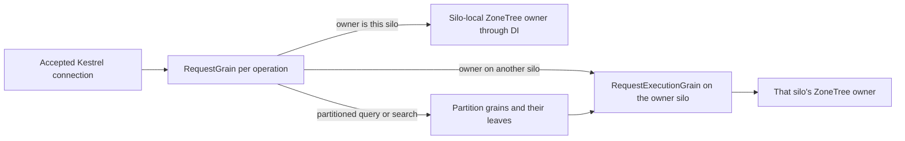

# ADR-125: Transport-owned connections and independent request grains

Status: Accepted under [ADR-136](ADR-136-orleans-partition-ownership.md); qualification in progress. Related: REQ/AC-CLIENT-CONNECTION-001/002 in [ClientApi](../Features/ClientApi.md), [ADR-082](ADR-082-cqrs-streams.md).

## Decision

`ServerConnectionFeature` owns admission, cancellation and closure for the accepted transport. The server sends each admitted operation directly to its own ordinary Orleans `RequestGrain`, keyed by the operation's server-issued request identity and using `PreferLocalPlacement`. Orleans registers it in the grain directory; cancellation and stream messages target that activation. The request grain reloads authority, resolves and borrows the appropriate storage owner, coordinates composed and partitioned work, and returns the result. Service-owned background work retains its independent admission and lifetime.

## Contract

- Identity. The server issues one opaque GUID per accepted physical connection and a fresh request GUID per operation. Neither can be selected by a public caller. The call-local connection identity confers no authorization; stable command IDs independently deduplicate writes.
- Operations. Every operation keeps fresh persisted authorization and its own cancellation and cleanup. The caller awaits the request grain's terminal reply or consumes its bounded ManagedCode.Communication response stream. The server disposes the original stream enumerator before asking the request grain to deactivate.
- Close. The transport stops admission, cancels its linked operations and joins their caller lifetimes. The silo waits for Orleans cancellation acknowledgement and signals cancellation on RPC timeout. A timeout or loss of the target still leaves a potentially committed write uncertain; the storage and request owners retain their original work until joined.
- Limits (typed validated options). No count limit on transport connections per node or concurrent operations per connection and no queued admission ([ADR-145](ADR-145-no-request-throttling.md)); `GrainRoutingOptions.ConnectionIdleTimeout` (two-minute default) expires a connection when no operation is active.
- Lifetime. Disconnect uses Kestrel `ConnectionClosed`; `RequestAborted` belongs to one operation. Host shutdown closes admission and joins connections before the silo and storage stop. Reconnect obtains a new transport identity. Silo loss discards live transport state; command receipts retain their existing semantics.
- Background work (timers, durable jobs, provider work) uses one bounded execution owner per silo service, never a grain per operation.
- Errors. `KeyLoadException` uses generated Orleans serialization so domain codes survive RPC.
- Transport. The AppHost exposes one HTTPS endpoint per node and Aspire allocates every public and Orleans port. TLS negotiates HTTP/1.1 or HTTP/2 on that endpoint; overlapping calls on one connection use HTTP/2. Clients use the Aspire-discovered HTTPS address. There is no separate cleartext HTTP/2 listener or application-selected port range. The SDK copies the supplied `HttpClient` request version and version policy into every request.
- Current MCP transport is stateless; this decision does not deliver SQL session interoperability.

## Verification

Qualify concurrent independent operations on one connection, cancellation leaving siblings healthy, fresh authorization, stream settlement and disconnect/idle/shutdown cleanup through the real transports. Measure grain messages and throughput independently.
