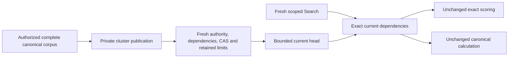

# ADR-127: bounded current BM25 corpus statistics

Status: Accepted current implementation decision. Original runtime and performance qualification remain OPEN.

## Decision and reason

KeyLoad retains one replaceable exact-Terms statistics head per full partition/collection/field/tokenizer/authenticated-subject identity in ZoneTree family `bm25-corpus-current`. This reduces repeated exact statistics calculation only when every current canonical dependency matches. [Bm25CorpusCurrent](../Features/Search/Bm25CorpusCurrent.md) is the canonical alias/field/phase/bounds and REQ/AC inventory; [ADR-018](ADR-018-global-rank-fusion.md) continues to own distributed statistics and final ranking.

Use the original generated four-field DistributedTextStatistics and exact tokenizer/scorer. Relocate the pure internal type mechanically to Core's Search Contracts, preserving namespace, alias and IDs; Query already consumes Core and receives its existing friend access. Do not add a duplicate type, scorer or Core-to-Query cycle. Public SDK/MCP/SQL contracts remain unchanged.

Only a server-verified private Orleans maintenance publication may write the head. Generic client commands, envelopes and public MCP descriptors reject phase45. Fresh persisted administrator and target-subject corpus permissions, exact source dependencies and expected-generation CAS are verified before first effects. Existing ordered node-local commit/apply ownership and acknowledgement from every configured copy remain authoritative.

Search reads the head within its original scoped view. Exact current Terms/policy/schema/resource digest/outbox/store incarnation admit unchanged scoring. Missing, unsupported, malformed or stale optimization data uses the same complete exact canonical calculation without writes. This does not change engine selection, current read-cut authority or authorization.

Bound total partition-family raw key/value bytes and records before first write with the existing MaxBatchBytes/MaxScanRecords, independently from existing request-read/cancellation budgets. Preserve exact first-run and same-ID replay contracts; replicated operation.EvaluatedAt controls deterministic committed expiry, while caller capture retains original actual cancellation/deadline.

Admit publication only after current family inventory/export/target/backup/census/restore paths handle the head. Preserve complete original values and strict corrupt/unsupported rejection. No legacy readers, previous-format migration, opaque receipt storage, whole-vocabulary dictionary, staging pages or unbounded secondary authority.

Portable header validation cannot recompute the historical PayloadDigest because the head does not retain its full source context. Keep strict shape/key/bounds, original authenticated archive/MAC integrity and exact copied values. Query independently verifies against fresh state and declines stale restored data; only a real new capture can qualify reuse. No extra head field is introduced.

Fresh receipt authorization fences both current administrator outcome epoch and exact target subject epoch. Revocation/repair at a higher target epoch refuses the original receipt without effects. Document-tail/CAS/quota and inner-expiry checks remain first-run only, independently from fresh receipt authorization.

## Consequences and qualification

Head capture Position/Applied/ReadGeneration are historical originating-view evidence, not values to equate across replicas or against post-publication Store.Position. Existing distributed witnesses retain their genuine node-local cut.

Genuine publication, exact result, denied/no-effect, CAS, full/one-over retained limits, reducing replacement, receipt/cold and current-format delivery flows map to every REQ/AC in the canonical feature. These flows supplement mandatory Linux Aspire cluster SDK/official MCP and fault/resource qualification. Comparable original before/after measurements are required for any CPU, allocation, memory or latency claim; no source review or static configuration is performance proof.

