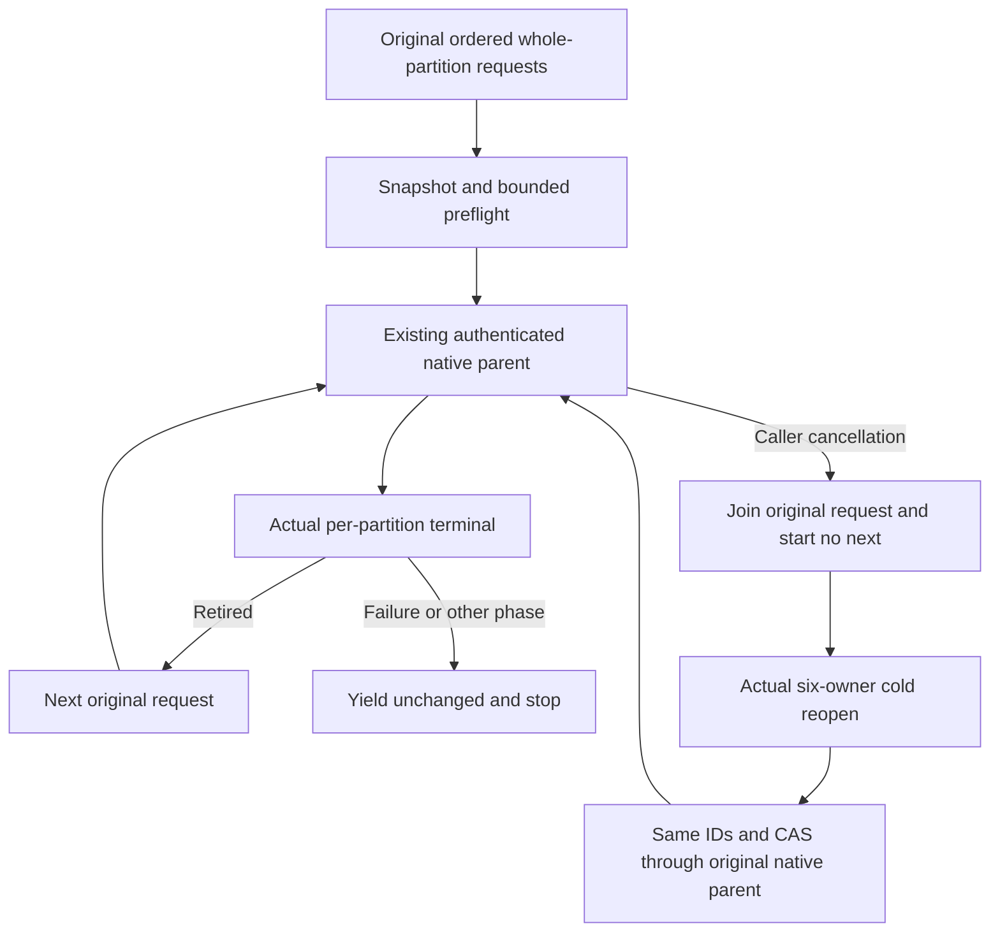

# ADR-128: Bounded explicit whole-partition physical packing orchestration

Status: Accepted design; implementation and qualification gates remain open.
Owners: KL071 / Client ClusterRouting and Integration ClusterRouting.
Related: ADR-016, ADR-106, REQ-MOVE-001/003/005/007.

## Decision

Compose an explicitly supplied ordered set of existing PartitionMoveRequest operations in the authenticated .NET SDK. The SDK convenience API MoveWholePartitionsAsync returns IAsyncEnumerable<Result<PartitionMoveResult>> using the existing ManagedCode.Communication result contract. It introduces no route, public wire payload, serializer alias/field, operation enum, persisted plan record or separate dispatcher. Every actual request uses existing MovePartitionAsync, server-owned connection execution, fresh persisted administrator authorization, original native CQRS phase progress and the existing node-local RF3 movement authority.

Physical split/merge means moving complete existing atomic partitions between already registered physical groups. It never splits a hot atomic partition or changes logical scope, creates a physical group, transfers Control authority, or grants all-shard atomicity. The caller retains original ordered requests; settled per-partition receipts are the only durable recovery authority.

## Admission, bounds and lifetime

The convenience method snapshots all inputs before any request. Admit 1..64 requests, distinct nonempty stable MoveIds, distinct complete PartitionRefs, one nonempty destination, original Transfer/Resume modes and nonnegative original placement CAS. Preserve Revision0 for the real unassigned fallback. Reject malformed/duplicate/oversized local plans before transport. SDK preflight cannot replace native server authorization, owner registration, byte budgets, CAS, current lineage or admission.

The explicit64 bound is a local memory/in-flight policy: at most64 retained original request references,64 GUID identities and64 complete PartitionRef references. Execution has exactly one awaited existing parent request in flight and no task queue, producer, channel or retained result history. Every individual request keeps the existing actual server byte/work/deadline limits. This cardinality is independent of DatabaseLimits.MaxBatchMutations. Larger caller-selected inventories require explicit bounded sequences of original requests.

Yield each actual original terminal result once in order. Continue only after native successful Retired; yield failure or non-Retired success unchanged then stop. There is no batch result or invented aggregate error. Partial success remains visible. Re-enumerating the original ordered snapshot uses the SAME original MoveIds, destination and CAS: existing native parent reconciliation returns original settled receipts and advances only unfinished moves. Never generate retry IDs, reset phase expiry, reinterpret refusal, or redispatch an uncertain phase through another transport.

The supplied caller token and enumerator cancellation govern the entire SDK enumeration. Await the current original HTTP/native CQRS lifecycle; after cancellation or disposal no next request starts. The caller owns the borrowed SDK client. Server and existing test fixtures own and join their original operation/stream/native node resources; this composition adds no parallel lifetime.

## Complete-flow acceptance

REQ-KL071-PLAN-001 / AC-KL071-PLAN-001: real registered two-RF3 topology and two distinct all-model atomic partitions. Reject65 and duplicate inputs before effects; mutate the caller list after API creation and prove the actual original snapshot remains authoritative for enumeration.

REQ-KL071-PLAN-002 / AC-KL071-PLAN-002: settle the first complete A-to-B transfer, cancel the original enumeration before the second request, prove the second original row revision/owner/epoch and all linked models unchanged while the global directory records only the first legitimate publication, then join six owners/all18 native locks. Cold original per-partition records show Retired first and absent second parent. Reopen and run the SAME plan: exact first receipt replay, actual second transfer, literal native installed receipt/owner/CAS/epoch, published row revision from the original global directory plus the ordered publication ordinal, and final global directory revision and all original SDK/official MCP/Q1 command receipts.

REQ-KL071-PLAN-003 / AC-KL071-PLAN-003: real first same-ID/changed-CAS Conflict is yielded unchanged and stops before the second entry. Replay both original terminal results across full six-owner cold reopen without raw image/counter/body/index changes; no old effect is redispatched.

REQ-KL071-PLAN-005 / AC-KL071-PLAN-005: within the same original complete operation, settle the first original request and await early enumerator disposal; re-enumerate the SAME plan with the API token absent and a linked original enumerator token, then cancel before the second request. Require the exact cancellation token and byte-equal original first terminal receipts across early disposal, enumerator cancellation and the original API-token cancellation/snapshot control. The existing second-partition absent native parent, unchanged placement/models, six-owner cold reopening and full resume/merge/healthy continuation prove no second dispatch. Keep the original case declaration and deadline.

REQ-KL071-PLAN-004 / AC-KL071-PLAN-004: read actual current per-partition placements, execute a reverse B-to-A plan with fresh stable IDs and actual CAS, require literal current ownership/install receipts and full all-model state. Write distinct healthy literal documents under actual current owner epochs, prove real SDK/official MCP/Q1 receipts and documents, then full native cold-image equality on replay. Preserve existing ParentDeadline12m and all actual runtime cleanup bounds.

Supporting automated case: PhysicalShardPartitionMovementRf3Tests.OrderedWholePartitionsResumeOriginalReceiptsAfterPartialCancellationThenMergeCold. Helpers reuse actual existing registration, all-model seeds, native per-partition terminal oracles, complete raw cuts and Aspire-owned kill/restart/cleanup. No fake host or substitute grain. This supports KL071; every persisted-phase crash, endurance, fault and exact-source Linux qualification remains mandatory and open until original evidence is joined.

No compilation, runtime, Linux, durability or throughput claim follows from this design. Rollback removes only this SDK facade, its owned admission/helpers/test and requirement mapping; all original single-partition movement contracts remain.

### Original partial conflict, cold replay and healthy whole-partition merge

REQ/AC-KL071-PLAN-005: In the actual protected six-owner topology, create three complete distinct atomic partitions through original all-model SDK/official-MCP/Q1 seeds and borrowed verified credential. Legally settle second original Transfer first. Stream first new exact Retired -> second same-ID changed-CAS actual Conflict Result/ValueNULL -> terminal before third dispatch. Require both literal original receipts/publication ordinals and third unchanged placement/epoch except real shared directory revision, all canonical models/command receipts unchanged. Join six owners/all18 locks; first+second compacted genuine receipts and absent third header/pending/lastIssued. Cold replay the same invalid plan with exact first receipt/Conflict and complete raw native images/counters/body/index equal; no third dispatch. Repair by resuming exact original valid three IDs/CAS: exact first+second replay, legitimate third transfer, actual directory/publication/installation oracles. Reverse merge and complete cold replay plus healthy all-model SDK/MCP/Q1 operations retain original ParentDeadline and cleanup bounds. Existing original case declarations are unchanged. Fresh unstarted stale-CAS RecoveryRequired semantics remain unchanged; this Conflict is produced by actual persisted RequireReplayScope. No new product API/provider/retry/error normalization.

### Observed committed Prepare interruption and original-plan recovery

REQ-KL071-PLAN-006 / AC-KL071-PLAN-006: Arm only the original deterministic Prepare command for the first complete partition in a real ordered two-partition plan. Existing SubmitReturned means the native leader committed the operation and joined materializer apply before returning its actual operation result. Publish a bounded private typed journal observation together with the original held marker; bind session/arm/request/command/connection/principal/full partition, actual ControlPrepare stage, move ID, native journal applied position and complete physical owner/incarnation/voter/silo identities. Verify the marker against signed actual silo discovery. A marker without this successful exact journal proof is insufficient to authorize the test-owned kill.

Kill only the proved original container first, then join the other five owned containers, original public producer, original AppHost and all18 node/database/replica locks without killing a stopped owner twice. Keep the actual first caller refusal as returned, with no invented error code, expected-detail rewrite, exception suppression or retry. Require no second dispatch. The stopped proved owner must retain the same scoped original Prepare outcome and journal receipt; every owner has no second-partition parent/header/pages. Recreate the same AppHost configuration, original peer parameters, endpoint ports and persisted volumes; reconnect official MCP with the same verified credential without reconfiguring its persisted principal. Resume the same ordered MoveIds/CAS, verify literal publication/install/current-directory ownership and complete linked models and original command receipts, then two complete cold replay cuts and reverse merge with healthy SDK/official MCP/Q1 continuation.

Retain the original arm together with its journal/marker through all native process/AppHost cold restarts; existing marker admission prevents its reclaim. Delete that arm only after the final cold/healthy continuation, so a fresh process can validate the durable private evidence without relying on the dead process's retained-arm memory.

Only the explicitly scoped private SubmitReturned/Hold arm enables this typed journal capture; unarmed and ordinary unscoped observers keep their original path. Journal AppliedPosition is not a replica entry index or term. Observation runs after the commit/apply gate and adds no authority, redispatch, wire field, public protocol or payload/credential logging. The old paired native-job/authorization killed-owner cleanup remains unchanged for its existing callers; the new single-arm join requires the exact journal/marker, joined original producer/AppHost, six original kill receipts and all18 released locks before retiring that gate. Every primary and cleanup failure remains in the original failure ledger.

Supporting complete operation: PhysicalShardPartitionMovementRf3Tests.OrderedWholePartitionsResumeAfterObservedCommittedPrepareOwnerKillThenMergeCold. Its original ParentDeadline and cleanup bounds remain unchanged. This is a process-interruption development/qualification candidate; it does not prove power loss, all persisted stages, Linux/RF3 acceptance, endurance or performance. Existing original cases and failures remain immutable.
