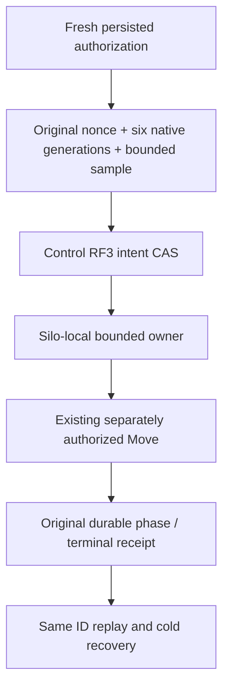

# ADR-129: capacity-aware tenant placement

Status: proposed coherent N under owner-approved ABI allocation; freeze before future source Y. No implementation/qualification claim.

## Decision

Use server-owned silo-local capacity readers and one bounded apply owner on each actual Control silo, not a cluster singleton or a new distributed admission grain. Authoritative policy and intent CAS remain existing Control RF3 ZoneTree state. Public operations remain unique request grains and native ManagedCode.Communication CQRS. Existing Move parents exclusively publish physical placement and receipts.

The complete contract, units, exact error/replay/authorization rules, authored whole-flow mapping and open gates are canonical in [CapacityAwarePlacement](../Features/ClusterRouting/CapacityAwarePlacement.md). The per-silo bound is 2 active + 16 pending; current Control RF3 aggregate ceiling is 6 active + 48 pending. A lost phase acknowledgement remains unknown pending original Move identity. No whole-shard/tenant atomicity, future enrollment reservation, provider replacement or migration is implied.

Reserve append-only OperationKind ConfigurePlacementPolicy46 / PersistPlacementIntent47 / ApplyPlacementIntent48 / PlacementIntentPhase49 and GrainReadKind OwnerCapacity81 / PlacementPolicy82 / PlacementPlan83 / PlacementIntent84. Private49/81 are not public generic operations. Keys are string namespaces encoded by existing KeyCodec, never new numeric IDs. New generated native aliases use keyload.cluster-routing. with explicit stable Id fields. Existing aliases, field IDs, wire version, MAC and Move request contracts remain unchanged. Same-version interface gains only the new native private method; mixed old/new cohorts and compatibility fallback are unsupported, not qualified upgrades.

Persist's fresh server admission is native sealed data, while its canonical operation identity remains the original public request. Original nonces/sample deadlines and native generations are retained; receiving/replaying a query cannot refresh them. Control-only public admission plus current persisted administrator checks prevent Destination-local policy authority. Unknown finite cgroup quota, physical DMI failure domain or complete roster refuses; no invented host labels or unbounded host memory.

Weighted rendezvous compares U^(1/weight) through bounded integer cross-powers (64-bit digest, weights 1..16, at most 2080-bit intermediates) and Guid-N ordinal ties. Hysteresis uses committed byte thresholds. No CPU allocation is traded for a speed claim; matched Linux profiles are still required.

This is current-set explicit intent orchestration. New tenant writes can enroll partitions without a PMAP global revision update. Complete current roster is revalidated at persist/apply; an authoritative future-enrollment reservation is not present. Therefore full automatic dedicated-tenant isolation and whole KL070/KL071 acceptance remain open.

