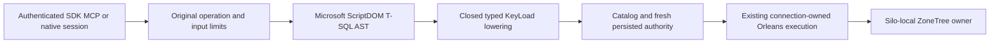

# ADR-130: Microsoft ScriptDOM owns T-SQL syntax

Status: Accepted implementation contract. Date: 2026-10-13. Implementation and qualification remain open.

Current integration: package 180.140.0 is centrally referenced and restored. Native syntax, SELECT, EXEC and closed same-partition queue/graph INSERT lowering are in the working source; the Release solution build and actual current-source operation tests are not yet complete. No acceptance, coverage or performance gate is claimed from these source changes.

## Decision

SQL syntax is T-SQL parsed by Microsoft ScriptDOM. Use centrally pinned `Microsoft.SqlServer.TransactSql.ScriptDom` **180.140.0**, published on NuGet on 2026-10-12, under its original MIT license. The package includes a .NET8 asset usable by .NET10 and declares no runtime dependencies. Verify the actual restored package identity and API before compiling the adapter. SQL Server's standalone T-SQL grammar is the selected syntax target; other engine profiles are not selected.

ScriptDOM owns lexical and syntactic parsing. KeyLoad owns a closed adapter from its native AST to existing typed database plans, catalog binding, fresh persisted authorization, admission, cancellation, resource charging, connection-owned Orleans execution, node-local ZoneTree storage and majority acknowledgement. Parsing a statement does not mean KeyLoad can execute it. Valid unimplemented statements return the existing `UnsupportedCapability`; malformed syntax returns the existing bounded `Validation` diagnostic without raw SQL or parser messages.

There is no handwritten-parser fallback, syntax-rewriting compatibility or persisted-data migration. Operation tests express their scenarios in the selected language and keep their state, authority, receipt, cancellation, recovery and fault assertions.

The existing PostgreSQL wire transport and Npgsql are separate from the SQL language. Their bounded authenticated session may carry T-SQL text, but does not imply PostgreSQL grammar or SQL Server TDS interoperability. No new driver or protocol dependency is authorized by this decision. SDK and official MCP callers continue through the same canonical operations.

## Implementation contract

1. Freeze this decision and the criterion-to-flow map in [ScriptDOM requirements](../Features/QueryExecution/ScriptDom.md). Preserve the original operation budgets and current public typed contracts.
2. No package lock files, unpublished assemblies, copies or extra application runtimes.
3. It preserves the existing `SelectQuery` and operand/predicate contracts and supports bounded `TOP` and ordered `OFFSET/FETCH`; valid unsupported clauses cannot be silently omitted.
4. Dynamic execution, multiple statements/batches and unresolved objects cannot gain admission from successful parsing. Model operations remain composed through the existing typed database contracts.
5. Bind verified values to ScriptDOM parameter nodes; never substitute values into SQL. Derive classification from the same typed plan and preserve conservative unknown-write behavior, original command IDs and current authorization.
6. Self-review the complete batch, then run native semantic diagnostics, solution build, formatting and focused complete operation classes together through the native TUnit entry with native maximum parallelism50. Run the mapped real SDK/official MCP/native-driver Docker cluster, process recovery and exact-source Linux gates; retain original failures and joined cleanup.

## Resource and cancellation contract

Retain the original UTF8 source, token, depth, parameter, examined-record, read-byte, result, memory, deadline and admission limits. ScriptDOM is synchronous: its `Parse(TextReader)` tokenizes before parsing the token collection. A cancellation-aware reader covers lexing only. Verify a bounded read-only token-list access boundary against the restored native parser so its accesses also observe the original cancellation and budget; gate structural depth before parsing and bound AST lowering. Check the original token before and after each owned phase and join parser work before returning cancellation. Do not abandon a task/thread or invent hard preemption. Input limits and runtime cancellation/resource proof remain acceptance requirements.

## Alternatives and risks

A handwritten grammar would add unnecessary syntax maintenance, and a PostgreSQL parser library does not match the T-SQL dialect. ScriptDOM supplies mature syntax and AST tooling; KeyLoad still must implement and qualify execution for every advertised family. Differences in booleans, NULL semantics, quoting, windows, functions and procedure calls require explicit lowering and real operation tests. A grammar-only demonstration cannot close full SQL, native interoperability, coverage or performance gates.

Primary sources: [Microsoft source](https://github.com/microsoft/SqlScriptDOM), [published package](https://www.nuget.org/packages/Microsoft.SqlServer.TransactSql.ScriptDom/180.140.0), [release notes](https://github.com/microsoft/SqlScriptDOM/blob/main/release-notes/180/180.140.0.md), [MIT license](https://github.com/microsoft/SqlScriptDOM/blob/main/LICENSE), [parser API](https://github.com/microsoft/SqlScriptDOM/blob/main/SqlScriptDom/Parser/TSql/TSqlParser.cs).
