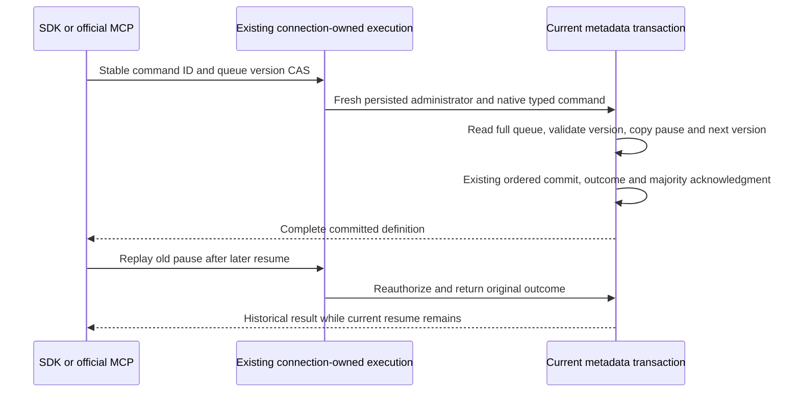

# ADR-131: Explicit queue dispatch-state compare-and-set

Status: Proposed for owning implementation; integration and qualification open.

Related feature: Messaging / QueueDispatchControl. REQ/AC-QUEUE-DISPATCH-001..006. This fixes the inherited QueueDeadlineClusterPause prerequisite while preserving ADR-093 policy-only replacement and ADR-028/094/117/125 queue atomicity, native due execution, TUnit/Aspire lifecycle and connection ownership.

## Problem and native evidence

Current ConfigureResource rejects changed existing metadata without ExpectedSchemaVersion. Its policy-only CAS retains Paused in the structural comparison. The original helper supplies a new default definition with changed Paused and no CAS; adding CAS alone cannot repair it. Native DispatchClient.SetDispatchAsync uses the existing global SetDispatch operation, whose canonical effect stores one system/dispatch-paused bool and returns true. It does not address one resource or carry a resource version. AdminCatalogReader exposes fresh scoped resource metadata (including schema version) under persisted administrator authority. None of these contracts authorizes default replacement of a queue definition or substituting global dispatch for a resource CAS.

## Decision

Add explicit SetQueueDispatch with QueueDispatchControlRequest(TenantId,DatabaseId,Queue,ExpectedSchemaVersion,Paused). Freeze generated alias keyload.messaging.queue-dispatch-control-request.v1 and stable Orleans field IDs0..4 in that order. The exact appended identity is OperationKind.SetQueueDispatch=50, selected after the authentic current enum ends at PlacementIntentPhase=49; no old value changes. All five JSON properties are required, and ExpectedSchemaVersion must be positive to prevent a missing Paused field from becoming an implicit resume. The SDK command path is /v1/admin/queues/dispatch and the official MCP operation is keyload_queue_dispatch_control, both through the existing canonical command registration, signing, connection owner and bounded native payload path. SQL reuses its current authorized operation envelope; this decision adds no SQL grammar or wire compatibility claim.

Apply loads the complete current ResourceDefinition from the canonical metadata transaction. It requires WorkQueue, the exact current schema version, an actual pause-state change and non-overflowing next version, then creates a record copy changing only Paused and SchemaVersion. Validate the complete preserved definition through current resource validation before write and reuse the exact outstanding partition-movement metadata-admission gate. Existing common command authority, deduplication, recovery and acknowledgement from every configured copy remain mandatory. ConfigureResource and ResourcePolicyUpdates remain policy-only; global dispatch remains its separate operation. No alternate dispatcher, storage authority, role, migration or fallback is introduced.

## Implementation contract and ownership

1. Requirements are frozen before source integration.
2. The shared enum and canonical metadata scope/cluster-principal classification, native operation factory/normalization/payload type/fingerprint/dispatch joins, HTTP composition, official MCP descriptor/schema catalog and global traceability. Add one stable operation value without renumbering existing values. Every binary and JSON boundary must resolve the same typed request and original command identity; no bool/global route substitution.
3. The original helper obtains fresh persisted schema metadata through the existing authorized AdminResources API and submits the explicit queue CAS. The server owns full-definition preservation. It must never construct a replacement default resource or cache trusted roles. Preserve original Case/Args/UID, configured resources, true due instant, task/caller cleanup, failure ledger and deadline.
4. Author meaningful real ZoneTree flows: pause, unauthorized/stale/missing/wrong-kind/no-op/overflow refusals with full data preservation, same-command changed-content conflict, exact successful and failed replay, later resume, old pause replay preserving successor, reopen and healthy work. Retain existing ConfigureResource pause-shape rejection as an independent unchanged policy-boundary regression.
5. Qualify genuine SDK/official MCP/current SQL envelope, exact full returned metadata and canonical message/counter state; original direct paused due operation still refuses, and selected service resumes autonomously Ready before Receive. Join callers before two same-volume all-three cold cycles and verify original full results/receipts/current state after each. Existing recovery fixtures exercise actual process cuts; no synthetic database doubles or mocked network.
6. The complete batch is previewed through native Roslynk and reviewed with diagnostics, canonical formatting and a solution build. Execute mapped native TUnit full-operation tests with current resource ownership, then the mandatory real recovery and exact-source Linux cluster/coverage gates. Retain original failures; source or local success alone cannot establish acceptance or production readiness.

## Error and no-op contract

Missing existing resource and stale expected version yield RevisionConflict. Wrong kind and unchanged desired state yield Validation. A version-changing command at long.MaxValue yields ResourceExhausted. Fresh persisted non-administrator metadata authority yields the existing PermissionDenied. Changed command identity/content uses the original common Conflict contract. Failures may retain their normal durable original outcome; no-effect assertions cover resource/data/queue state rather than pretending the global journal position cannot advance. Exact original replay follows current native authority/fingerprint/incarnation rules and never reapplies an old pause over a successor resume.

## Rollout and rollback

This is one additive unreleased current-format operation with stable generated IDs. Integrate all producer/consumer and catalog joins together and qualify the same delivered source. No packages, storage format, data migration or compatibility fallback. Before acknowledgment rollback may remove the unqualified capability coherently; after acknowledgment it must preserve committed definitions and outcome history and cannot restore older policies or reapply historical state.

No acceptance or implemented status is assigned from this source preparation.

The actual metadata scope resolver requires an explicit SetQueueDispatch global entry; add it alongside ConfigureResource, preserving partition-scoped model outcomes. Official MCP descriptions and effect hints register the exact typed command, avoiding the unknown-operation catalog rejection. Common AuthorizeModelOperation requires current persisted ClusterAdministrator before either mutation or cached result. No new grant, trusted caller flag or bypass is introduced.

The dispatch command returns the complete ResourceDefinition using the existing metadata result contract; it does not introduce or promise a public dispatch CommitReceipt. Original queue seed/ACK CommitReceipt checks remain distinct from dispatch results. Internal ordered metadata outcomes and acknowledgement from every configured copy require their actual common native/runtime evidence; no public dispatch cut or private counter is fabricated.
