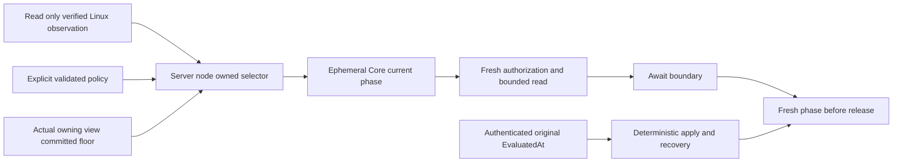

# ADR-133: Node-owned read-only kernel clock phases

Status: Accepted implementation contract; implementation and qualification pending.
Date: 2026-10-15.
Owner: KeyLoad integration owner.
Scope: KL-092 ResourceExecution and existing node-local ownership.

## Context

Current authorization, expiry and scheduler admission need current time. Authenticated committed operations instead retain their original logged EvaluatedAt for deterministic apply and recovery. A configured NTP service or a supplied timestamp does not establish a healthy current clock. ADR-115 TimeProvider ownership and ADR-125 connection-owned execution remain authoritative.

## Decision

KeyLoad.Storage.IO may add a narrowly read-only ResourceExecution/Interop observation for verified little-endian Linux LP64 x64/arm64 GNU libc. The private adjtimex input modes is always zero. Native observation never sets the clock, changes NTP configuration, starts a process or owns database state. Existing unsafe generation remains confined to IO; no new library or dependency cycle is introduced.

Pin authoritative Linux and GNU libc headers. A source-derived208-byte timex layout is a hypothesis until a matching actual Linux runtime ABI probe confirms size, offsets and loaded runtime identity. A private gnu_get_libc_version observer reads at most the named32-byte bound through the first NUL; null, missing symbol, malformed version or absent terminator is unavailable. A GNU version string alone is not ABI proof. Unsupported or unverified runtimes cannot become Ready.

The Server adapter binds once before the owning partition is exposed or silo readiness is admitted. It combines a typed native observation with explicit validated policy, the same original TimeProvider.System and the actual committed floor from the current owning store view. It must not recursively open another store view or accept caller-supplied floors. Missing policy, binding or health refuses current admission; there are no healthy defaults.

Respect STA_NANO only for timeval subsecond interpretation; maximum and estimated errors remain microseconds. Validate ranges and use checked conversions. Capture actual monotonic time before and after observation. Compare the single System UTC sample with the kernel timeval within measured acquisition age, reported error and the declared quantum; reject detected large steps. This is conditional kernel health evidence and does not establish independent physical UTC accuracy.

Core owns an ephemeral nonserialized invocation phase with accepted UTC, original provider and conservative monotonic anchor. Recheck after await and before current result release. Preserve original cancellation, stages, resource limits and the existing read start. One timestamp ages both the phase and original lifetime; intersect bounds without renewal. Server-authenticated identity and fresh persisted authorization remain mandatory.

Authenticated committed Apply and recovery use original logged EvaluatedAt. A later current caller release is a distinct phase and may refuse while preserving the original receipt and unknown-write boundary. Existing deterministic lower-level explicit-time helpers remain deterministic; no fake Ready provider or product test bypass is admitted. Genuine current-provider tests use actual System-time data and separately label arithmetic controls.

## Required evidence and consequences

[KernelClockPhaseAdmission](../Features/ResourceExecution/KernelClockPhaseAdmission.md) defines REQ-KERNEL-PHASE-001–006 and AC-KERNEL-PHASE-001–006. Complete native signatures, provider registration, all current callers, after-await boundaries, actual Linux ABI/health, scheduler, credential/lease, replay, cold recovery and SDK/official MCP Aspire RF3 operations require independent review and original execution. Documentation, source review or local builds close none of those gates. No physical accuracy, power-loss, performance or production claim follows from this decision.

Primary sources: [Linux6.12 timex](https://raw.githubusercontent.com/torvalds/linux/v6.12/include/uapi/linux/timex.h), [GNU libc2.40 timex](https://raw.githubusercontent.com/bminor/glibc/glibc-2.40/sysdeps/unix/sysv/linux/bits/timex.h), [Linux clock state](https://raw.githubusercontent.com/torvalds/linux/v6.12/kernel/time/ntp.c), [GNU libc version declaration](https://raw.githubusercontent.com/bminor/glibc/glibc-2.40/include/gnu/libc-version.h), [GNU libc version implementation](https://raw.githubusercontent.com/bminor/glibc/glibc-2.40/csu/version.c).

