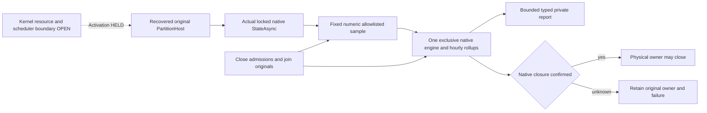

# ADR-134: Node-owned derived operational analytics

Status: Accepted; published dependency and private native owner integrated. The three real-engine component flows pass locally in Stage89. Production activation is HELD by the existing kernel/resource/scheduler prerequisite; complete coverage and Linux/RF3 qualification remain OPEN.

## Verified package and authority

The owner selected the actual [ZoneTree.Analytics 1.0.0 package](https://www.nuget.org/packages/ZoneTree.Analytics/1.0.0). Its official NuGet archive SHA256 is `14254385f46a979ddbfee6c874833b4a3a5e754655bdc39b0525d99262370452`. The nuspec identifies published source commit [f7511306bbf0c375a918fc8a93845b1f596777b7](https://github.com/ZoneTree/ZoneTree.Analytics/tree/f7511306bbf0c375a918fc8a93845b1f596777b7), MIT copyright2026 Ahmed Yasin Koculu, net10.0/net9.0/net8.0 and the sole direct dependency ZoneTree2.0.1. Root owns the central1.0.0 pin, Server package reference, restore/build and unmodified original MIT asset copied to output/publish. Native package APIs and this actual published source control integration; no vendoring, local package or project-reference fallback is admitted.

The earlier71c260e9 source review and expected-publication404 observations remain historical. Publication is now verified; no missing-package defect or issue is claimed. Published1.0.0 provides native cleanup with retained failure ownership: final failure retains remaining owned stores/directory lock and a later DisposeAsync retries cleanup. The reviewed engine, worker and disposal-helper bodies are unchanged between those two source commits; this is current behavior, not evidence of a newly introduced cleanup feature.

R230 restore and R233 package-pin build remain original history. The [Stage89 checkpoint](../implementation/qualification-stage89-foundation.md) supplies the current full Release build, canonical formatter and all three actual native component operations, including observed original caller cancellation. This is local development evidence; production activation, full coverage and Linux/RF3 analytics qualification remain open.

The optional host scheduling and TimeProvider integration request is published as [ZoneTree.Analytics issue1](https://github.com/ZoneTree/ZoneTree.Analytics/issues/1). It is a source/API capability request, not a reproduced defect or a qualification pass.

## Private component and held production path

The private Server ResourceExecution/Analytics component owns one native AnalyticsEngine for its supplied physical node directory, in the fixed private `derived-operational-analytics` child. Actual ServerApplication activation and registration are separately HELD; package reference or component compilation does not start production analytics. It is disposable operational history. Canonical ZoneTree models, replica/atomic journals, RF3 receipts and fresh persisted authorization remain authoritative; OpenTelemetry and ManagedCode.TimeSeries retain their roles. No feature-off switch is added to conceal the missing prerequisite. No additional host, public route, SDK/MCP schema, operation dispatcher or distributed singleton is introduced.

The separately HELD activation overlay would publish an application-owned OperationalAnalyticsRuntime witness before native allocation. After PartitionHost has recovered, StartAsync opens the native engine, obtains the actual locked Consensus.StateAsync snapshot, records and explicitly flushes the first sample before starting public HTTP/silo readiness. One sequential sampler subsequently observes the same native StateAsync every10 seconds through the original TimeProvider.System. It does not hook ordered apply, commands, WAL, commit callbacks or ACK barriers. Sampling success is not database ACK, exact command count or historical completeness; physical replicas must not be summed into cluster transaction totals.

The separately HELD shutdown overlay first settles existing connection work, then closes analytics admission, requests/joins the original sampler cancellation, joins any admitted original flush/query, and awaits native engine cleanup before physical ownership may close. Owner fields are disposed directly in their owning classes. A native cleanup failure remains an original failure; one subsequent native cleanup attempt joins the library's explicitly supported remaining-resource retry without hiding the first failure. HasJoinedEngine is set only after an actual successful native DisposeAsync. Unknown construction/closure retains the application witness and refuses later app/PartitionHost disposal rather than treating a canceled wait as ownership release.

## Privacy and native profile

Only the fixed event `replica-state-sample`, fixed site `keyload-node`, System UTC timestamp and three numeric values enter Track: `committed_position`, `applied_position`, `committed_backlog`. The application reads no snapshot voter/leader/role/term identity for ingestion. It validates0 <= materialized <= committed <= last <=2^53-1, computes subtraction with checked integers, and rejects invalid/unavailable inputs instead of clamping or inventing zero. These nonnegative integer doubles and report aggregates are checked for finiteness, integral value and the same exact-range ceiling.

Raw events, sessions, visitor identification, geography, user-agent details, versions, URL query collection, bot detection, custom filters/enrichers, default web rollups and indexes are disabled. AllowedDimensions is an explicit empty set and MaxCustomDimensions is zero; null would keep all custom dimensions. Track constructs its own event and accepts no caller-shaped payload/dimension/value expressions. EventFilter exceptions fail open upstream and are never used for privacy or authorization.

The native logger has no console/text export. It retains the first original logged exception privately, while native statistics retain numeric error/loss counters. This is bounded first-failure retention, not conservation of every logged exception. Direct operation/cleanup failures still retain all independent originals in the owning server failure ledger. No credential, principal/resource identity, query/document content, private path, URL, IP address or exception detail is written as an analytics event/report field.

## Frozen resource and query contract

Validated init-only OperationalAnalyticsOptions are captured before engine construction. Engineering defaults and ceilings are queue64, buffered rows128, native groups192, buckets168, filled rows192, report65536 UTF8 bytes, mutable store4096 items and disk segment/partition16384 items. One worker and one admitted query-or-flush operation are fixed. Sampling remains10 seconds; native flush/query limits default2 seconds, hourly rollup retention7 days and retention checks60 minutes. Configured reductions remain positive; intervals and capacities are validated without automatic relaxation. These are resource policies, not measured throughput, RSS or physical disk-byte ceilings.

Private ReadAsync accepts only UTC hour-aligned from/to, positive span within the configured retention, from no earlier than current UTC minus retention, and to no later than the next UTC hour. Thus the genuine current bucket is readable without backdating. It constructs one fixed hourly totals query with QuerySource.Rollups, FillMode.None, Events and the three fixed sums. No caller group/filter/metric expression, native raw fallback or raw result object escapes. Projection rejects unexpected source/shape/count/numerics, creates bounded immutable numeric rows and checks the serialized private report byte ceiling. NativePlanComplete describes only native planning coverage, never complete sampled history, zero loss or a database read cut.

Track returns queue acceptance/drop only. TrackAsync is not inserted into database execution. Read/Flush retain the actual original native FlushAsync(None) barrier even when the caller's wait cancels; cancellation does not dispose or replace accepted work. Native QueryAsync uses its actual timeout/token. The native query timeout does not bound an original storage flush or cleanup join. One pending operation remains owned until actual terminal completion. Expected caller-requested original cancellation is retained as ObservedCallerCancellation and does not poison normal joined DisposeAsync; native/unrequested failures remain captured with original ExceptionDispatchInfo and are rethrown without sync-over-async. Genuine native failure latches unavailable admission until joined close/new ownership; no healthy fallback is selected.

## Hard activation hold and remaining gates

Production activation is not selected. REQ-ANALYTICS-005 requires actual existing ResourceExecution/kernel admission and scheduler ownership before integration, not only a lifecycle witness. Existing CommandAdmissionGovernor requires a verified principal/operation payload and cannot honestly admit an invented analytics command. Core AnalyticalReadGate only counts active analytical reads and is internal to Core; it does not schedule native workers. CacheMemoryBudget can reserve modeled bytes/entries until a lease is returned, but such a lease does not redirect native scheduling/clock or prove heap/disk limits. NativeRequestWorkOwner governs its closed request/capability frame kinds, not arbitrary library housekeeping. None is replaced, widened or bypassed here.

Native workers and QueryAsync use Task.Run, housekeeping uses Timer, and retention uses native UTC/Stopwatch. Selecting System does not redirect those primitives through the kernel-clock provider. KL092 actual ABI/provider/current-caller and native scheduler/lifetime qualification remain separate OPEN gates; no fabricated Ready or clock adapter is used. System-clock steps, UTC hour boundaries, native retention/merge cleanup and actual resource reservations require execution. Retention and segment item settings do not prove a hard physical quota. The private component cannot be activated in ServerApplication until a concrete, independently reviewed native-worker admission/lease/kernel/scheduler boundary exists and its original work remains owned through successful native cleanup. The four-file activation overlay is retained separately with exact guards; it is not part of the selected component intake. No library callback is fabricated, no new parallel governor/Task.Run dispatcher is created, and a source-derived reservation alone cannot satisfy this gate. The integration remains resource-unqualified until those gates close; live native files must never be deleted to simulate quota enforcement.

[OperationalAnalytics](../Features/ResourceExecution/OperationalAnalytics.md) maps whole-operation regressions and remaining gates. Published metadata, source review and package-only builds are not executed integration, native worker/queue cancellation, privacy, RF3, physical durability, performance or production-readiness proof. Root owns actual source adoption, full compiler/analyzers and original Linux execution. The owner-required ZoneTree-family reporting rule applies to confirmed reproducible upstream defects; source hypotheses and expected publication history are not defect reports.

