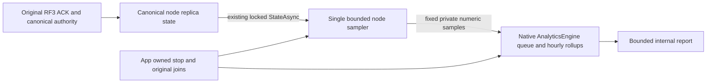

# ADR-134: Node-owned derived operational analytics

Status: PROPOSED; user selected ZoneTree.Analytics for adoption. Published package1.0.0 is verified, centrally pinned, restored and compiled as a dependency. Native engine source integration and all operation/production-activation gates remain OPEN.

## Context and verified dependency

Research on 2026-10-15 inspected [upstream commit 71c260e96908e52450fce1e70b1ec7bdb8fed5dd](https://github.com/ZoneTree/ZoneTree.Analytics/tree/71c260e96908e52450fce1e70b1ec7bdb8fed5dd). Its core project targets net10.0/net9.0/net8.0, directly references only ZoneTree 2.0.1 and uses MIT. Preserve the original license and copyright. The source VersionPrefix is 1.0.0; this is not proof of an available package. Original NuGet gallery and flat-container requests returned 404, exact package search returned zero hits and upstream tags/releases were empty. A genuine published package, verified license/dependency metadata, Root-owned central pin and actual restore/build are prerequisite to executable adoption. No vendored source, local package, project-reference fallback or imaginary version is permitted.

## Decision candidate

Keep one application-owned native AnalyticsEngine per physical node, with an exclusively owned derived subdirectory under that node's private data directory. Server ResourceExecution owns populated Analytics/Configuration, Execution, Lifecycle, Models and Queries roles as needed. KeyLoad.Diagnostics remains BCL-only and its phase bank is unchanged. This engine stores disposable operational history; canonical ZoneTree models, replication journals, RF3 receipts and persisted authorization remain authoritative. ManagedCode.TimeSeries and OpenTelemetry retain their current roles.

A single joined periodic sampler reads the existing native PartitionHost.Consensus.StateAsync(token). That API returns one consistent locked ReplicaNodeState. Record fixed named samples of committed-to-materialized backlog and bounded local progress, with actual observation timestamp. Do not hook TrackAsync into command execution, ordered apply, WAL, commit callbacks or acknowledgement barriers. Samples may miss intervals. Never equate sample count with command count, treat accepted ingestion as durable commit, or sum physical replica histories into cluster transaction totals. No second authority, logical model store or cross-node analytics coordinator is introduced.

The initial native profile has one worker, bounded Drop queue, no raw events, sessions, visitors, geography, UA collection, enrichers, web defaults or indexes. Clear default rollup definitions and configure only the fixed operational totals. Native numeric values are doubles: compute differences with checked integer arithmetic and reject unavailable/invalid/out-of-exact-range observations rather than truncate, overflow, clamp or manufacture zero. No credentials, principal/resource identifiers, query/document content, errors with private text, URLs or IP addresses enter analytics.

The app-owned lifecycle starts after successful physical recovery, closes analytics sampling/report admission before physical shutdown, cancels and joins the original sampler and accepted query work, then awaits native DisposeAsync before PartitionHost closes. No duplicate host or providers. The actual native DisposeAsync has no token: a canceled observation cannot release ownership or abandon original work. Construction/worker/query/flush/disposal failures remain observed original failures, without changing the outcome of already committed database work. The owning server failure ledger retains cleanup errors with the primary failure.

## Native API contract

Track returns queue acceptance. With QueueFullBehavior.Drop it does not wait for queue space, though snapshot/filter validation occurs synchronously. TrackAsync always waits for space and its cancellation token cancels that wait; it does not mean persisted ingestion or RF3 acknowledgement. FlushAsync enqueues worker barriers and waits for processing/aggregate flush; cancellation ends the caller wait without canceling already accepted work. QueryAsync schedules the actual synchronous native query with Task.Run and native timeout/cancellation. Native query group, time-bucket and filled-row limits are required in addition to a one-query admission owner. Native EventFilter exceptions fail open; filters and enrichers must never enforce authorization or privacy. Queue admission and FlushAsync do not provide a per-event persistence receipt: native rejected/failed events must remain explicit diagnostic loss. DisposeAsync drains workers and flushes/closes native stores; the actual final failure and owned resource settlement must be tested.

## Bounds proposed for implementation review

Use captured validated IOptions with an immutable runtime snapshot; engineering values are proposals, not measurements: sample every 10 seconds; one worker; queue 64; 128 buffered rollup rows; flush every 2 seconds; hourly-only rollups retained 7 days; one query; query timeout 2 seconds; maximum 192 groups, 168 time buckets and 192 filled rows; native raw scan parallelism 1 even though raw storage is disabled. Fixed private report permits at most the last 7 days with hourly buckets and no user-shaped query/group/metric expressions. A native query must never trigger hidden raw fallback. Independent expected metric literals must verify coverage.

Native retention hides expired data before physical removal, which may wait for merges. These values are not a hard RSS or disk-byte ceiling. A hard physical quota, separate retention/check interval and actual store settings need explicit integration review; never delete live native files or claim retention alone proves bounded disk use. Failure to establish the selected resource contract keeps adoption OPEN.

Native worker startup and QueryAsync use Task.Run; native housekeeping uses System.Threading.Timer, and ingestion/retention use DateTime.UtcNow plus Stopwatch for elapsed flush intervals. No injected TimeProvider contract was observed. Registering KeyLoad clock or scheduler services does not redirect this native work. Before integration, define actual existing ResourceExecution/kernel admission, scheduler and shutdown ownership for the sampler, query and native worker lifetime; preserve native cancellation and join original tasks. System-clock retention, reporting time zone/hour boundaries and clock-change behavior remain explicit qualification gates, separate from canonical clock admission. No fake clock adapter or claim that all native work already runs under the kernel is admitted.

Before Track, the application must construct only the fixed allowlisted event/value names and permitted fields. Freeze an explicit dimension allowlist, using an empty set when none are permitted: native AllowedDimensions=null keeps all custom dimensions. EventFilter is not a privacy boundary. Freeze a finite private-report field and byte budget before implementation; native group/bucket/row limits do not impose a result-byte ceiling. Keep integration OPEN until those bounds and their original-task cancellation/settlement oracles are specified.

## Reporting and qualification

Use a bounded internal typed report owner; do not map the library's collection/reporting HTTP routes or install its ASP.NET middleware. Any later public SDK/MCP surface requires its own operation schema, fresh persisted authorization, connection-owned Orleans execution under ADR-125 and explicit RF3 scope. Existing database status contracts and wire IDs are unchanged.

See [OperationalAnalytics requirements](../Features/ResourceExecution/OperationalAnalytics.md). This document is a source proposal, not measured performance, package adoption, physical durability, RF3, privacy execution or readiness proof. Root owns dependency pins, integration and Linux execution; upstream publication is an external prerequisite. The owner clarified that NuGet publication is expected soon. This expected unpublished state is an external prerequisite, not a confirmed upstream defect; no missing-package issue is required or published. Continue independent work while awaiting genuine publication.

## Published package prerequisite update

On 2026-10-15 the official NuGet feed supplied ZoneTree.Analytics1.0.0, repository commit `f7511306bbf0c375a918fc8a93845b1f596777b7`, nupkg SHA256 `14254385f46a979ddbfee6c874833b4a3a5e754655bdc39b0525d99262370452`. Its net10.0 dependency is ZoneTree2.0.1. The original MIT license/copyright is copied unchanged into server output/publish content. R230 restore and R233 full Release build pass; this closes the publication/pin prerequisite only. The earlier404 observations above remain original history. Native component operation proof and actual kernel/scheduler/lifecycle ownership remain open before production activation.
