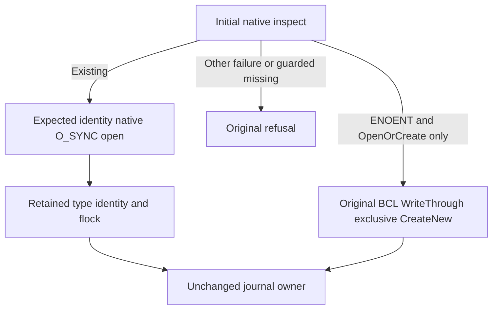

# ADR-135: Native write-through journal admission

Status: Proposed; no active source change or executed acceptance.

Retain existing [ADR-003](ADR-003-durability-ack-barrier.md), [ADR-011](ADR-011-current-native-format.md), [ADR-046](ADR-046-storage-private-owners.md) and [ADR-116](ADR-116-first-release-current-format.md). The native file owner opens existing regular journals with original identity/type/flock protections AND the same platform O_SYNC used by .NET10 FileOptions.WriteThrough. Only Linux/macOS little-endian x64/arm64 existing support is in scope; other platforms stay unsupported. No new provider, library, native struct, System.Native internal export or fallback engine.

Primary source: .NET runtime v10.0.10 SafeFileHandle.Unix.cs maps WriteThrough to PAL O_SYNC; v10.0.10 pal_io.c maps to platform O_SYNC. Linux v6.12 asm-generic fcntl defines full O_SYNC as0x101000, not merely O_DSYNC. Apple xnu11417.101.15 sys/_types/_o_sync.h defines O_SYNC0x80. Exact bounded originals/hash inventory lives in the source proposal. Local installed10.0.10 metadata is evidence of presence only; its raw commit retrieval failed404, so release-tag source is not represented as exact installed binary provenance. Actual kernel handle flags and Linux execution remain mandatory.

The x64 Linux and both supported macOS native default flags retain their original values and operations. The same-owner confirmed ARM64 mapping defect is corrected: Linux ARM64 O_NOFOLLOW is0x8000 from its selected asm/fcntl.h override, while x64 uses generic0x20000. The old universal0x20000 is ARM64 O_LARGEFILE, not no-follow; no end-to-end bypass or race is claimed observed. All other selected access/nonblocking/close-on-exec/sync flags retain verified primary-header values. Unsupported architectures fail closed. New named write-through opening adds only O_SYNC. Keep retained handle regular type, expected device/inode/length, no-follow/nonblocking/close-on-exec, same advisory lock, normalized Name, original share/buffer/disposal/error ownership. No assertion equates SafeHandle isAsync:false or Flush(true) with WriteThrough.

Journal opening first inspects the path. ONLY initial native missing-entry admission plus original OpenOrCreate allows retained BCL CreateNew/ReadWrite/ShareRead/validated buffer/WriteThrough. After expected identity is known, native existing-open has no create fallback or retry. Guarded FileMode.Open never creates. Concurrent creation fails closed at CreateNew; no symlink-following OpenOrCreate. Header→payload→Flush(true)→apply→position and recovery/checkpoint flush/swap ordering are unchanged.

Acceptance requires genuine same-OS original BCL/native F_GETFL O_SYNC observations, unchanged native defaults and invalid-entry refusal, full canonical Commit/replay/two native cold cuts, actual bounded RecoveryProcess FIFO/symlink/missing refusal/repair, compiler/style and Linux recovery/cluster/fault evidence. No source review, process-kill or fsync promise claims power-loss durability.
