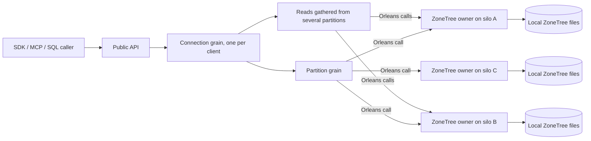

# ADR-136: Orleans is the cluster; every silo owns its own ZoneTree

Status: Accepted. Implementation and exact-source runtime qualification are in progress.

## Decision

KeyLoad is an Orleans application. Orleans does all of the clustering; KeyLoad writes clear Orleans code that uses it.

| Concern | Owner |
|---|---|
| Membership, silo discovery, failure detection | Native Orleans clustering provider (Azure Table storage through Aspire, or localhost clustering for local development) |
| Grain directory, placement, activation migration and repartitioning | Native Orleans distributed grain directory, placement and activation repartitioner |
| Internal communication between silos | Ordinary Orleans grain calls, Grain Service calls and Orleans streams |
| Scaling | Adding silos to the Orleans cluster |
| Client connection | One Orleans connection grain per connected client ([ADR-125](ADR-125-connection-owned-execution.md)) |
| Logical partition | An ordinary Orleans grain that serializes commands for one logical partition and calls the storage owners |
| Files on a node | One silo-local ZoneTree owner (Orleans Grain Service) per silo: ZoneTree stores, WAL/journals, file locks, ordered apply |
| Copies of data | The partition grain sends the write through Orleans calls to the ZoneTree owners on `KeyLoad:ReplicaCount` silos ([ADR-143](ADR-143-independent-silo-replica-topology.md)) |

Request flow: public API (HTTP, .NET SDK, MCP, SQL) → connection grain → partition grains → ZoneTree owner on the same node or on other nodes through Orleans → results are gathered → returned to the caller.

## Rules

1. Native Orleans APIs own every cluster responsibility in the table above. KeyLoad code uses their membership snapshots, grain addresses and lifecycle directly.
2. Storage files never move. The ZoneTree owner opens the node's files once in its Grain Service initialization through the native silo lifecycle and closes them once at silo shutdown, after the grains that use them have drained. Grain activations may migrate; a migrated grain simply calls the ZoneTree owners again through Orleans.
3. Writes: the database grain sends one prepared native command in canonical order to its ReplicaCount ZoneTree owners through Orleans and returns success after every configured copy confirms persisted apply (ADR-003). Receipts report the actual persisted copy count separately from durability. An unavailable required copy prevents a successful write.
4. Reads: grains read from the ZoneTree owner of the relevant node through Orleans; a read that spans partitions is fanned out by the connection grain and merged within the operation's bounds.
5. Grains that need locality use the native `[Immovable]` attribute; all other grains keep native migration.
6. Every operation still checks fresh persisted authorization, runs within bounded admission and cancellation, keeps idempotent command outcomes and emits OpenTelemetry through the native integrations.

## Verification

Verify native provider, directory and repartitioner configuration; silo-local
ZoneTree ownership; and connection-grain calls through the real .NET SDK and
MCP clients against the Aspire-owned topology. Writes, reads, cancellation,
silo restart, duplicate commands and joined shutdown must preserve their
observable contracts. Build, TUnit, process recovery and exact-source Linux
cluster qualification are separate gates. Process-kill tests do not prove
power-loss durability.

## Consequences

The design is small enough to read in one sitting. Availability and placement of activations follow Orleans behaviour. Physical file rebalancing, split and merge are outside this design.

The current implementation reads native active membership, orders native silo names and selects ReplicaCount addresses. Equal-cut reads prefer their executing silo. This is not a file-rebalancing or general empty-copy recovery mechanism; those runtime guarantees remain unqualified. See [ClusterReplication](../Features/ClusterReplication.md) for the actual retry and recovery limits.
