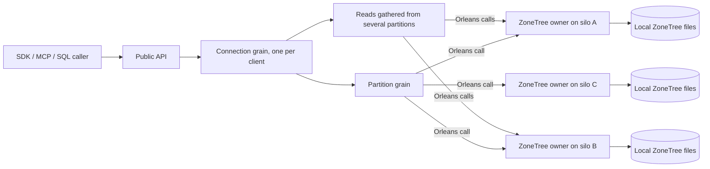

# ADR-136: Orleans is the cluster; every silo owns its own ZoneTree

Status: Accepted by owner direction 2026-10-18 (supersedes the 2026-10-15 text of this ADR). Implementation pending: the current source still contains self-written cluster mechanisms that must be removed. Canonical slices: ClusterRouting, ClusterReplication, StorageRecovery. Related: [ADR-036](ADR-036-orleans-foundation.md), [ADR-125](ADR-125-connection-owned-execution.md), [ADR-143](ADR-143-independent-silo-replica-topology.md), [ADR-110](ADR-110-native-orleans-execution-primitives.md), [ADR-003](ADR-003-durability-ack-barrier.md).

## Decision

KeyLoad is an Orleans application. Orleans does all of the clustering; KeyLoad writes clear Orleans code that uses it.

| Concern | Owner |
|---|---|
| Membership, silo discovery, failure detection | Native Orleans clustering provider (Azure Table storage through Aspire, or localhost clustering for local development) |
| Grain directory, placement, activation migration and repartitioning | Native Orleans distributed grain directory, placement and activation repartitioner |
| Internal communication between silos | Ordinary Orleans grain calls, Grain Service calls and Orleans streams |
| Scaling | Adding silos to the Orleans cluster |
| Client connection | One Orleans connection grain per connected client ([ADR-125](ADR-125-connection-owned-execution.md)) |
| Logical partition | An ordinary Orleans grain that serializes commands for one logical partition and calls the storage owners |
| Files on a node | One silo-local ZoneTree owner (Orleans Grain Service) per silo: ZoneTree stores, WAL/journals, file locks, ordered apply |
| Copies of data | The partition grain sends the write through Orleans calls to the ZoneTree owners on `KeyLoad:ReplicaCount` silos ([ADR-143](ADR-143-independent-silo-replica-topology.md)) |

Request flow: public API (HTTP, .NET SDK, MCP, SQL) → connection grain → partition grains → ZoneTree owner on the same node or on other nodes through Orleans → results are gathered → returned to the caller.

## Rules

1. KeyLoad does not implement clustering. There is no KeyLoad consensus, term, vote or leader protocol; no membership table, discovery service, peer transport or peer authentication protocol; no physical owner directory, shard catalog, placement manager, capacity packing, partition movement/split/merge protocol, ownership epoch, session token or coordination-only silo role.
2. Storage files never move. The ZoneTree owner opens the node's files once in its Grain Service initialization through the native silo lifecycle and closes them once at silo shutdown, after the grains that use them have drained. Grain activations may migrate; a migrated grain simply calls the ZoneTree owners again through Orleans.
3. Writes: the partition grain applies a command in order, sends it to the ZoneTree owners of its ReplicaCount copies through Orleans and returns success after a majority of copies confirm durable local apply (ADR-003). A copy that was offline catches up by reading committed records from another copy through Orleans calls.
4. Reads: grains read from the ZoneTree owner of the relevant node through Orleans; a read that spans partitions is fanned out by the connection grain and merged within the operation's bounds.
5. Grains that need locality use the native `[Immovable]` attribute; all other grains keep native migration.
6. Every operation still checks fresh persisted authorization, runs within bounded admission and cancellation, keeps idempotent command outcomes and emits OpenTelemetry through the native integrations.

## Implementation contract

| Stage | Work | Verification |
|---|---|---|
| 1 | Keep the native clustering provider, distributed directory and repartitioner configuration ([ADR-036](ADR-036-orleans-foundation.md)); one silo-local ZoneTree Grain Service registered first and opened in its native `Init` | Release build; Aspire host starts the configured silos; restart reopens the same files |
| 2 | Connection grain → partition grain → ZoneTree owner calls for every public operation; copies to ReplicaCount owners through Orleans with majority acknowledgement | TUnit operations through the real .NET SDK and official MCP client against the Aspire-owned cluster: write, read back, restart a silo, read again |
| 3 | Remove the self-written cluster code and its tests, routes, SDK/MCP surfaces and options in the same change as the replacement | Build, unit, process-recovery and Aspire cluster suites green; no references remain |

Process-kill tests do not prove power-loss durability. Exact-source Linux CI remains the qualification gate.

## Consequences

The design is small enough to read in one sitting. Availability and placement of activations follow Orleans behaviour. Features that previously depended on custom placement or movement (physical rebalancing, split/merge) are out of scope.

Open question for the owner: which silos store the copies of a partition when `SiloCount` is larger than `ReplicaCount`. Today the copies live on the configured replica silos (by default all three silos of a three-silo cluster, see ADR-143). Any answer must stay inside Orleans and must not reintroduce a placement or movement protocol.
