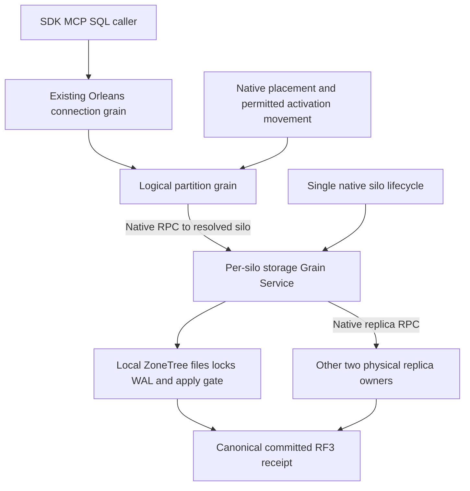

# ADR-136: Orleans owns partition execution and silo-local storage lifetime

Status: Accepted implementation contract by owner direction, 2026-10-15; implementation and runtime qualification remain open. Canonical slices: ClusterRouting, StorageRecovery, ClusterReplication and ResourceExecution. Requirements: REQ-FOUNDATION-003..006/009/010 in [FoundationDelivery](../Features/RepositoryGovernance/FoundationDelivery.md). This decision refines ADR-036/094/115/125 and does not change persisted formats or introduce a migration.

## Decision and ownership

Use one application host with the native Orleans silo. Native membership and failure detection, distributed grain directory, placement, activation movement, grain turns, Grain Services, Streams and selected scheduling primitives own their corresponding runtime responsibilities. Reuse existing native calls: the current replica, movement, document and graph services already use Orleans GrainService RPC. Do not replace them with another transport or infer an HTTP transport from a class name.

| Responsibility | Native owner and invariant |
|---|---|
| Client connection and independent operations | Existing ADR-125 connection grain and ManagedCode.Communication native response streams. Preserve separate operation identities, fresh authorization, bounded admission, original producer settlement and cancellation. |
| Logical atomic partition | Stable partition-grain identity routes and serializes decisions for that logical partition. Its ID is independent of physical shard, silo address and activation lifetime. |
| Physical ZoneTree partition files | A silo-local Grain Service owns the original asynchronous opening, published node-local PartitionHost, locks, journals and eventual joined close. One service instance can own the silo's bounded physical-partition registry. No migrating grain owns an open file handle. |
| Calls to a particular physical replica | Existing native GrainServiceClient addresses the actual current silo generation for the selected database replica; verify database identity, voter/incarnation, authority and ownership epoch. |
| Replica durability and atomic apply | Node-local ZoneTree plus the existing ordered canonical commit, RF3 acknowledgement, outcome and recovery contracts. Native membership or directory replication does not supply these data guarantees. |
| Scheduled/model work | Activation timers for disposable activation work; reminders or selected Durable Jobs for their actual durable delivery contract; bounded StatelessWorkers for independent interchangeable work; native library maintainers for their own backend work when their completion contract is sufficient. |

Grain Service locality is explicit. Default hash-ring service selection is not evidence that a call reached the owner of a particular database file. Physical replica clients must address the resolved native silo, and reject a stale generation or wrong partition before effects.

## Placement and activation movement

`PreferLocalPlacement` is a preference at activation creation, with fallback to a compatible silo. It neither pins an activation nor moves storage. A placement hint is also not an authority token. Native placement filters/eligible-silo metadata select a compatible execution cohort; persisted database authority selects the physical replica owner.

Storage owners are per-silo services and never participate in activation repartitioning. A logical coordinator may move only when it re-resolves the current physical owner and authority on every operation and carries no constructor-bound assumption that an arbitrary local DatabaseEngine is that partition. Audit each current grain before enabling migration for it; a locality-sensitive grain whose invariant requires a fixed silo must opt out using the pinned native API. Keep native migration available for the grains whose contracts support it, instead of applying one blanket policy to storage owners, connections and compute workers.

Connection migration additionally preserves its original in-flight producer/callback ownership and verified identity. There is no migration of an executing request by dropping its retained native task, no silent owner substitution and no automatic retry of an unknown committed write. Physical replica movement/split/merge is the separate KL-036/070/071/072 data operation with checkpoint, catch-up and authority cutover.

## One-host startup contract

1. Register immutable validated options, stable node identity, native clustering resources, serialization/identity converters and OpenTelemetry before acquisition. Register a single silo-local storage Grain Service and its one ownership record. Registration must not open files.
2. Constructors of native lifecycle participants, Grain Services and runtime-journal/job providers must not borrow an unpublished PartitionHost. Generic Host resolves hosted-service constructors before their start callbacks; an earlier storage hosted service alone does not fix that dependency cycle. Existing borrowers resolve at operation time or await the same original publication at their actual lifecycle boundary; they do not create another store or a parallel provider.
3. Register the storage Grain Service first and open/recover local ZoneTree in its original awaited `Init` operation. Pinned Orleans resolves all Grain Service constructors before it calls their Init operations sequentially: every constructor must defer storage borrowing, and a borrower cannot await publication from a service whose Init would run later. Subsequent service Init operations use the same completed publication. Independent lifecycle callbacks at the same stage still have no ordering guarantee. Do not wait for quorum/RPC from a constructor or pre-Active native startup callback.
4. After native Active, bootstrap/verify the persisted database catalog and RF3 authority. Keep native membership readiness, local storage availability and authorized database readiness distinct. A bootstrap operation which itself needs grain RPC must not be awaited by the host callback that prevents the silo becoming Active.
5. Admit public SDK/MCP/SQL only after the actual RF3 database gate and fresh persisted identity are ready. Initial setup may expose only its explicitly authorized bootstrap surface. Normal first-start topology has three voters. The separate two-RF3/six-silo movement fixture is not a universal readiness requirement.

## Shutdown and failed acquisition

Close public admission, cancel and join the original connection operations and native job producers, then drain database requests while the required native services still exist. Native Durable Jobs already owns its scheduling admission and worker shutdown; do not reproduce that runtime with reflection or a parallel lifecycle wrapper.

The storage Grain Service's ordinary `Stop` is not permission to close files while grain deactivation, directory shutdown or replica callbacks can still use them. Retain the original physical-close task in the same owner, and join it through native silo lifecycle after the existing RuntimeStorageServices replica-transport drain completes and before lower runtime services disappear. The exact callback registration must name native stage constants and be verified against Orleans10.4 source. Same-stage callbacks execute concurrently; later callbacks may still run after a previous failure, so explicit original-task joins and failure retention remain mandatory.

Acquisition failure, cancellation, repeated close and partial host startup all settle the same opening/closing tasks exactly once. Keep the first failure and every cleanup failure; unknown close retains its physical owner and evidence root. Never turn a canceled caller wait into proof that its underlying native producer ended. Preserve the current never-started-silo stop guard until the unified-host failed-start operation proves equivalent cleanup; deleting it based on naming alone would lose a known contract.

## Transactions

Native Orleans Transactions supplies distributed ACID transactions over participating `ITransactionalState<T>` using `ITransactionalStateStorage<T>`. It is a candidate for short changes spanning multiple grain-owned control states. All participating access uses `PerformRead`/`PerformUpdate`, the actual native transaction context and the required grain scheduling contract.

Calling arbitrary ZoneTree APIs inside a transaction does not enlist those writes. A transactional-state provider backed by the actual canonical ZoneTree/RF3 path must prove prepare/commit/abort persistence, recovery, isolation and unknown-outcome behavior before KeyLoad promises atomic cross-grain database effects. Do not add an in-memory/development storage bridge, duplicate authoritative state, a custom replacement transaction coordinator or a package merely to advertise transactions. Native transaction support is evaluated inside KL-012/069 and the relevant model composition contract; it is not an invented prerequisite to the first same-partition write.

Existing same-partition document/table/event/queue batches continue through their canonical atomic writer. ZoneTree native local transactions and snapshot iterators are reused where they fit that writer's contract; they do not independently establish RF3 acknowledgement or multi-partition atomicity. Long operations, external effects and queue delivery retain idempotent/outbox recovery instead of holding an unbounded distributed transaction.

## Versions and source basis

The current central pins are Orleans10.4.0, Durable Jobs/Journaling10.4.0-alpha.1, ZoneTree2.0.1, FullTextSearch1.0.9 and Analytics1.0.0. Jobs/Journaling remain prerelease; existing native registration is not stable-provider qualification. No package version changes are authorized by this ADR.

Use the [official Grain Services documentation](https://learn.microsoft.com/en-us/dotnet/orleans/grains/grainservices), [placement documentation](https://learn.microsoft.com/en-us/dotnet/orleans/grains/grain-placement), [silo lifecycle](https://learn.microsoft.com/en-us/dotnet/orleans/host/silo-lifecycle), [transactions](https://learn.microsoft.com/en-us/dotnet/orleans/grains/transactions) and [ZoneTree native source](https://github.com/ZoneTree/ZoneTree). Version-sensitive ordering and migration APIs must match the installed Orleans source commit `d114d7522a53b8cce4c6b97d44293e5c7273d766`; the ZoneTree2.0.1 source identity is `ec774af2223bd87457a0aa985908f0b4e508e4c8`.

## Implementation and acceptance

| Existing tasks / requirement | Concrete verification |
|---|---|
| KL-008/014/018/019, REQ-FOUNDATION-009 | One real host and original per-silo file owner; startup, failure after partial acquisition, cancellation, concurrent close, every native resource joined, same-root cold reopen and healthy public write. No nested-host or manually pre-opened fixture fallback. |
| KL-019/069, REQ-FOUNDATION-005/010 | Actual native membership/directory/placement; target-silo service identity and RF3 authority; compatible activation movement or explicit native opt-out; no file reopening at migration, no wrong-owner effects, strong read/replay after restart. |
| KL-012/069, REQ-FOUNDATION-010 | Transaction selection records real participants/provider and exact atomic boundary. Any adopted distributed transaction passes commit/abort/concurrent conflict/participant crash/restart and unknown-outcome operations through real persisted storage. Until then cross-grain ACID remains unavailable. |
| KL-015/020/021/053/061/064/066, REQ-FOUNDATION-003/004/006 | Actual test-owned Aspire Docker RF3, real SDK and official MCP operation, persisted authorization and revoke/repair, exact state/receipt/replay, cancellation/healthy continuation, restart, telemetry privacy and joined cleanup. |

Frontend and new client API/schema are N/A for this internal ownership refactor. Existing public operations, aliases/field IDs, limits and current-format bytes remain protected. Build/static checks prove only their actual scope; local native operations are development proof, and exact-source Linux fault/endurance/coverage gates still qualify delivery. Whole-task status changes only on complete acceptance.

## Current per-grain native opt-out

The current CommandPartitionGrain, ConnectionGrain, RecurringDueCoordinatorGrain, AnnProjectionCoordinatorGrain and SampleChunkCoordinatorGrain use native `Orleans.Placement.Immovable(Orleans.Placement.ImmovableKind.Any)`. This excludes automatic repartitioner/rebalancer migration without disabling either native capability globally. Preserve their existing placement, reentrancy, grain aliases, wire IDs and durable identities. It is an interim explicit eligibility policy while their local storage/runtime dependencies require locality; it is not an owner-resolution implementation or a hard local-only placement guarantee.

Pinned Orleans explicitly permits user-initiated migration despite Immovable. Only the already-existing opt-in same-RF3 RequestCqrsProbeMigration remains selected: exact original claim/activation, target in the same configured voter set, refreshed authenticated domain identity and current silo generation, original producer settlement, persisted authority checks on subsequent operations, full original receipt/state/replay and two-cold whole-operation verification. Its foreign/cancel refusals remain. Ordinary manual migration is unavailable; broader logical migration requires the service-based current physical-owner routing proof first. Removing the current discovery layer must preserve those minimal identity/generation fences in native replacement calls, not silently broaden target eligibility.

Traceability and the unchanged real-operation selectors are REQ/AC-ROUTE-MIGRATION-001..003 in [ClusterRouting](../Features/ClusterRouting.md#native-per-grain-automatic-migration-eligibility). Attribute presence is source configuration only. Initial placement, failure/reactivation safety, accepted original connection-producer drain, current authorization, native automatic-exclusion observation and full exact-source RF3 qualification remain OPEN until their respective operations are executed. No new clock, scheduler, provider, package or physical data-movement contract follows from this policy.
