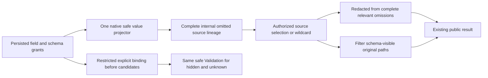

# ADR-137: Schema-visible safe projection and restricted field binding

Status: Selected implementation contract; source and runtime qualification OPEN.

## Context

Architecture sections30.2–30.3 and KL-062/063/064 require sensitive values and field-schema metadata to have distinct persisted authority. Current omit-default projection retains complete omitted source paths and derives Redacted from them. Dropping those paths before selection would lose the redaction flag and source lineage. Open document fields have no closed visible-column catalog, so rejecting only an explicitly hidden path while returning null for an unknown path would disclose hidden-schema membership.

This decision implements the coordinator-selected restricted-binding contract. It supplements ADR-014/015/022/093/116/130. It introduces no library, storage owner, identity authority, compatibility reader, migration or historical-format qualification.

## Decision

1. Append nullable `SensitiveFieldPolicy.SchemaReadGrant` at Orleans field ID6. Existing IDs0–5 and the contract alias remain assigned to their current members. Null explicitly means public schema in the new product contract; a nonnull value names the current persisted principal field grant required to disclose schema metadata. Nonnull values use the existing `JsonData.Identifier` validation, including empty/whitespace/control/byte-limit rejection. JSON omits this optional null member by its declared representation. This is not a historical-reader fallback. The same administrator-owned ResourceDefinition/CAS/SchemaVersion authority persists field and header policies. Parent-capacity accounting includes this nullable string.
2. Schema authority is independent of raw-read, raw-use, field-write, required-processing and sensitive-replacement authority. A raw-read/use grant cannot supply a missing schema grant. An authorized administrator follows the existing persisted administrator grant rule. No ticket gains roles or field grants.
3. Preserve the existing native `IAuthorizationPolicy.Project` JSON/out-complete-omitted contract and its one value projector. Add `CanReadFieldSchema(principal, policy)` and `RequireSchemaVisibility(principal, resource)` to that interface. Complete omitted source paths remain local internal execution data; they are not public metadata. Existing JSON-only consumers retain their value projection semantics.
4. Core adds an internal `DocumentProjection` containing `Value: DocumentResult` and `CompleteOmittedPaths: ImmutableArray<string>`, returned by internal `DatabaseEngine.ProjectWithLineage`. Public `Project` returns Value. Redacted is derived from complete omissions before public-path filtering. A single Core metadata helper retains each omitted path only when every effective overlapping policy permits its schema disclosure. This conservative overlap rule prevents a visible descendant/duplicate policy from revealing an ancestor protected by an unmet schema grant. Order of disclosed original paths is retained. Generic redaction is represented by existing `Redacted=true` plus empty `RedactedFields`; public output aliases and field IDs do not change.
5. Query selection intersects complete internal source lineage with actual selected source policies, independently filters public paths, and returns both a redaction flag and visible paths. An unrelated public source has no selected redaction. Wildcard retains the whole source Value. Join emitters OR source redaction flags independently and prefix only visible source paths. Model policy rebasing preserves the schema grant. Saga payload/header/state metadata filters disclosed paths separately from its original complete-omission boolean. Queue/event/graph/time-series JSON-only results remain masked through the same projector.
System ID/revision selection, filtering and ordering are not payload JSON sources: an omitted root payload policy therefore contributes no selected redaction or public paths to those exact system values, and payload raw-use policies do not authorize these independent system operands. This source identity exception never follows an output alias or similarly named user field.

6. If ANY effective resource field policy has an unmet schema grant, restricted query binding applies before candidate lookup, field-specific validation errors, path-dependent plan metadata or EXPLAIN execution. Every non-system explicit source path in selection, filter, order or join yields the same `Validation` and fixed detail `The requested field binding is unavailable.` This covers known public, known protected and unknown paths uniformly. Only exact existing `SqlSyntax.MetadataIdPath` and `MetadataRevisionPath` source identities are system exemptions; output aliases and similarly spelled payload fields do not qualify. A safe wildcard value projection is allowed. Schema-visible resources retain their declared missing/null and raw-use contracts.
Pure structural grammar and parameter normalization remain before admission. Source-specific join predicate path whitelists are validated by the existing actual resource-bound binder after current schema authority, not by pre-resource normalization; schema-visible resources retain their original Unsupported classification before candidate lookup. No extra pre-authentication resource read is introduced.

7. Special queue/event entity-reference and relational join binders must enforce each participating source's schema authority before schema-dependent errors/candidates, including implicit referenced field use. Preserve the already selected KL-048 typed binding as an explicit future source dependency; do not overwrite its postimage. Live and partition queries preserve their existing fresh bind and schema-version/cursor checks.
8. Hidden-schema EXPLAIN must not expose index names, access paths, schema, estimates or leaf metadata through a wildcard loophole. Its exact owning Explain-v2 integration is coordinated with Main; the conservative required behavior is the same generic Validation before planning on a restricted source. Administrative resource configuration remains privileged; the existing AdminCatalog summary and static MCP guide do not become unprivileged field catalogs. SDK/MCP/SQL/AST/Q1 public surfaces use current persisted authority and sanitized transport errors.
9. JSON mutations, replacement, raw use, replay and grants retain their existing distinct semantics. This decision does not invent a general closed relational schema for open documents or change blind-write authority. Generic schema binding is the declared query contract; other privacy domains and safe Export remain separate mandatory KL-064 gates.

## Ownership and sequence

Freeze this ADR and [feature contract](../Features/Authorization/SchemaVisibleProjection.md) before code images. A owns DTO, native Security evaluation and resource grant validation. Root owns IAuthorizationPolicy, internal Core projection/metadata, Saga metadata and server capacity bound. C owns selected-row/join projectors and the exact KL-048-dependent binder overlay after owner coordination. B owns genuine native and Aspire RF3 whole operations. Main alone applies shared SourceY, builds, discovers/runs tests and performs Git actions. No code packet is qualified by its source receipt.

## Consequences and qualification

Schema denial deliberately restricts even otherwise public explicit paths within that resource, allowing open-schema hidden/unknown indistinguishability without a fabricated field catalog. Safe wildcard access remains bounded, row-authorized and value-masked. A caller with raw values but no schema grant still cannot bind an explicit source path. The internal lineage never enters public serializers, diagnostics, retained authorities or alternate storage.

Required proof includes serializer IDs and declared JSON representation; invalid grant no-effects; policy CAS/current-principal repair and revoke; independent raw-read/use/schema authority; generic and mixed redaction with exact original paths and bool; root/array/alias/two-source joins; public/hidden/unknown selection/filter/order/EXPLAIN equality and no candidate effects; actual SDK and official MCP sanitized results; immutable original receipts, canonical documents/outbox, healthy continuation and two actual same-root cold cycles. Preserve normal SIMD, native TUnit, process recovery, RF3 and exact-source Linux gates. No historical record reader, upgrade, migration, compatibility dispatcher or fallback is implemented or claimed. No speed, durability or full-product acceptance follows from this design.
