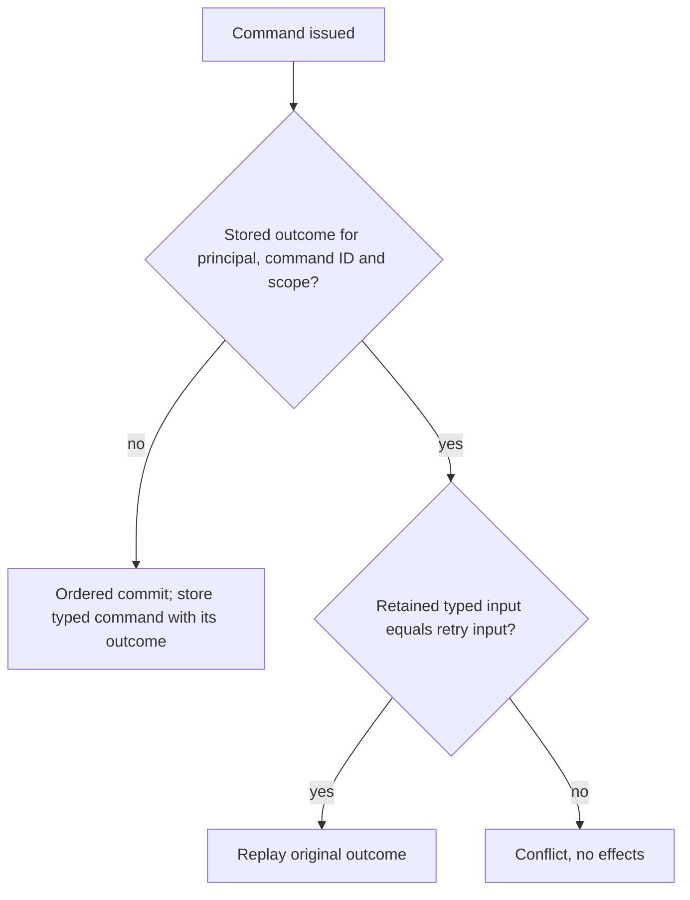

# ADR-140: Command identity without fingerprints

Status: owner-directed contract (2026-10-31); delivered-source qualification remains open.

## Context

Every command used to carry a SHA256 fingerprint of its JSON-serialized input, principal and kind. Analytics
batches were additionally canonicalized into ordered JSON before hashing. Each new command therefore serialized
its whole input to JSON and hashed it, and the stored outcome, resource lifetimes, resource effect admissions and
queue transfer authorities copied that digest. The owner directed that commands carry no hashes or extra
serialization.

## Decision

- `DatabaseCommand` carries `Kind`, typed `Input`, retry decisions and resource admission. It has no fingerprint;
  field 2 is retired. `StoredOutcome` has no fingerprint; field 0 is retired.
- A retry is recognized by its outcome key (principal, command ID and scope). Only when a stored outcome exists,
  the receiving node compares the public JSON shape of the retained typed input with the retry's typed input
  (`DatabaseCommandContentIdentity.SameContent`); server-attached `[JsonIgnore]` state is not command content.
  Equal input replays the original outcome, including a retry whose raw JSON differs only in spelling or
  whitespace; different input is `Conflict`. Both sides are deserialized on the same node, so immutable
  dictionaries enumerate in the same order for the same keys.
- A resource incarnation is the creating command GUID in `N` format
  ([ResourceLifetime](../Features/ResourceExecution/ResourceLifetime.md)).
- Resource effect admissions, remote transfer accept failures and repair witnesses identify their command by
  command ID only.
- Analytics batches receive no canonical identity text, and analytics issuance needs no original read budget.

## Acceptance and evidence boundaries

AC-CMD-ID-001: `CanonicalJsonTests.AcMp006CanonicalCommandFingerprintKeepsPersistedRetryIdempotent` replays a
same-ID retry without a new position and refuses changed content with `Conflict`.
`PublicNormalizationTests.ConfiguredNullGrantRetainsCommittedClockCachedOutcomeAndReplaysRespelledInput` and
`JsonTextQueueReplayTests.AcMp006MultiQueueReceiveReplayRetainsTokensAndReplaysRespelledInput` replay a retry whose
raw JSON differs only in spelling.

Local focused and full functional runs are development evidence. Cross-process replay, every configured copy,
power-loss durability and performance are not proven by this ADR.
