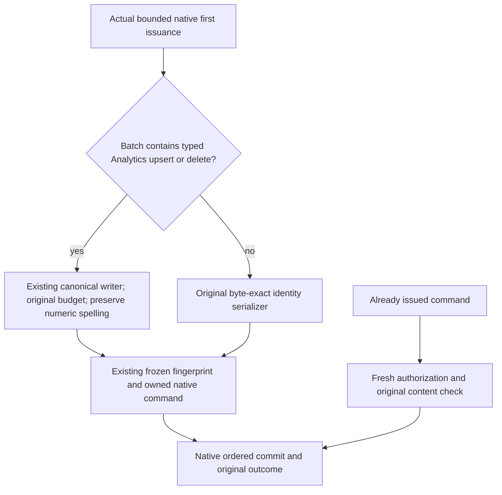

# ADR-140: Deterministic first issuance of new Analytics command identity

Status: owner-selected contract; prepared source and qualification remain separate.

## Context

New user AnalyticsStore mutations introduce immutable string-keyed dictionaries in canonical Batch commands. `UpsertAnalyticsEvents` contains event Dimensions, Metrics and ExpectedRevisions; `DeleteAnalyticsEvents` contains ExpectedRevisions. These are semantic maps. Their enumeration order is not a command operation order. Native Orleans deserialization reconstructs dictionaries on the receiving process; process-specific string hashes may change enumeration order.

The native first-issuance factory derives fingerprint identity text from the decoded typed input. The frozen fingerprint includes that identity as an opaque string; sorting its outer fields cannot order map properties inside the string. Native `Command<DatabaseCommand>` retains the original typed input bytes, stable CommandId, verified UserId and server-evaluated Timestamp. Existing retained command identities, prepared business facts and persisted outcomes remain byte exact. This identity normalization is not a second transport or command authority framework.

## Decision and scope

REQ-ANALYTICS-ID-001: Only newly issued OperationKind.Batch whose actual typed CommandRequest.Mutations contains `UpsertAnalyticsEvents` (`kind: upsertAnalyticsEvents`) or `DeleteAnalyticsEvents` (`kind: deleteAnalyticsEvents`) receives deterministic identity material. The issuer identifies these actual mutation variants; OperationKind.Batch alone, ResourceKind alone, resource names, or substrings in arbitrary user JSON do not select this policy.

REQ-ANALYTICS-ID-002: Canonicalize the complete decoded CommandRequest at its first native issuance, including mixed document/graph/event siblings, using the existing bounded canonical JSON writer. Recursively order object keys ordinally, reject duplicate property names and preserve arrays, mutation/event order, scalar types and number spelling. Use the existing writer's `decimalNumbers: false` mode. Document JSON remains its original string content. No dictionary values, event arrays, links, capabilities or native wire contracts are rewritten.

REQ-ANALYTICS-ID-003: Charge serialization, traversal and output to the actual original issuance work and bounds. Cancellation/deadline and allocation/output limits stay authoritative; no new unlimited buffer, configuration inflation, fallback writer or second budget is introduced. The existing canonical writer owns formatting and configured flushing, while the issuer owns the original ledger and bounded destination.

REQ-ANALYTICS-ID-004: Every non-Analytics operation and every Batch without either selected Analytics mutation retains its original typed-input identity text byte for byte. Frozen fingerprint algorithms remain unchanged for every operation. Retained native commands are never rewritten, reissued or canonicalized on replay. Original outcome selection and fresh persisted authorization retain their existing semantics. Different map values or different ordered command contents under the same GUID still refuse as Conflict and do not alter the original business outcome.

This is an explicit pre-release contract for new Analytics first issuance, not a migration of retained data or a general change to semantic command equality. Map ordering is not guaranteed by ImmutableDictionary or System.Text.Json; this integration policy belongs to KeyLoad.

## Acceptance and evidence boundaries

AC-ANALYTICS-ID-001: `AnalyticsCommandIdentityTests.FreshAnalyticsIssuanceRetainsMixedReceiptAcrossMapOrderingConflictAndNativeCold(false/true)` retains both actual upsert/delete arguments and newly issues mixed commands from independently rebuilt reversed maps. It checks ordinal map keys against literal names, the exact original public receipt including its actual persisted-copy count, complete literal rows/document, changed-value Conflict with no result, conserved canonical image/identity/applied sequence and fresh issuance after a joined same-directory cold reopen. The native unit fixture owns one real canonical ZoneTree store; original outcome bytes and no-effect replay remain required independently of receipt equality.

AC-ANALYTICS-ID-002: `AnalyticsCommandIdentityTests.NonAnalyticsIssuanceRetainsPublicIdentityInFrozenFingerprint` verifies the unchanged Batch and ConfigureResource identity and existing frozen outer fingerprint. `DatabaseCommandFingerprintTests.EveryKindAndEscapeMatchesTheExistingGoldenFingerprintShape` retains every operation kind, exact escaped content and numeric JSON spelling as independent golden inputs.

AC-ANALYTICS-ID-003: The existing FunctionalDatabaseGateTests normal and cold cases must send genuine freshly reconstructed same-GUID Analytics and mixed commands through SDK, official MCP and T-SQL EXEC against their original Aspire-owned one-node/multi-node server processes. They must check full original receipts and complete model state, changed-value Conflict and no effects, then repeat after genuine joined cold restart. Replaying only an already prepared native command does not satisfy the fresh-issuance criterion.

AC-ANALYTICS-ID-004: Original-budget cancellation/exhaustion/output-size negatives and healthy following commands must pass with the selected actual issuer. The issuer owner supplies these bound-specific regressions. Native immutable-map framing and same-root native journal cold tests remain independent required coverage.

These gates remain OPEN until the complete current source builds and retains its actual original TUnit/process/public results. This ADR, source inspection and same-process unit tests do not prove cross-process replay, acknowledgement from every configured copy, power-loss durability, performance or production readiness.

Related contracts: [AnalyticsStore](../Features/AnalyticsStore.md) and [native CreateTable identity](ADR-132-native-create-table-command-identity.md).
